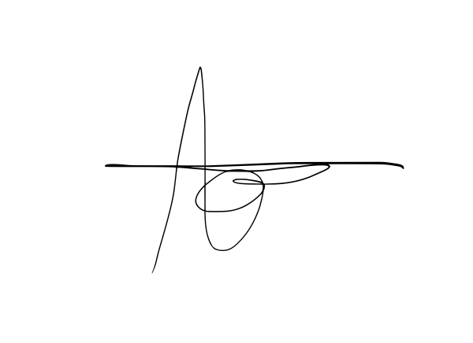

# Deklarasi Penggunaan AI

## Tugas Besar IF2150 - Rekayasa Perangkat Lunak

| Informasi | Keterangan |
|---|---|
| Kelas | K-01 |
| Nomor Kelompok | G-08 |
| Nama Kelompok | firstTimeRPL |
| Nama Perangkat Lunak | *SIGAP* |

**Anggota Kelompok:**

| NIM | Nama |
| --- | --- |
| 13525022 | Muhammad Rafi Insyan Syiham Abrar |
| 13525037 | Muhammad Rafiif Ansyadya |
| 13525076 | Reinhard Mikhael Tandra |
| 13525094 | Arga Cyrano Simanjuntak |
| 13525136 | Jonathan Lewie |

---

### Daftar Isi
- [Deklarasi Penggunaan AI](#deklarasi-penggunaan-ai)
  - [Tugas Besar IF2150 - Rekayasa Perangkat Lunak](#tugas-besar-if2150---rekayasa-perangkat-lunak)
    - [Daftar Isi](#daftar-isi)
    - [Log Penggunaan AI per Milestone](#log-penggunaan-ai-per-milestone)
    - [Milestone 1](#milestone-1)
  - [Milestone 2](#milestone-2)
  - [Milestone 3](#milestone-3)
  - [Milestone 4](#milestone-4)
  - [Milestone 5](#milestone-5)
  - [Milestone 6](#milestone-6)
  - [Milestone 7](#milestone-7)
  - [Milestone 8](#milestone-8)
    - [Pernyataan Integritas dan Persetujuan](#pernyataan-integritas-dan-persetujuan)

---

### Log Penggunaan AI per Milestone

Silakan catat penggunaan AI yang berdampak signifikan pada pengerjaan tugas (misal: *generate* fungsi algoritma yang kompleks, *generate* draf dokumen SKPL/DPPL, atau *debugging* error utama). 
*Penggunaan sepele seperti memperbaiki *typo* atau auto-complete satu baris kode tidak perlu dicatat.*

### Milestone 1
| Tool AI | Tujuan Penggunaan | Contoh Prompt Utama | Modifikasi & Validasi Manusia |
| :--- | :--- | :--- | :--- |
| Gemini | Brainstorming topik awal | Tolong berikan topik dan ide awal yang berkaitan dengan SDG 13 | AI menyarankan beberapa contoh topik, namun akhirnya kami memutuskan untuk memilih topik tentang kebakaran hutan karena berkaitan dengan apa yang terjadi akhir-akhir ini |
| Gemini | Brainstorming latar belakang| Apakah indikator data satelit dan tinggi air tanah mungkin dipakai untuk skala tugas besar| AI menyarankan untuk memakai sumber data yang lebih feasible, seperti API gratis dari BMKG. Kami mempertimbangkan untuk memakai saran tersebut dengan verifikasi dan validasi format data dan kebutuhan teknis aplikasi|
| Gemini | Penjelasan penggunaan markdown | Tolong jelaskan apa fungsi \\* | Reinhard bertanya kepada AI tentang apa fungsi karakter tersebut dalam markdown |
| | | | | |

## Milestone 2

| Tool AI | Tujuan Penggunaan | Contoh Prompt Utama | Modifikasi & Validasi Manusia |
|---|---|---|---|
| ChatGPT | Melengkapi parameter Kebutuhan Non-Fungsional (KNF) yang belum ada | "Dari tabel ini adakah yang perlu ditambahkan parameternya untuk diperjelas?" | Membandingkan parameter yang sudah dipakai (Response time, Reliability, Portability, Security, Constraint, Accuracy, Availability, Ergonomy) dengan daftar acuan, lalu memverifikasi bahwa Memory dan Safety belum ada dan memang relevan untuk SIGAP sebelum ditambahkan |
| Gemini | Brainstorming mekanisme sinkronisasi data luring (offline) | "Tolong Bagaimana cara kerja aplikasi menyimpan data form laporan saat offline dan mengirimkannya kembali saat online tanpa terjadinya data ganda?" | AI menyarankan penggunaan service worker dan background sync yang terlalu kompleks. Saya memvalidasi saran tersebut dan memutuskan untuk menyederhanakannya menggunakan penyimpanan `localStorage` biasa dengan pengecekan status koneksi dan pembuatan UUID di sisi client, sesuai dengan kebutuhan dan kapasitas teknis tugas besar. |
| | | | | |

## Milestone 3

| Tool AI | Tujuan Penggunaan | Contoh Prompt Utama | Modifikasi & Validasi Manusia |
|---|---|---|---|
| Gemini | Mencari tahu apakah ada skenario alternatif yang blm ada | "Apakah ada skenario alternatif lain untuk use case ini dan seperti apa jika ada" | Menentukan apakah skenario dari AI benar-benar dapat terjadi lalu membuat skenarionya sesuai dengan aplikasi kami |
| | | | | |

## Milestone 4

| Tool AI | Tujuan Penggunaan | Contoh Prompt Utama | Modifikasi & Validasi Manusia |
|---|---|---|---|
| Claude | Membantu brainstorming dan menyusun struktur logika diagram yang efisien | "Saya ingin membuat diagram alur kerja untuk case keseluruhan, tolong bedah tahapan utamanya beserta susunan hirarki logisnya" | Memeriksa kebenaran logika alur serta menyesuaikan penamaan variabel/istilah teknis sesuai standar |
| | | | | |

## Milestone 5

| Tool AI | Tujuan Penggunaan | Contoh Prompt Utama | Modifikasi & Validasi Manusia |
|---|---|---|---|
| Gemini | Membantu brainstorming untuk membuat diagram | "Saya ingin membuat diagram swimlane dan diagram context, tolong jelaskan apa saja yang dibutuhkan dan seperti apa" | Memeriksa kebenaran logikanya dan menyesuaikannya dengan aplikasi kami |
| | | | | |

## Milestone 6

| Tool AI | Tujuan Penggunaan | Contoh Prompt Utama | Modifikasi & Validasi Manusia |
|---|---|---|---|
| Gemini | Membantu brainstorming untuk memilih style arsitektur yang sesuai dengan aplikasi kami | "Saya ingin memilih style arsitektur yang sesuai. Tolong berikan beberapa pilihan style arsitektur" | Memilah style-style arsitektur lalu memilih yang paling sesuai dengan aplikasi kami |
| | | | | |

## Milestone 7

| Tool AI | Tujuan Penggunaan | Contoh Prompt Utama | Modifikasi & Validasi Manusia |
|---|---|---|---|
| Claude | Membuat aset ikon api dengan gelombang sinyal untuk titik pada huruf "i" di logo SIGAP | "Buatkan Logo api seperti pusat sinyal dengan color pallet yang sama dengan ini,  tolong dibuat tanpa background, mau saya upload ke Canva dalam resolusi tinggi" | Memilih konsep api + sinyal dari beberapa alternatif karena paling mewakili fitur notifikasi berjenjang SIGAP. Menyusun ulang di Canva: mengganti font tulisan "sigap", mengatur ukuran dan posisi ikon di atas huruf "i", serta menambahkan tagline |
| Claude | Membuat aset ikon pin lokasi berelemen api untuk kotak tengah ikon peta risiko | "elemen apinya dibuat lebih besar di bagian luar pin, tapi pin harus tetap terlihat jelas sebagai pin" | Ide awal pin (api yang dibalik menjadi bentuk pin) berasal dari kami, lalu direvisi beberapa kali sampai bentuk pin dan apinya jelas. Memilih versi pin putih, menempatkannya di kotak tengah grid 3×3, serta menentukan sendiri susunan dan gradasi warna heatmap di Canva |

---

## Milestone 8

| Tool AI | Tujuan Penggunaan | Contoh Prompt Utama | Modifikasi & Validasi Manusia |
|---|---|---|---|
| Claude | Memberikan cara-cara untuk mencari warga yang terhubung dengan id petak lahan tertentu | Model warga tidak memiliki `idPetak`, bagaimanakah cara mendapatkan daftar warga yang terhubung dengan petak tersebut | AI merekomendasikan untuk menambahkan atribut `idPetak`, namun supaya tidak mengubah kelas-kelasnya, usul tersebut ditolak. Usul yang diterima dari AI yaitu untuk menyimpan relasi tersebut pada tabel database (menambahkan kolom `id_petak`) tanpa mencantumkannya sebagai atribut di dalam struktur kelas model. |

---

### Pernyataan Integritas dan Persetujuan

Kami yang bertanda tangan di bawah ini menyatakan bahwa seluruh log penggunaan AI di atas adalah benar. Kami telah memvalidasi seluruh hasil AI dan bertanggung jawab penuh atas orisinalitas, keamanan, dan kebenaran hasil akhir dari tugas ini.

| Tanda Tangan | Nama Anggota |
| :---: | :--- |
|  | 13525022 - Muhammad Rafi Insyan Syiham Abrar |
|  | 13525037 - Muhammad Rafiif Ansyadya |
|  | 13525076 - Reinhard Mikhael Tandra |
|  | 13525094 - Arga Cyrano Simanjuntak |
|  | 13525136 - Jonathan Lewie |
