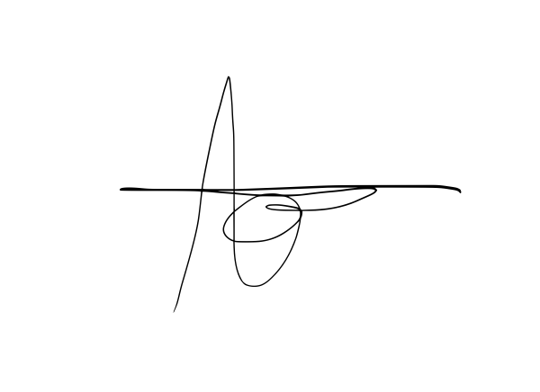

# Deklarasi Penggunaan AI

## Tugas Besar IF2150 - Rekayasa Perangkat Lunak

| Informasi | Keterangan |
|---|---|
| Kelas | K-01 |
| Nomor Kelompok | G-08 |
| Nama Kelompok | firstTimeRPL |
| Nama Perangkat Lunak | *SIGAP* |

**Anggota Kelompok:**

| NIM | Nama |
| --- | --- |
| 13525022 | Muhammad Rafi Insyan Syiham Abrar |
| 13525037 | Muhammad Rafiif Ansyadya |
| 13525076 | Reinhard Mikhael Tandra |
| 13525094 | Arga Cyrano Simanjuntak |
| 13525136 | Jonathan Lewie |

---

### Daftar Isi
- [Deklarasi Penggunaan AI](#deklarasi-penggunaan-ai)
  - [Tugas Besar IF2150 - Rekayasa Perangkat Lunak](#tugas-besar-if2150---rekayasa-perangkat-lunak)
    - [Daftar Isi](#daftar-isi)
    - [Log Penggunaan AI per Milestone](#log-penggunaan-ai-per-milestone)
    - [Milestone 1](#milestone-1)
  - [Milestone 2](#milestone-2)
  - [Milestone 3](#milestone-3)
  - [Milestone 4](#milestone-4)
  - [Milestone 5](#milestone-5)
  - [Milestone 6](#milestone-6)
  - [Milestone 7](#milestone-7)
  - [Milestone 8](#milestone-8)
  - [Milestone 9](#milestone-9)
    - [Pernyataan Integritas dan Persetujuan](#pernyataan-integritas-dan-persetujuan)

---

### Log Penggunaan AI per Milestone

Silakan catat penggunaan AI yang berdampak signifikan pada pengerjaan tugas (misal: *generate* fungsi algoritma yang kompleks, *generate* draf dokumen SKPL/DPPL, atau *debugging* error utama). 
*Penggunaan sepele seperti memperbaiki *typo* atau auto-complete satu baris kode tidak perlu dicatat.*

### Milestone 1
| Tool AI | Tujuan Penggunaan | Contoh Prompt Utama | Modifikasi & Validasi Manusia |
| :--- | :--- | :--- | :--- |
| Gemini | Brainstorming topik awal | Tolong berikan topik dan ide awal yang berkaitan dengan SDG 13 | AI menyarankan beberapa contoh topik, namun akhirnya kami memutuskan untuk memilih topik tentang kebakaran hutan karena berkaitan dengan apa yang terjadi akhir-akhir ini |
| Gemini | Brainstorming latar belakang| Apakah indikator data satelit dan tinggi air tanah mungkin dipakai untuk skala tugas besar| AI menyarankan untuk memakai sumber data yang lebih feasible, seperti API gratis dari BMKG. Kami mempertimbangkan untuk memakai saran tersebut dengan verifikasi dan validasi format data dan kebutuhan teknis aplikasi|
| Gemini | Penjelasan penggunaan markdown | Tolong jelaskan apa fungsi \\* | Reinhard bertanya kepada AI tentang apa fungsi karakter tersebut dalam markdown |
| | | | | |

## Milestone 2

| Tool AI | Tujuan Penggunaan | Contoh Prompt Utama | Modifikasi & Validasi Manusia |
|---|---|---|---|
| ChatGPT | Melengkapi parameter Kebutuhan Non-Fungsional (KNF) yang belum ada | "Dari tabel ini adakah yang perlu ditambahkan parameternya untuk diperjelas?" | Membandingkan parameter yang sudah dipakai (Response time, Reliability, Portability, Security, Constraint, Accuracy, Availability, Ergonomy) dengan daftar acuan, lalu memverifikasi bahwa Memory dan Safety belum ada dan memang relevan untuk SIGAP sebelum ditambahkan |
| Gemini | Brainstorming mekanisme sinkronisasi data luring (offline) | "Tolong Bagaimana cara kerja aplikasi menyimpan data form laporan saat offline dan mengirimkannya kembali saat online tanpa terjadinya data ganda?" | AI menyarankan penggunaan service worker dan background sync yang terlalu kompleks. Saya memvalidasi saran tersebut dan memutuskan untuk menyederhanakannya menggunakan penyimpanan `localStorage` biasa dengan pengecekan status koneksi dan pembuatan UUID di sisi client, sesuai dengan kebutuhan dan kapasitas teknis tugas besar. |
| | | | | |

## Milestone 3

| Tool AI | Tujuan Penggunaan | Contoh Prompt Utama | Modifikasi & Validasi Manusia |
|---|---|---|---|
| Gemini | Mencari tahu apakah ada skenario alternatif yang blm ada | "Apakah ada skenario alternatif lain untuk use case ini dan seperti apa jika ada" | Menentukan apakah skenario dari AI benar-benar dapat terjadi lalu membuat skenarionya sesuai dengan aplikasi kami |
| | | | | |

## Milestone 4

| Tool AI | Tujuan Penggunaan | Contoh Prompt Utama | Modifikasi & Validasi Manusia |
|---|---|---|---|
| Claude | Membantu brainstorming dan menyusun struktur logika diagram yang efisien | "Saya ingin membuat diagram alur kerja untuk case keseluruhan, tolong bedah tahapan utamanya beserta susunan hirarki logisnya" | Memeriksa kebenaran logika alur serta menyesuaikan penamaan variabel/istilah teknis sesuai standar |
| | | | | |

## Milestone 5

| Tool AI | Tujuan Penggunaan | Contoh Prompt Utama | Modifikasi & Validasi Manusia |
|---|---|---|---|
| Gemini | Membantu brainstorming untuk membuat diagram | "Saya ingin membuat diagram swimlane dan diagram context, tolong jelaskan apa saja yang dibutuhkan dan seperti apa" | Memeriksa kebenaran logikanya dan menyesuaikannya dengan aplikasi kami |
| | | | | |

## Milestone 6

| Tool AI | Tujuan Penggunaan | Contoh Prompt Utama | Modifikasi & Validasi Manusia |
|---|---|---|---|
| Gemini | Membantu brainstorming untuk memilih style arsitektur yang sesuai dengan aplikasi kami | "Saya ingin memilih style arsitektur yang sesuai. Tolong berikan beberapa pilihan style arsitektur" | Memilah style-style arsitektur lalu memilih yang paling sesuai dengan aplikasi kami |
| | | | | |

## Milestone 7

| Tool AI | Tujuan Penggunaan | Contoh Prompt Utama | Modifikasi & Validasi Manusia |
|---|---|---|---|
| Claude | Membuat aset ikon api dengan gelombang sinyal untuk titik pada huruf "i" di logo SIGAP | "Buatkan Logo api seperti pusat sinyal dengan color pallet yang sama dengan ini,  tolong dibuat tanpa background, mau saya upload ke Canva dalam resolusi tinggi" | Memilih konsep api + sinyal dari beberapa alternatif karena paling mewakili fitur notifikasi berjenjang SIGAP. Menyusun ulang di Canva: mengganti font tulisan "sigap", mengatur ukuran dan posisi ikon di atas huruf "i", serta menambahkan tagline |
| Claude | Membuat aset ikon pin lokasi berelemen api untuk kotak tengah ikon peta risiko | "elemen apinya dibuat lebih besar di bagian luar pin, tapi pin harus tetap terlihat jelas sebagai pin" | Ide awal pin (api yang dibalik menjadi bentuk pin) berasal dari kami, lalu direvisi beberapa kali sampai bentuk pin dan apinya jelas. Memilih versi pin putih, menempatkannya di kotak tengah grid 3×3, serta menentukan sendiri susunan dan gradasi warna heatmap di Canva |

---

## Milestone 8

| Tool AI | Tujuan Penggunaan | Contoh Prompt Utama | Modifikasi & Validasi Manusia |
|---|---|---|---|
| Claude | Memberikan cara-cara untuk mencari warga yang terhubung dengan id petak lahan tertentu | Model warga tidak memiliki `idPetak`, bagaimanakah cara mendapatkan daftar warga yang terhubung dengan petak tersebut | AI merekomendasikan untuk menambahkan atribut `idPetak`, namun supaya tidak mengubah kelas-kelasnya, usul tersebut ditolak. Usul yang diterima dari AI yaitu untuk menyimpan relasi tersebut pada tabel database (menambahkan kolom `id_petak`) tanpa mencantumkannya sebagai atribut di dalam struktur kelas model. |
| Claude | Brainstorming perancangan algoritma penyaringan titik panas yang ditandai keliru berdasarkan batas waktu dan radius lokasi | Bagaimana merancang logika untuk mengabaikan titik panas yang ditandai keliru dalam 24 jam terakhir, tetapi tetap memperhitungkannya jika muncul titik api baru di sekitarnya? | AI merekomendasikan perhitungan jarak planar sederhana, lalu menerapkan rumus Haversine untuk verifikasi radius 500 meter (`<= 0.5 km`) serta ditambahkan validasi waktu agar deteksi baru setelah penandaan keliru tetap terhitung |
| Claude | Brainstorming kondisi-kondisi layar (*state*) yang perlu dirancang pada setiap antarmuka | "Untuk setiap layar SIGAP (login, peta risiko, jadwal, antrean laporan, daftar tugas, form laporan, tandai keliru, SMS), kondisi apa saja selain kondisi normal yang perlu dibuatkan rancangan antarmukanya?" | AI memberikan daftar kondisi seperti data kosong, sedang memuat, gagal terhubung, luring, dan validasi input. Kami hanya memakai kondisi yang sesuai dengan skenario alternatif use case di SKPL, misalnya GPS belum aktif dan penyimpanan penuh pada I-06, lalu membuang kondisi yang tidak ada skenarionya. Desain tampilan dan isi tabel spesifikasi objek tetap kami susun sendiri |

---

## Milestone 9

| Tool AI | Tujuan Penggunaan | Contoh Prompt Utama | Modifikasi & Validasi Manusia |
|---|---|---|---|
| Claude | Mencocokkan implementasi UC03 (`VerifikasiLaporanController` dan `LaporanBuktiKerja`) dengan Algo-005, Algo-006, dan Q-016 sampai Q-019 di DPPL2 | "Cek apakah verifikasiLaporan dan tolakLaporan sudah sesuai Algo-006. Kalau dua petugas menekan setuju untuk laporan yang sama hampir bersamaan, apa yang terjadi?" | AI menjelaskan bahwa pemeriksaan status di awal saja tidak cukup dan yang menahan laporan diproses dua kali adalah `rowCount` dari Q-018. Kami mempertahankan transaksi sesuai DPPL, lalu menguji sendiri skenario dua petugas memutuskan laporan yang sama sampai petugas kedua mendapat 409. Usulan AI untuk menambah kelas error khusus dan fungsi pembungkus galat kami buang setelah review PR karena tidak ada di rancangan |
| Claude | *Debugging* endpoint detail laporan yang membalas 500 saat dibuka dengan id sembarang | "GET /api/laporan/abc balasnya 500, padahal harusnya laporan tidak ditemukan. Kenapa?" | AI menunjukkan galat 22P02 dari Postgres karena kolom `id_laporan` bertipe UUID. Kami menambah pemeriksaan pola UUID di controller agar balasannya 404, lalu mencatat perubahan ini di Tabel B.1 laporan implementasi |
| Claude | Membantu menindaklanjuti hasil code review pada PR UC02 dan UC06 | Isi review dari reviewer | Saya memilah poin review yang perlu diubah dan yang cukup dijelaskan ke reviewer, menyelesaikan konflik dengan branch anggota lain, dan menguji ulang setiap revisi sebelum push |
| Claude | Mendapatkan langkah-langkah yang runtut untuk mengetes halaman Simulasi SMS secara manual | "Tolong berikan urutan langkah-langkah dalam pengetesan secara lengkap dan membahas semua kemungkinan" | Langkah-langkah diverifikasi apakah benar dan sesuai dengan apa yang diharapkan dari DPPL |
| Gemini | Memverifikasi kesesuaian `perbaruiData` dengan Algo-001 serta penanganan galat API Open-Meteo dan CSV NASA FIRMS | "Cek apakah alur `perbaruiData` dan `ambilDataCuaca` sudah sesuai Algo-001 saat API gagal, dan bagaimana membaca kolom CSV FIRMS secara aman?" | Saya menghapus `try/catch` internal di `ambilDataCuaca` agar galat diteruskan ke `perbaruiData` (balasan 500 dan fallback cache), membatasi curah hujan sampai kemarin, serta menyesuaikan parsing CSV berdasarkan indeks header (`indexOf`) |
| Gemini | Brainstorming kasus uji batas (*edge cases*) untuk fungsi `isDikecualikan` dan `hitungHariKering` sesuai Algo-003 dan Algo-001 | "Skenario batas apa saja yang perlu diuji untuk radius 500 m dan batas 24 jam pada `isDikecualikan` agar semua cabang Algo-003 tertutup?" | Saya memilah skenario uji yang sesuai DPPL (batas 24 jam dan titik yang terdeteksi sebelum penandaan keliru), membersihkan fallback koordinat bertumpuk, lalu memverifikasi seluruh tes lulus lewat `npm test` |
| Gemini | Membantu menindaklanjuti hasil code review PR #17 pada antarmuka peta risiko (`HalamanPetaRisiko.js`) | "Bagaimana menangani state gagal saat `/api/peta` error agar skeleton tidak tertahan, dan jalur apa saja yang diubah jika Leaflet dipindah ke lokal?" | Saya memilah poin review antara yang diubah di kode dan yang dicatat di laporan M9, menambahkan state gagal pada UI, memindahkan aset Leaflet 1.9.4 ke `vendor/leaflet/`, serta menguji ulang tampilan luring dan cache |

---

## Milestone 10

| Tool AI | Tujuan Penggunaan | Contoh Prompt Utama | Modifikasi & Validasi Manusia |
|---|---|---|---|
| Claude | Menyusun unit test C10 (`VerifikasiLaporanController`) dan operasi verifikasi C11 (`LaporanBuktiKerja`), tes integrasi verifikasi ke database, serta KNF06 sesuai panduan M10 | "Ini panduan asistensi M10 dan pembagian tugasku. Buatkan pengujian C10 sampai coverage minimal 70%, operasi verifikasi C11, dan tes integrasi verifikasi ke database. Ikuti pola dan penomoran yang dipakai di branch `test/m10-setup`, dan jangan ubah kode aplikasi" | Saya mencocokkan cakupan tes dengan pembagian tugas, meminta tes lama tanpa ID diganti dengan penomoran `CXX-UTYY` mengikuti branch milik Jonathan, dan memastikan kode aplikasi tidak berubah. Temuan `hitungJarak` yang menghasilkan NaN untuk koordinat bukan angka tidak saya ubah karena koordinat sudah divalidasi lebih dulu oleh Algo-011, tetapi saya catat di PR. Hasil akhir saya cek lewat `npm run test:semua` dan `npm run coverage` |
| Claude | Menindaklanjuti review PR tentang cabang "kalah balapan" di dalam transaksi yang belum teruji secara pasti | "Reviewer bilang baris 163 belum tertutup dan sisi setujui masih bergantung pada timing UT24. Bagaimana cara menguji keputusan petugas lain yang masuk tepat di antara pengecekan status dan transaksi tanpa bergantung keberuntungan?" | AI mengusulkan helper `selaSetelahQuery` yang menyisipkan perubahan tepat setelah query pengecekan. Saya memakainya untuk C10-UT35 dan UT36, sedangkan C10-UT37 mengikuti kode dari reviewer. Setelah coverage dijalankan ulang, branch C10 naik dari 95,45% menjadi 97,01%, dan dua cabang yang tersisa (baris 64 dan 101) saya jelaskan alasannya di PR |
| Claude | Menjalankan skenario UC04 dan UC05 di Chrome terhadap server lokal dan mengambil screenshot setiap langkah | "Lanjutkan UC04-TC02 sampai TC04 dan semua UC05 di Chrome lokal, termasuk kondisi luring, GPS belum aktif, dan penyimpanan lokal penuh. Ambil screenshot setiap langkah dan beri nama file pakai tanda hubung" | Screenshot UC04-TC01 saya ambil sendiri, lalu nama semua file saya minta diseragamkan. Karena relawan maksimal punya 3 tugas aktif, UC05-TC04 tidak bisa dicapai lewat UI biasa, sehingga 20 laporan tertunda diisikan lewat `PenyimpananLokal.js` milik aplikasi. Cara ini saya cantumkan terang-terangan di PR, dan data uji dikembalikan dengan `npm run seed` |
| Claude | Menguji KNF04 (portability) tanpa memindahkan aplikasi ke HP fisik | "HP-ku Samsung Galaxy A16 5G, tapi ribet kalau harus dipindah ke HP. Bisa tidak diuji lewat inspect di Chrome seolah-olah pakai HP, termasuk saat mode pesawat?" | Saya memutuskan memakai emulasi Android di Chrome DevTools dan meminta semua bukti diberi label "emulasi", bukan HP fisik. Setelah review, saya menambahkan screenshot panel Manifest dan Service workers, lalu mengambil ulang tc01c dengan jeda 90 detik dan jam pengambilan agar berbeda dari tc01b. Hal yang belum tercakup emulasi, yaitu pemasangan ke layar utama di HP fisik, saya tulis sebagai keterbatasan |
| Claude | Menyusun deskripsi PR bagian M10 | "Tuliskan deskripsi PR-nya dengan gaya seperti contoh ini, lalu tambahkan bagian ID test case, tabel hasil coverage, dan cara mencoba seperti punya Jonathan untuk test case-ku" | Saya meringkas sendiri draf awalnya, lalu mencocokkan setiap angka (jumlah tes, persentase coverage, dan nama file bukti) dengan isi file di `docs/M10/assets/bukti/`, dan memperbaruinya setiap kali ada revisi dari reviewer |
| Claude | Menindaklanjuti review PR test/m10-c06-jadwal | jelaskan singkat isi review | Saya menerapkan saran reviewer (port 3103, `hentikanServer`, assertion urutan KF17, kode galat 22001, judul INT-TC21), memastikan kode 22001 benar muncul dari database, lalu menjalankan ulang seluruh tes |

---

### Pernyataan Integritas dan Persetujuan

Kami yang bertanda tangan di bawah ini menyatakan bahwa seluruh log penggunaan AI di atas adalah benar. Kami telah memvalidasi seluruh hasil AI dan bertanggung jawab penuh atas orisinalitas, keamanan, dan kebenaran hasil akhir dari tugas ini.

| Tanda Tangan | Nama Anggota |
| :---: | :--- |
|  | 13525022 - Muhammad Rafi Insyan Syiham Abrar |
|  | 13525037 - Muhammad Rafiif Ansyadya |
|  | 13525076 - Reinhard Mikhael Tandra |
|  | 13525094 - Arga Cyrano Simanjuntak |
|  | 13525136 - Jonathan Lewie |
