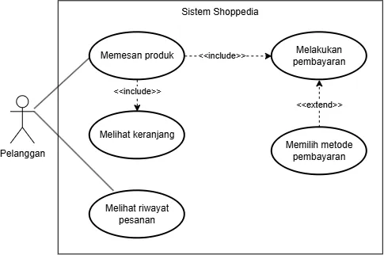

<h1>
IF2150 REKAYASA PERANGKAT LUNAK
 
TUGAS 10
 
HASIL IMPLEMENTASI DAN UJI PERANGKAT LUNAK (HIUPL)
</h1>
 

## *Nama Perangkat Lunak*
### *[Logo Perangkat Lunak]*

### Untuk: *[Nama Asisten]*

Dipersiapkan oleh:
| Informasi | Keterangan |
| --- | --- |
| Kelas | *\[Kelas\]* |
| Kelompok | *\[Nomor Kelompok\]*  |

| NIM | Nama |
|---|---|
| *[NIM 1]* | *[Nama Anggota 1]* |
| *[NIM 2]* | *[Nama Anggota 2]* |
| *[NIM 3]* | *[Nama Anggota 3]* |
| *[NIM 4]* | *[Nama Anggota 4]* |
| *[NIM 5]* | *[Nama Anggota 5]* |

---

## Daftar Isi

- [BAB 1: Pendahuluan](#bab-1-pendahuluan)
  - [1.1 Tujuan Penulisan Dokumen](#11-tujuan-penulisan-dokumen)
  - [1.2 Lingkup Masalah](#12-lingkup-masalah)
  - [1.3 Definisi, Istilah, dan Singkatan](#13-definisi-istilah-dan-singkatan)
  - [1.4 Aturan Penomoran](#14-aturan-penomoran)
  - [1.5 Referensi](#15-referensi)
  - [1.6 Deskripsi Umum Dokumen (Ikhtisar)](#16-deskripsi-umum-dokumen-ikhtisar)
- [BAB 2: Deskripsi Umum Perangkat Lunak](#bab-2-deskripsi-umum-perangkat-lunak)
- [BAB 3: Implementasi](#bab-3-implementasi)
  - [3.1 Lingkungan Implementasi](#31-lingkungan-implementasi)
  - [3.2 Implementasi Modul](#32-implementasi-modul)
  - [3.3 Implementasi Antarmuka](#33-implementasi-antarmuka)
  - [3.4 File Lain](#34-file-lain)
- [BAB 4: Hasil Pengujian](#bab-4-hasil-pengujian)
  - [4.1 Strategi dan Kedalaman Pengujian Kelas](#41-strategi-dan-kedalaman-pengujian-kelas)
  - [4.2 Pengujian Unit Kelas](#42-pengujian-unit-kelas)
  - [4.3 Pengujian Integrasi](#43-pengujian-integrasi)
  - [4.4 Pengujian Use Case](#44-pengujian-use-case)
  - [4.5 Pengujian Kebutuhan Non-Fungsional (KNF)](#45-pengujian-kebutuhan-non-fungsional-knf)
  - [4.6 Tangkapan Layar dan Bukti Hasil Pengujian](#46-tangkapan-layar-dan-bukti-hasil-pengujian)
- [BAB 5: Traceability](#bab-5-traceability)

---

## Daftar Perubahan

| Revisi | Deskripsi |
| :--- | :--- |
| *A* | *Deskripsikan perubahan yang dilakukan dari dokumen sebelumnya pada dokumen ini. Jika tidak terdapat perubahan, harap kosongkan tabel.* |
| *B* |  |
| *C* |  |
| ... |  |

---

# BAB 1: Pendahuluan

## 1.1 Tujuan Penulisan Dokumen
Tuliskan uraian ringkas mengenai isi dokumen, tujuan pembuatan dokumen HIUPL ini, dan siapa saja target pembacanya.

## 1.2 Lingkup Masalah
Tuliskan lingkup masalah, yaitu membangun perangkat lunak *[nama perangkat lunak]*. Jelaskan dengan singkat dan jelas deskripsi aplikasi serta keterkaitannya dengan perangkat lunak atau sistem lain (jika ada). Bagian ini maksimal berisi satu paragraf, dapat diambil dari SKPL/DPPL.

## 1.3 Definisi, Istilah, dan Singkatan
Semua definisi dan singkatan yang digunakan dalam dokumen ini beserta penjelasannya.

Tabel 1.3. Definisi Istilah dan Singkatan

| Singkatan, Akronim, atau Istilah | Penjelasan |
| :--- | :--- |
| *P/L* | *Singkatan dari Perangkat Lunak, yaitu aplikasi yang memberikan perintah kepada komputer untuk menjalankan tugas tertentu.* |
| *SKPL* | *Singkatan dari Spesifikasi Kebutuhan Perangkat Lunak, yaitu dokumen yang merangkum kriteria-kriteria yang diperlukan untuk membangun aplikasi menjalankan tugasnya.* |
| *DPPL* | *Singkatan dari Deskripsi Perancangan Perangkat Lunak, yaitu dokumen yang menjelaskan rancangan arsitektur, kelas, dan antarmuka P/L.* |
| *HIUPL* | *Singkatan dari Hasil Implementasi dan Uji Perangkat Lunak, yaitu dokumen yang melaporkan hasil implementasi dan pengujian P/L.* |
| *KF* | *Singkatan dari Kebutuhan Fungsional.* |
| *KNF* | *Singkatan dari Kebutuhan Non-Fungsional.* |
| *UC* | *Singkatan dari Use Case.* |
| *TC* | *Singkatan dari Test Case, yaitu satu kasus uji untuk skenario tertentu.* |
| *UT* | *Singkatan dari Unit Test, yaitu test case tingkat kelas/operasi.* |
| *INT* | *Singkatan dari Integration Test, yaitu test case yang menguji interaksi antarkomponen.* |
| *Boundary* | *Kasus uji pada nilai batas masukan, misalnya nilai minimum, maksimum, atau tepat di ambang aturan.* |
| *Coverage* | *Persentase baris/cabang kode yang dieksekusi oleh pengujian.* |
| *...* | *...* |

## 1.4 Aturan Penomoran
Tuliskan aturan penomoran (ID) yang digunakan dalam dokumen ini. Gunakan pola ID yang **sama** dengan yang sudah dipakai pada dokumen-dokumen sebelumnya (SKPL, APL, DPPL), kecuali untuk ID pengujian yang baru diperkenalkan pada dokumen ini.

Tabel 1.4. Aturan Penomoran

| Hal/Bagian | Penomoran | Keterangan |
| :--- | :--- | :--- |
| *Kebutuhan Fungsional* | *KFXX* | *Sesuai SKPL* |
| *Kebutuhan Non-Fungsional* | *KNFXX* | *Sesuai SKPL* |
| *Use Case* | *UCXX* | *Sesuai SKPL* |
| *Kelas* | *CXX* | *Sesuai DPPL* |
| *Antarmuka* | *I-XX* | *Sesuai DPPL* |
| *Test Case Unit* | *CXX-UTYY* | *XX adalah nomor kelas, YY adalah nomor urut test case unit pada kelas tersebut* |
| *Test Case Integrasi* | *INT-TCYY* | *YY adalah nomor urut test case integrasi* |
| *Test Case Use Case* | *UCXX-TCYY* | *XX adalah nomor use case, YY adalah nomor urut test case pada use case tersebut* |
| *Test Case KNF* | *KNFXX-TCYY* | *XX adalah nomor KNF, YY adalah nomor urut test case pada KNF tersebut* |
| *...* | *...* | *...* |

## 1.5 Referensi
Cantumkan daftar buku, panduan, atau dokumentasi lain yang dirujuk dalam pembuatan dokumen dan pengembangan P/L, **minimal dokumen SKPL, APL, DPPL, dan Implementasi (Tugas 9)**. Tambahkan dokumentasi *framework*/*library*/*testing tool* atau referensi lain apabila digunakan.

## 1.6 Deskripsi Umum Dokumen (Ikhtisar)
Tuliskan sistematika pembahasan dokumen ini secara ringkas dan runut bab demi bab, dengan maksimal 1 paragraf.

 

---

# BAB 2: Deskripsi Umum Perangkat Lunak

Bagian ini diisi dengan *System Overview*, dalam bentuk gambar dan narasi yang memberikan gambaran tentang aplikasi dan konteksnya. **Batasan dan keterkaitan** antara sistem yang dibangun dengan sistem lain di luarnya harus jelas. Deskripsi umum sistem perlu dilengkapi dengan pemodelan kasus yang dihadapi, seperti *use case diagram*. Berikan narasi yang jelas untuk setiap gambar yang ditampilkan.

Bagian ini dapat menyalin atau meringkas dari dokumen SKPL atau DPPL.

<i>Gambar 2.1. Use Case Diagram [Nama P/L]</i>

 

---

# BAB 3: Implementasi

Bagian ini diisi dengan informasi tentang elemen P/L yang dikembangkan (*executable files*, *configuration files*, *data files*, dan sebagainya) serta perubahannya terhadap rancangan pada DPPL (jika ada).

## 3.1 Lingkungan Implementasi

Tuliskan *hardware* dan *software* yang digunakan untuk implementasi, mencakup *operating system*, bahasa pemrograman beserta versinya, *framework*/*library*, DBMS, *development tools*, dan *version control*. Lingkungan ini harus konsisten dengan **Subbab 2.1 DPPL**; jelaskan jika ada perubahan. Cantumkan juga *framework* dan alat pengujian yang dipakai.

Tabel 3.1. Lingkungan Implementasi

| Aspek | Keterangan |
| :--- | :--- |
| *Hardware* | *[Spesifikasi perangkat keras]* |
| *Operating System* | *[Nama dan versi OS]* |
| *Bahasa Pemrograman* | *[Bahasa dan versi]* |
| *Framework/Library* | *[Daftar framework/library beserta versi]* |
| *DBMS* | *[Nama dan versi DBMS]* |
| *Development Tools* | *[IDE, version control, tools lain]* |
| *Testing Tools* | *[Framework unit test, alat ukur performa, alat coverage]* |

## 3.2 Implementasi Modul

Daftar modul/kelas yang **TELAH** diimplementasikan. Gunakan nama dan ID kelas yang sama dengan DPPL, dan konsisten dengan Tabel B.5 pada dokumen Implementasi (Tugas 9).

Tabel 3.2. Implementasi Modul

| No | ID Kelas | Nama Modul/Kelas | Nama File Fisik | Nama File Executable |
| :--- | :--- | :--- | :--- | :--- |
| 1 | *[C01]* | *[Nama modul/kelas]* | *[path/ke/file]* | *[Nama file executable, atau - jika tidak ada]* |
| 2 | *[C02]* | *[Nama modul/kelas]* | *[path/ke/file]* | *[...]* |
| ... | *...* | *...* | *...* | *...* |

## 3.3 Implementasi Antarmuka

Daftar antarmuka yang telah diimplementasikan. Gunakan ID dan nama layar yang sama dengan ID dan nama layar pada tugas DPPL.

Tabel 3.3. Implementasi Antarmuka

| No | ID Antarmuka | Nama Antarmuka | Nama File Fisik | Nama File Executable |
| :--- | :--- | :--- | :--- | :--- |
| 1 | *[I-01]* | *[Nama layar]* | *[path/ke/file]* | *[Nama file executable, atau - jika tidak ada]* |
| 2 | *[I-02]* | *[Nama layar]* | *[path/ke/file]* | *[...]* |
| ... | *...* | *...* | *...* | *...* |

## 3.4 File Lain

Daftar file lain yang dibuat selain file kelas dan antarmuka, misalnya file *utility*, *configuration*, *database schema/seed*, *file test*, atau *data*.

Tabel 3.4. File Lain

| No | Nama File | Keterangan |
| :--- | :--- | :--- |
| 1 | *[Nama file]* | *[Fungsi file]* |
| ... | *...* | *...* |

 

---

# BAB 4: Hasil Pengujian

Bab ini melaporkan hasil pengujian P/L pada level unit, integrasi, dan sistem. Pengujian dilakukan pada tag release terakhir Tugas 9. Hasil aktual diisi berdasarkan pengamatan saat pengujian. Kesimpulan diisi `Pass` atau `Fail`, dan untuk `Fail` dilengkapi penyebab serta usulan perbaikan.

## 4.1 Strategi dan Kedalaman Pengujian Kelas

Setiap kelas perancangan pada Tabel 4.1 DPPL diklasifikasikan ke dalam tiga tingkat kedalaman pengujian. Tingkat **Mendalam** diberikan pada kelas yang memuat logika bisnis, perhitungan, validasi, aturan status, algoritma, integrasi eksternal, atau keamanan. Tingkat **Sedang** diberikan pada kelas yang hanya mengoordinasikan atau mendelegasikan proses. Tingkat **Tidak perlu** diberikan pada kelas tanpa logika, seperti *entity/DTO* dan kelas konfigurasi, yang teruji secara tidak langsung melalui test case use case. Seluruh kelas wajib dicantumkan beserta alasan penentuan tingkatnya.

Tabel 4.1.1. Identifikasi Tingkat Pengujian Kelas

| ID Kelas | Nama Kelas | Tingkat | Alasan | Test Case Terkait |
| :--- | :--- | :--- | :--- | :--- |
| *C02* | *Pesanan* | *Mendalam* | *Memuat `hitungTotal()` dan transisi status pembayaran* | *C02-UT01 s.d. C02-UT08* |
| *C03* | *Keranjang* | *Sedang* | *Delegasi sederhana ke Produk dan Pesanan* | *C03-UT01 s.d. C03-UT03, INT-TC02* |
| *C01* | *Pelanggan* | *Tidak perlu* | *Hanya menyimpan data akun, tanpa logika* | *-* |
| *[CXX]* | *[Nama kelas]* | *[Mendalam/Sedang/Tidak perlu]* | *[Alasan penentuan tingkat pengujian]* | *[ID test case atau -]* |
| *...* | *...* | *...* | *...* | *...* |

## 4.2 Pengujian Unit Kelas

Pengujian unit dilakukan pada kelas bertingkat Mendalam dan Sedang. Kelas Mendalam diuji pada seluruh operasi public dengan kasus normal, batas, dan negatif, serta mencapai *coverage* minimal 70%. Kelas Sedang diuji minimal dengan satu kasus normal dan satu kasus gagal pada operasi public utama.

Cara menjalankan unit test: *[tuliskan perintah, mis. `pytest src/tests/`]*.

Lokasi file test: *[path, mis. `src/tests/`]*.

### 4.2.1 Kelas [Nama Kelas 1]

**ID Kelas:** *[C02]*  
**Nama Kelas:** *[Pesanan]*  
**Tingkat:** *[Mendalam]*

Tabel 4.2.1. Hasil Pengujian Unit Kelas [C02]

| ID Pengujian | Operasi yang Diuji | Jenis Kasus | Prosedur/Masukan | Hasil yang Diharapkan | Hasil Pengujian | Kesimpulan |
| :--- | :--- | :--- | :--- | :--- | :--- | :--- |
| *C02-UT01* | *`hitungTotal(): Decimal`* | *Normal* | *Pesanan berisi 2 item: 10.000 x 2 dan 5.000 x 1* | *Total = 25.000* | *[Hasil aktual]* | *Pass/Fail* |
| *C02-UT02* | *`hitungTotal(): Decimal`* | *Batas* | *Pesanan berisi tepat 1 item dengan jumlah 1* | *Total = harga item tersebut* | *[...]* | *Pass/Fail* |
| *C02-UT03* | *`hitungTotal(): Decimal`* | *Negatif* | *Pesanan tanpa item* | *Total = 0 atau melempar kesalahan sesuai rancangan* | *[...]* | *Pass/Fail* |
| *...* | *...* | *...* | *...* | *...* | *...* | *...* |

Khusus kelas **Mendalam**:

Tabel 4.2.1b. Ringkasan Cakupan Kelas [C02]

| Informasi | Keterangan |
| :--- | :--- |
| Daftar operasi public pada DPPL | *[op1(), op2(), ...]* |
| Operasi yang diuji | *[op1(), op2(), ...]* |
| ID Algoritma yang tercakup | *[Algo-001, ...]* |
| Coverage (wajib ≥ 70%) | *[% baris / % cabang, alat dan bukti pada 4.6]* |

### 4.2.2 Kelas [Nama Kelas 2]

*[Ulangi pola 4.2.1 untuk setiap kelas bertingkat Mendalam atau Sedang.]*

 

## 4.3 Pengujian Integrasi

Pengujian integrasi memeriksa interaksi antarkomponen yang melewati batas, yaitu *Controller* ke *Model*, aplikasi ke basis data, dan aplikasi ke sistem eksternal. Daftar antarmuka mengacu pada dokumen DPPL, dengan minimal satu test case untuk setiap antarmuka. Pengujian memakai komponen nyata, bukan *mock*. Apabila ada antarmuka tambahan yang belum didaftarkan pada dokumen DPPL, cantumkan juga.

Tabel 4.3.1. Daftar Antarmuka Antarkomponen

| ID Antarmuka | Komponen Asal | Komponen Tujuan | Jenis Batas | Test Case |
| :--- | :--- | :--- | :--- | :--- |
| *I-01* | *KeranjangController* | *Keranjang (Model)* | *Controller - Model* | *INT-TC01, INT-TC02* |
| *I-02* | *Pesanan (Model)* | *Database* | *Aplikasi - Basis data* | *INT-TC03* |
| *I-03* | *PaymentGatewayAdapter* | *Payment Gateway (dummy)* | *Aplikasi - Sistem eksternal* | *INT-TC04, INT-TC05* |
| *[I-XX]* | *[Komponen asal]* | *[Komponen tujuan]* | *[Jenis batas]* | *[ID test case]* |
| *...* | *...* | *...* | *...* | *...* |

Tabel 4.3.2. Hasil Pengujian Integrasi

| ID Pengujian | ID Antarmuka | Skenario | Prosedur/Masukan | Hasil yang Diharapkan | Hasil Pengujian | Kesimpulan |
| :--- | :--- | :--- | :--- | :--- | :--- | :--- |
| *INT-TC01* | *I-01* | *Normal: tambah item ke keranjang* | *Panggil `tambahItem()` melalui KeranjangController dengan produk valid* | *Item tersimpan pada Keranjang dan tampil pada daftar item* | *[Hasil aktual]* | *Pass/Fail* |
| *INT-TC03* | *I-02* | *Normal: simpan pesanan* | *Buat pesanan, lalu baca ulang langsung dari basis data* | *Baris pesanan ada dengan nilai total dan status yang sama* | *[...]* | *Pass/Fail* |
| *INT-TC05* | *I-03* | *Gagal: gateway mengembalikan status gagal* | *Kirim otorisasi dengan saldo dummy tidak cukup* | *Status pesanan tidak berubah menjadi "Lunas", pesan gagal diteruskan ke pengguna* | *[...]* | *Pass/Fail* |
| *...* | *...* | *...* | *...* | *...* | *...* | *...* |

 

## 4.4 Pengujian Use Case

Pengujian use case dilakukan pada seluruh skenario normal dan alternatif sesuai Subbab 4.4 SKPL, dengan minimal satu test case untuk setiap skenario. Kolom ID KF menunjukkan KF yang diverifikasi oleh test case tersebut.

### 4.4.1 Use Case [Nama Use Case 1]

**ID Use Case:** *[UC01 sesuai SKPL]*  
**Nama Use Case:** *[Nama use case sesuai SKPL]*

Tabel 4.4.1. Hasil Pengujian Use Case [UC01]

| ID Pengujian | ID KF | Skenario | Prosedur Pengujian | Masukan | Hasil yang Diharapkan | Hasil Pengujian | Kesimpulan |
| :--- | :--- | :--- | :--- | :--- | :--- | :--- | :--- |
| *UC01-TC01* | *KF01* | *Normal* | *1. Buka halaman login. 2. Masukkan kredensial. 3. Klik tombol "Login".* | *User: rpl@gmail.com Pass: 123456* | *Pengguna diarahkan ke Halaman Dashboard.* | *Pengguna diarahkan ke Halaman Dashboard sesuai hasil yang diharapkan.* | *Pass* |
| *UC01-TC02* | *KF01* | *Alternatif 1: [Nama skenario]* | *[Langkah-langkah pengujian]* | *[Data masukan]* | *[Hasil yang diharapkan]* | *[Hasil aktual]* | *[Pass/Fail. Jika Fail: penjelasan dan solusi]* |
| *...* | *...* | *...* | *...* | *...* | *...* | *...* | *...* |

### 4.4.2 Use Case [Nama Use Case 2]

*[Lanjutkan untuk seluruh use case dengan pola yang sama, hingga 4.4.N.]*

 

## 4.5 Pengujian Kebutuhan Non-Fungsional (KNF)

Setiap KNF pada Tabel 3.2 SKPL diuji secara terukur berdasarkan parameter yang telah didefinisikan. Setiap pengujian memuat target terukur, metode dan alat yang sesuai dengan parameter (misalnya Chrome DevTools untuk *response time* dan inspeksi basis data untuk *security*), serta hasil aktual berupa angka atau data. KNF yang belum dipenuhi atau tidak diimplementasikan dicantumkan beserta alasan dan rencana perbaikan.

Tabel 4.5. Hasil Pengujian KNF

| ID Pengujian | ID KNF | Parameter | Target Terukur | Metode dan Alat | Hasil Aktual | Kesimpulan |
| :--- | :--- | :--- | :--- | :--- | :--- | :--- |
| *KNF01-TC01* | *KNF01* | *Reliability* | *Tidak ada data hilang/ganda saat jaringan putus di tengah transaksi* | *Simulasi putus koneksi saat bayar, lalu cek status di DB* | *[Hasil aktual]* | *Pass/Fail* |
| *KNF02-TC01* | *KNF02* | *Security* | *Password tersimpan sebagai hash, bukan plain-text* | *Inspeksi tabel pengguna di DB* | *[...]* | *Pass/Fail* |
| *KNFXX-TC01* | *KNFXX* | *Response time* | *Halaman tampil ≤ 4 detik* | *Chrome DevTools, 5 kali ukur, ambil rata-rata* | *[Rata-rata ... detik, maks ... detik]* | *Pass/Fail* |
| *...* | *...* | *...* | *...* | *...* | *...* | *...* |

 

## 4.6 Tangkapan Layar dan Bukti Hasil Pengujian

Bukti pengujian dilampirkan sesuai ID Pengujian pada Subbab 4.2 sampai 4.5, berupa tangkapan layar aplikasi, keluaran *test runner*, laporan *coverage* untuk setiap kelas Mendalam, atau hasil alat ukur.

Tabel 4.6. Bukti Hasil Pengujian

| ID Pengujian | Bukti Hasil Pengujian |
| :--- | :--- |
| *C02-UT01 – C02-UT08* | *[Sisipkan hasil keluaran unit test]* |
| *C02 (coverage)* | *[Sisipkan laporan coverage kelas C02]* |
| *INT-TC01* | *[Sisipkan bukti pengujian integrasi]* |
| *UC01-TC01* | *[Sisipkan tangkapan layar UC01-TC01 sesuai prosedur pengujian]* |
| *UC01-TC02* | *[Sisipkan tangkapan layar UC01-TC02 sesuai prosedur pengujian]* |
| *KNF01-TC01* | *[Sisipkan bukti pengukuran parameter KNF01-TC01]* |
| *...* | *...* |

 

---

# BAB 5: Traceability

Petakan setiap KF ke KNF, use case, kelas perancangan, file implementasi, dan test case. Tabel traceability berikut akan menjadi sarana verifikasi KF. Setiap KF memiliki minimal satu test case dan dinyatakan terpenuhi apabila **seluruh** test case terkaitnya berkesimpulan `Pass`. KF yang tidak diimplementasikan tetap dicantumkan beserta alasannya.

Tabel 5.1. Matriks Kerunutan KF terhadap Implementasi dan Pengujian

| KF ID | KNF Terkait | Use Case ID | Kelas Terkait | Implementasi File Terkait | Test Case (UC) | Test Case (Unit/Integrasi/KNF) |
| :--- | :--- | :--- | :--- | :--- | :--- | :--- |
| *KF05* | *KNF01* | *UC03* | *C02 - Pesanan* | *`src/...`* | *UC03-TC01* | *C02-UT05, INT-TC04, KNF01-TC01* |
| *KF01* | *-* | *UC01 UC02* | *[C01 - Nama kelas] [C02 - Nama kelas]* | *[path/ke/file1] [path/ke/file2]* | *UC01-TC01, UC01-TC02 UC02-TC01* | *-* |
| *KF02* | *[KNFXX atau -]* | *[UCXX]* | *[CXX - Nama kelas]* | *[path/ke/file]* | *[UCXX-TCYY]* | *[CXX-UTYY, INT-TCYY, KNFXX-TCYY atau -]* |
| *KFXX* | *-* | *[UCXX atau -]* | *[CXX - Nama kelas atau -]* | *Tidak diimplementasikan: [alasan]* | *-* | *-* |
| *...* | *...* | *...* | *...* | *...* | *...* | *...* |

Tabel 5.2. Matriks Kerunutan KNF terhadap Pengujian

| ID KNF | Parameter | KF/UC Terkait | Test Case |
| :--- | :--- | :--- | :--- |
| *KNF01* | *Reliability* | *KF05 / UC03* | *KNF01-TC01* |
| *KNFXX* | *[Parameter]* | *[KFXX / UCXX atau -]* | *[KNFXX-TCYY]* |
| *...* | *...* | *...* | *...* |