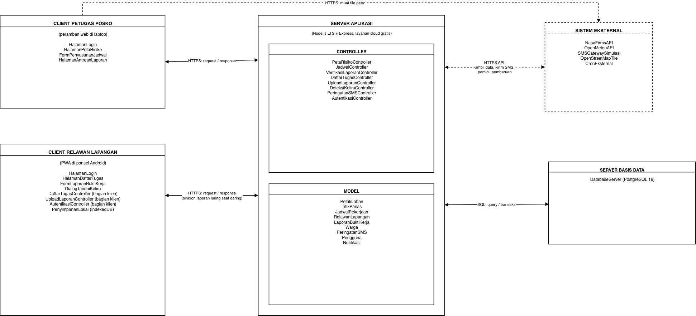
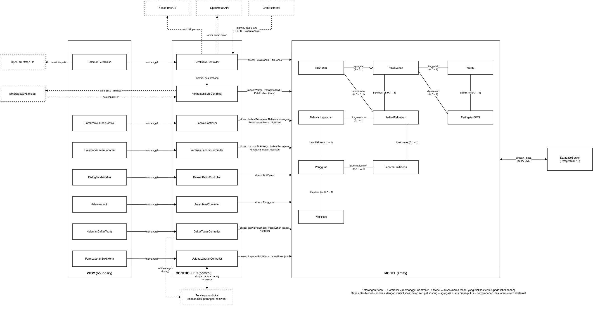

<h1>
IF2150 REKAYASA PERANGKAT LUNAK
 
TUGAS 5
 
DESKRIPSI PERANCANGAN PERANGKAT LUNAK (DPPL)
</h1>
 

## *SIGAP*

### Untuk: *Amanda Aurellia Salsabilla*

Dipersiapkan oleh:
| Informasi | Keterangan |
| --- | --- |
| Kelas | K-01 |
| Kelompok | G-08 |

| NIM | Nama |
|---|---|
| 13525022 | Muhammad Rafi Insyan Syiham Abrar |
| 13525037 | Muhammad Rafiif Ansyadya |
| 13525076 | Reinhard Mikhael Tandra |
| 13525094 | Arga Cyrano Simanjuntak |
| 13525136 | Jonathan Lewie |
---

> **Catatan draf (hapus sebelum dikumpulkan).** Draf ini memuat sampul, Bab 1, dan Bab 2. Agar DPPL konsisten, dokumen sebelumnya perlu disesuaikan:
>
> 1. **APL Tabel 2.1:** samakan nama komponen eksternal dengan gambar (`NasaFirmsAPI`, `OpenMeteoAPI`, `SMSGatewaySimulasi`, `OpenStreetMapTile`, `CronEksternal`). Deskripsi `OpenMeteoAPI` tidak boleh menyebut "batas koordinat wilayah". Tambahkan `ambilNotifikasi()` pada `PetaRisikoController` dan `tampilkanNotifikasi()` pada `HalamanPetaRisiko`.
> 2. **Gambar 3 (Logical View):** tambahkan akses `Notifikasi` pada `PetaRisikoController`, dan akses `Pengguna (baca)` pada `DaftarTugasController` (untuk mencari semua petugas penerima notifikasi pembatalan, KF21).
> 3. **Gambar 1 (MVC):** panah *Model* ke *View* berlabel "state query" tidak sesuai implementasi karena *View* menerima data dari *Controller*, dan panah itu juga tidak ada di Gambar 3. Hapus atau ubah.
> 4. **SKPL KNF11:** ubah "7 hari tidak aktif" menjadi "7 hari sejak login", karena token JWT berlaku tetap.

## Daftar Perubahan

| Revisi | Deskripsi |
| :--- | :--- |
| A | Dokumen awal DPPL. |

---

# BAB 1: Pendahuluan

## 1.1 Tujuan Penulisan Dokumen
DPPL ini menjelaskan rancangan perangkat lunak SIGAP sebagai kelanjutan dari SKPL dan APL, yaitu lingkungan implementasi, komponen, realisasi tiap use case, dan diagram kelas perancangan. Dokumen ini dipakai oleh dua pihak. Tim pengembang Kelompok G-08 K-01 memakainya sebagai acuan saat menulis kode dan pengujian, sedangkan asisten dan dosen IF2150 memakainya untuk memeriksa kesesuaian antara kebutuhan, rancangan, dan implementasi.

## 1.2 Lingkup Masalah
SIGAP adalah sistem informasi berbasis peta untuk mencegah kebakaran lahan gambut di satu wilayah percontohan setingkat kecamatan. Sistem mengolah data titik panas NASA FIRMS dan data curah hujan Open-Meteo menjadi skor risiko tiap petak lahan, lalu skor itu dipakai untuk menugaskan pekerjaan pencegahan kepada relawan. Relawan mengirim bukti kerja yang diverifikasi petugas posko, dan pengirimannya tetap bisa dilakukan saat luring. Ketika risiko di sekitar permukiman naik ke tingkat tinggi, sistem mengirim peringatan SMS (disimulasikan) kepada warga yang telah terdaftar.

## 1.3 Definisi, Istilah, dan Singkatan

Tabel 1.3. Definisi Istilah dan Singkatan

| Singkatan, Akronim, atau Istilah | Penjelasan |
| :--- | :--- |
| P/L | Perangkat Lunak. |
| SKPL | Spesifikasi Kebutuhan Perangkat Lunak, yaitu dokumen yang merangkum kebutuhan yang harus dipenuhi aplikasi. |
| APL | Arsitektur Perangkat Lunak, yaitu dokumen yang menetapkan pola arsitektur, komponen, dan model arsitektur aplikasi. |
| DPPL | Deskripsi Perancangan Perangkat Lunak, yaitu dokumen ini. |
| UC | *Use Case*. |
| KF / KNF | Kebutuhan Fungsional / Kebutuhan Non-Fungsional pada SKPL. |
| MVC | *Model-View-Controller*, pola yang memisahkan data (*Model*), antarmuka (*View*), dan logika pengendali (*Controller*). |
| BCE | *Boundary-Control-Entity*, pola pemodelan kelas pada SKPL. Dalam DPPL, *boundary* diwujudkan sebagai *View*, *control* sebagai *Controller*, dan *entity* sebagai *Model*. |
| PWA | *Progressive Web App*, aplikasi web yang dapat dipasang di ponsel dan sebagian fiturnya tetap berfungsi saat luring melalui *Service Worker*. |
| Service Worker | Skrip peramban yang berjalan di latar belakang, dipakai untuk menyimpan berkas aplikasi agar dapat dibuka saat luring. |
| IndexedDB | Basis data bawaan peramban untuk menyimpan data berukuran besar, termasuk foto, di perangkat pengguna. |
| UUID | *Universally Unique Identifier*, penanda unik laporan yang dibuat di perangkat relawan untuk mencegah laporan ganda. |
| JWT | *JSON Web Token*, token bertanda tangan yang diterbitkan server saat login dan memuat peran serta masa berlaku sesi. |
| REST | Gaya komunikasi klien dan server melalui HTTP dengan data berformat JSON. |
| Cron eksternal | Layanan penjadwal gratis di luar P/L yang memanggil endpoint pembaruan server setiap 3 jam. |
| *Bounding box* | Kotak persegi panjang yang dibatasi lintang dan bujur minimum serta maksimum. Dipakai sebagai batas petak lahan. |
| Haversine | Rumus jarak antara dua koordinat di permukaan bumi. |
| Petak Lahan, Titik Panas, Skor Risiko, Tugas Aktif, Luring | Sesuai definisi pada Tabel 1.3 SKPL. |

## 1.4 Aturan Penomoran
Pola ID sama dengan SKPL dan tidak ada pola baru.

Tabel 1.4. Aturan Penomoran

| Hal/Bagian | Penomoran | Keterangan |
| :--- | :--- | :--- |
| Use Case | UCXX | UC01 sampai UC08, sesuai SKPL subbab 4.2. |
| Kelas | CXX | C01 sampai C24, sesuai SKPL subbab 5.1. Kelas perancangan memakai ID kelas analisis yang sama. |
| Kebutuhan Fungsional | KFXX | KF01 sampai KF24, sesuai SKPL Tabel 3.1. |
| Kebutuhan Non-Fungsional | KNFXX | KNF01 sampai KNF12, sesuai SKPL Tabel 3.2. |
| Aktor | AKXX | AK01 sampai AK03, sesuai SKPL subbab 4.1. |

## 1.5 Referensi
1. Kelompok G-08 K-01. *Spesifikasi Kebutuhan Perangkat Lunak (SKPL) SIGAP*. Tugas 5, IF2150 Rekayasa Perangkat Lunak, 2026.
2. Kelompok G-08 K-01. *Arsitektur Perangkat Lunak (APL) SIGAP*. Tugas 6, IF2150 Rekayasa Perangkat Lunak, 2026.
3. Sommerville, I. (2016). *Software Engineering* (10th ed.). Pearson. Chapter 6: *Architectural Design*.
4. Kruchten, P. (1995). The 4+1 View Model of Architecture. *IEEE Software*, 12(6), 42–50.
5. Express. *Express documentation*. https://expressjs.com
6. node-postgres. *node-postgres documentation*. https://node-postgres.com
7. Leaflet. *Leaflet API reference*. https://leafletjs.com/reference.html
8. MDN Web Docs. *Service Worker API* dan *IndexedDB API*. https://developer.mozilla.org/en-US/docs/Web/API/Service_Worker_API, https://developer.mozilla.org/en-US/docs/Web/API/IndexedDB_API

## 1.6 Deskripsi Umum Dokumen (Ikhtisar)
BAB 1 berisi tujuan, lingkup, istilah, aturan penomoran, dan referensi. BAB 2 menjelaskan lingkungan implementasi, pola arsitektur acuan, identifikasi komponen, serta model arsitektur (*Logical View* dan *Physical View*) hasil APL. BAB 3 merealisasikan setiap use case melalui identifikasi kelas, *sequence diagram* untuk tiap skenario, dan diagram kelas. BAB 4 memuat diagram kelas keseluruhan beserta daftar atribut dan metodenya. BAB 5 memuat matriks kerunutan antara kelas perancangan dan use case.

---

# BAB 2: Perancangan Arsitektur

## 2.1 Rancangan Lingkungan Implementasi

Tabel 2.1. Lingkungan Implementasi

| Aspek | Pilihan | Keterangan |
| :--- | :--- | :--- |
| *Operating system* | Pengembangan: Windows, Linux, atau macOS sesuai laptop anggota. Server: Linux pada platform hosting. Klien petugas: Windows, Linux, atau macOS. Klien relawan: Android. | Lintas platform karena seluruh klien berjalan di peramban (SKPL subbab 2.5). |
| Bahasa pemrograman | JavaScript (ES modules) di server dan klien, SQL, serta HTML dan CSS. | Satu bahasa di kedua sisi supaya anggota tim bisa bertukar tugas. |
| Server | Node.js LTS 22 dengan Express. Pustaka: `pg` (koneksi PostgreSQL), `bcrypt` (hash password, KNF11), `jsonwebtoken` (sesi), `multer` (penerimaan foto). | Satu aplikasi monolit yang juga menyajikan berkas antarmuka kedua klien. |
| Klien | HTML, CSS, dan JavaScript murni tanpa *framework* dan tanpa proses *build*. Leaflet untuk peta (hanya klien petugas). *Service Worker* dan IndexedDB memakai API bawaan peramban. | Lihat alasan di bawah tabel. |
| DBMS | PostgreSQL 16 pada layanan database gratis (Neon) untuk data server. IndexedDB pada peramban relawan untuk laporan luring. | Layanan database dipisah dari hosting aplikasi (lihat catatan hosting). |
| Hosting aplikasi | Layanan web gratis (Render, paket Free) dengan HTTPS bawaan. | Diperlukan HTTPS agar Geolocation API dan PWA berfungsi (SKPL batasan 11). |
| Penjadwal | Layanan cron eksternal gratis yang memanggil endpoint pembaruan setiap 3 jam dengan token rahasia. | Sesuai APL subbab 3.2. |
| *Development tools* | Visual Studio Code, Git dan GitHub (repositori publik), draw.io untuk diagram, serta peramban dan `curl` untuk menguji endpoint. | Repositori publik, sehingga seluruh data fiktif (SKPL batasan 13). |
| *Filing system* | Kode di repositori Git. Foto bukti kerja disimpan sebagai data biner (`bytea`) di PostgreSQL, tidak sebagai berkas di server. Di perangkat relawan, foto disimpan sebagai *Blob* di IndexedDB. | Berkas pada layanan hosting gratis bersifat sementara dan hilang saat server dijalankan ulang. Foto sudah dikompres maksimal 500 KB (KNF09). |
| Data master dan data uji | Skrip Node.js untuk mengisi akun, relawan, warga, grid petak, dan data titik panas historis FIRMS. | Sesuai SKPL batasan 9 dan 10. Tidak ada halaman pengelolaan data master. |

**Alasan tanpa *framework* front-end.** Antarmuka SIGAP hanya berisi tujuh halaman dengan interaksi sederhana: formulir, daftar, dan satu peta. *Framework* menambah proses *build*, konfigurasi, dan konsep baru yang perlu dipelajari tim, sementara hasilnya tidak diperlukan oleh kebutuhan SKPL. Berkas statis juga lebih mudah di-*cache* oleh *Service Worker* untuk fitur luring. Tampilan relawan mengikuti KNF08: tombol aksi di bagian bawah layar, kontras minimal 4,5:1, dan target sentuh minimal 48×48 dp.

**Catatan hosting.** Layanan web gratis akan tidur setelah 15 menit tanpa permintaan dan butuh sekitar satu menit untuk aktif kembali, sehingga server dipanaskan sebelum pengujian dan demo (APL subbab 3.2). Database gratis dari penyedia hosting aplikasi dipilih tidak dipakai karena masa berlakunya terbatas. Neon dipakai karena paket gratisnya tidak memiliki batas waktu, dengan kapasitas 0,5 GB. Kapasitas ini cukup untuk data uji dan foto terkompres pada skala demo.

## 2.2 Style/Pattern Arsitektur Acuan

SIGAP memakai kombinasi **Client-Server** dan **MVC**, sesuai APL BAB 1. Client-Server dipilih karena petugas posko (laptop, koneksi stabil) dan relawan (ponsel Android kelas menengah ke bawah, sinyal lemah) memakai perangkat yang sangat berbeda, sehingga pekerjaan berat seperti pengambilan data FIRMS (KF02) dan pengiriman SMS (KF16) dipusatkan di server. MVC dipilih untuk memisahkan antarmuka dari logika bisnis, sehingga peta Leaflet dan formulir luring dapat dikerjakan terpisah dari *backend* dan penyimpanan lokal relawan (KF12, KF13) cukup menjadi tanggung jawab *Controller*.

Penerapan MVC pada implementasi:

- ***View***: halaman HTML beserta modul JavaScript yang menampilkan data dan meneruskan aksi pengguna ke *Controller*.
- ***Controller***: modul penangan *route* Express di server, ditambah modul JavaScript di PWA relawan untuk fungsi luring (bagian klien dari `DaftarTugasController`, `UploadLaporanController`, dan `AutentikasiController`).
- ***Model***: modul yang membungkus data dan aturan tiap entitas serta kueri SQL ke PostgreSQL melalui `pg`. *View* tidak membaca *Model* secara langsung. Data sampai ke *View* sebagai JSON dari *Controller* lewat HTTPS.

<i>Gambar 1. Arsitektur MVC pada P/L SIGAP</i>

<i>Gambar 2. Arsitektur Client-Server pada P/L SIGAP</i>

## 2.3 Identifikasi Komponen / Modul / Subsistem

Seluruh 31 komponen berasal dari Tabel 2.1 APL, dikelompokkan menurut lapisan. Nama komponen sama dengan yang dipakai pada Gambar 1 sampai Gambar 4.

Tabel 2.3. Identifikasi Komponen/Modul/Subsistem

| Nama Komponen/Modul/Subsistem | Jenis | Penjelasan |
| :--- | :--- | :--- |
| `HalamanLogin` | View | Formulir masuk untuk petugas dan relawan, serta pesan kegagalan login. |
| `HalamanPetaRisiko` | View | Peta risiko per petak untuk petugas, beserta waktu pembaruan, keterangan cache, atribusi sumber data, pernyataan batasan skor, dan notifikasi petugas. |
| `FormPenyusunanJadwal` | View | Formulir penyusunan jadwal, daftar relawan aktif, rekomendasi petak, dan pesan kapasitas penuh. |
| `HalamanAntreanLaporan` | View | Antrean dan detail laporan bukti kerja untuk diverifikasi, termasuk peringatan jarak. |
| `HalamanDaftarTugas` | View | Daftar dan detail tugas relawan, penanda luring, formulir pembatalan, dan notifikasi relawan. |
| `FormLaporanBuktiKerja` | View | Formulir laporan: pengambilan foto, pengisian koordinat GPS, dan peringatan GPS mati. |
| `DialogTandaiKeliru` | View | Formulir keterangan untuk menandai titik panas sebagai deteksi keliru. |
| `AutentikasiController` | Controller | Memverifikasi kredensial, menerbitkan dan memeriksa token sesi, serta mengarahkan pengguna menurut peran. Bagian klien memeriksa masa berlaku token saat luring. |
| `PetaRisikoController` | Controller | Menerima pemicu cron, mengambil data titik panas dan curah hujan, menghitung skor, menyimpan hasil, memakai cache jika pengambilan gagal, memicu pengecekan ambang SMS, serta menyediakan data peta dan notifikasi petugas. |
| `JadwalController` | Controller | Menyusun rekomendasi petak, memvalidasi batas 3 tugas aktif per relawan, menyimpan jadwal, dan membuat notifikasi penugasan. |
| `VerifikasiLaporanController` | Controller | Menghitung jarak laporan ke batas petak, memproses persetujuan atau penolakan, mengunci laporan, memperbarui status tugas, dan membuat notifikasi ke relawan. |
| `DaftarTugasController` | Controller | Mengambil tugas relawan terurut skor petak, memproses pembatalan tugas, dan membuat notifikasi ke petugas. Bagian klien menyimpan salinan tugas di IndexedDB. |
| `UploadLaporanController` | Controller | Bagian klien: membuat UUID, mengompres foto, mendeteksi koneksi, menyimpan laporan luring, dan menyinkronkannya. Bagian server: menerima laporan, menolak UUID ganda, dan mengubah status tugas. |
| `DeteksiKeliruController` | Controller | Memvalidasi keterangan dan mengubah status titik panas menjadi keliru. |
| `PeringatanSMSController` | Controller | Mengecek petak yang naik ke tingkat tinggi dan batas 24 jam, mengirim SMS (simulasi) ke warga dengan persetujuan aktif, memproses balasan STOP, dan menghapus nomor yang dicabut. |
| `PetakLahan` | Model | Batas wilayah (*bounding box*), skor, tingkat risiko, dan waktu pembaruan terakhir satu petak. |
| `TitikPanas` | Model | Titik panas dari FIRMS beserta status validitas dan keterangan penandaan keliru. |
| `JadwalPekerjaan` | Model | Satu tugas pencegahan: jenis pekerjaan, status, tanggal, dan alasan pembatalan. |
| `RelawanLapangan` | Model | Identitas, kontak, dan status keaktifan relawan. |
| `LaporanBuktiKerja` | Model | UUID, foto, koordinat unggahan, jarak ke petak, status verifikasi, dan waktu verifikasi. |
| `Warga` | Model | Nomor HP penerima SMS, status persetujuan, dan waktu pencabutan. |
| `PeringatanSMS` | Model | Log pengiriman SMS: isi pesan, waktu kirim, dan status. |
| `Pengguna` | Model | Akun: username, hash password, dan peran. |
| `Notifikasi` | Model | Notifikasi dalam aplikasi: isi pesan, waktu dibuat, dan status sudah dibaca. |
| `DatabaseServer` | Penyimpanan Data | PostgreSQL 16 untuk seluruh data *Model* di server. |
| `PenyimpananLokal` | Penyimpanan Data | IndexedDB di perangkat relawan untuk salinan tugas dan laporan luring. |
| `NasaFirmsAPI` | Integrasi Eksternal | Sumber data titik panas (NASA FIRMS Area API). |
| `OpenMeteoAPI` | Integrasi Eksternal | Sumber data curah hujan harian, termasuk beberapa hari ke belakang. |
| `SMSGatewaySimulasi` | Integrasi Eksternal | Gateway SMS tiruan: mencatat log pengiriman dan meneruskan balasan STOP dari halaman simulasi. |
| `OpenStreetMapTile` | Integrasi Eksternal | Penyedia tile peta dasar, dimuat langsung oleh peramban petugas. |
| `CronEksternal` | Integrasi Eksternal | Penjadwal yang memanggil endpoint pembaruan server setiap 3 jam. |

## 2.4 Model Arsitektur Perangkat Lunak

Model arsitektur memakai dua *view* dari model 4+1 (Kruchten, 1995), sesuai APL BAB 3. *Process View* dan *Development View* tidak dibuat karena alur dinamis tiap fitur dijelaskan oleh *sequence diagram* pada BAB 3 dan seluruh komponen sudah tercakup oleh dua *view* di bawah.

### 2.4.1 Logical View

*Logical View* dipilih karena memperlihatkan pembagian tanggung jawab antarkomponen sesuai MVC, sehingga tiap kebutuhan SKPL dapat ditelusuri ke satu *View*, satu *Controller*, dan *Model* yang diaksesnya. Dua hal khusus pada diagram: `PetaRisikoController` juga dipicu oleh `CronEksternal` (bukan hanya oleh *View*), dan `PeringatanSMSController` tidak punya *View* karena warga tidak membuka antarmuka apa pun (AK03).

<i>Gambar 3. Logical View SIGAP</i>

Tabel 2.4.1. Pemanggil dan *Model* yang Diakses Tiap *Controller*

| *Controller* | Dipanggil oleh | *Model* yang diakses | Komponen lain |
| :--- | :--- | :--- | :--- |
| `PetaRisikoController` | `HalamanPetaRisiko`, `CronEksternal` | `PetakLahan`, `TitikPanas`, `Notifikasi` | `NasaFirmsAPI`, `OpenMeteoAPI`, memicu `PeringatanSMSController` |
| `PeringatanSMSController` | `PetaRisikoController`, `SMSGatewaySimulasi` (balasan STOP) | `Warga`, `PeringatanSMS`, `PetakLahan` (baca) | `SMSGatewaySimulasi` |
| `JadwalController` | `FormPenyusunanJadwal` | `JadwalPekerjaan`, `RelawanLapangan`, `PetakLahan` (baca), `Notifikasi` | - |
| `VerifikasiLaporanController` | `HalamanAntreanLaporan` | `LaporanBuktiKerja`, `JadwalPekerjaan`, `Pengguna` (baca), `Notifikasi` | - |
| `DaftarTugasController` | `HalamanDaftarTugas` | `JadwalPekerjaan`, `PetakLahan` (baca), `Notifikasi`, `Pengguna` (baca) | `PenyimpananLokal` |
| `UploadLaporanController` | `FormLaporanBuktiKerja` | `LaporanBuktiKerja`, `JadwalPekerjaan` | `PenyimpananLokal` |
| `DeteksiKeliruController` | `DialogTandaiKeliru` | `TitikPanas` | - |
| `AutentikasiController` | `HalamanLogin` | `Pengguna` | - |

### 2.4.2 Physical View

*Physical View* dipilih karena pembagian node pada Client-Server adalah inti lingkungan operasi: klien petugas, klien relawan, server aplikasi, dan server basis data. *View* ini juga menunjukkan bahwa sebagian *Controller* berjalan di perangkat relawan agar fitur luring tetap berfungsi.

<i>Gambar 4. Physical View SIGAP</i>

Tabel 2.4.2. Penempatan Komponen pada Node

| Node | Lingkungan eksekusi | Komponen |
| :--- | :--- | :--- |
| Laptop petugas posko | Peramban modern (Chrome, Edge, Firefox) dengan Leaflet | `HalamanLogin`, `HalamanPetaRisiko`, `FormPenyusunanJadwal`, `HalamanAntreanLaporan` |
| Ponsel Android relawan | Chrome Android, PWA dengan *Service Worker* | `HalamanLogin`, `HalamanDaftarTugas`, `FormLaporanBuktiKerja`, `DialogTandaiKeliru`, `PenyimpananLokal`, bagian klien dari `AutentikasiController`, `DaftarTugasController`, `UploadLaporanController` |
| Server aplikasi | Node.js LTS 22 + Express (hosting gratis) | Delapan *Controller* dan sembilan *Model* (bagian server dari tiga *Controller* di atas ikut di sini) |
| Server basis data | PostgreSQL 16 | `DatabaseServer` |
| Sistem eksternal | Di luar P/L | `CronEksternal`, `NasaFirmsAPI`, `OpenMeteoAPI`, `SMSGatewaySimulasi`, `OpenStreetMapTile` |

Keputusan rancangan yang mengikuti dari *view* ini:

1. **Monolit modular.** Seluruh *Controller* dan *Model* berada dalam satu proses Express yang juga menyajikan berkas antarmuka kedua klien, sehingga hanya satu layanan yang dideploy.
2. ***Controller* terbagi klien dan server.** Logika luring (UUID, kompresi foto, penyimpanan lokal, pemeriksaan masa berlaku token) berjalan di PWA. Penerimaan data, penolakan UUID ganda (KNF03), dan penerbitan token berjalan di server.
3. **Sesi memakai JWT** berlaku 7 hari sejak login, agar masa berlakunya dapat diperiksa di perangkat saat luring (KF20).
4. **Endpoint pembaruan dilindungi token rahasia.** Token dan MAP_KEY FIRMS disimpan sebagai *environment variable* di server dan tidak masuk repositori publik.
5. **Pemanggilan API eksternal hanya dari server.** Satu-satunya pengecualian adalah tile peta, yang dimuat langsung oleh peramban petugas.
6. **Penanda prototipe.** Antarmuka menampilkan "Prototipe: data historis dan SMS disimulasikan".

---

# BAB 3: Realisasi Use Case

# BAB 4: Diagram Kelas Keseluruhan

# BAB 5: Matriks Kerunutan
