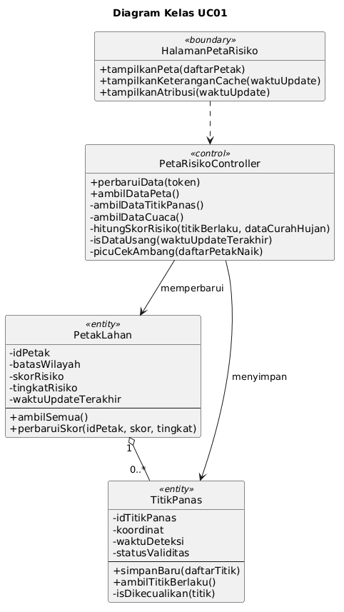
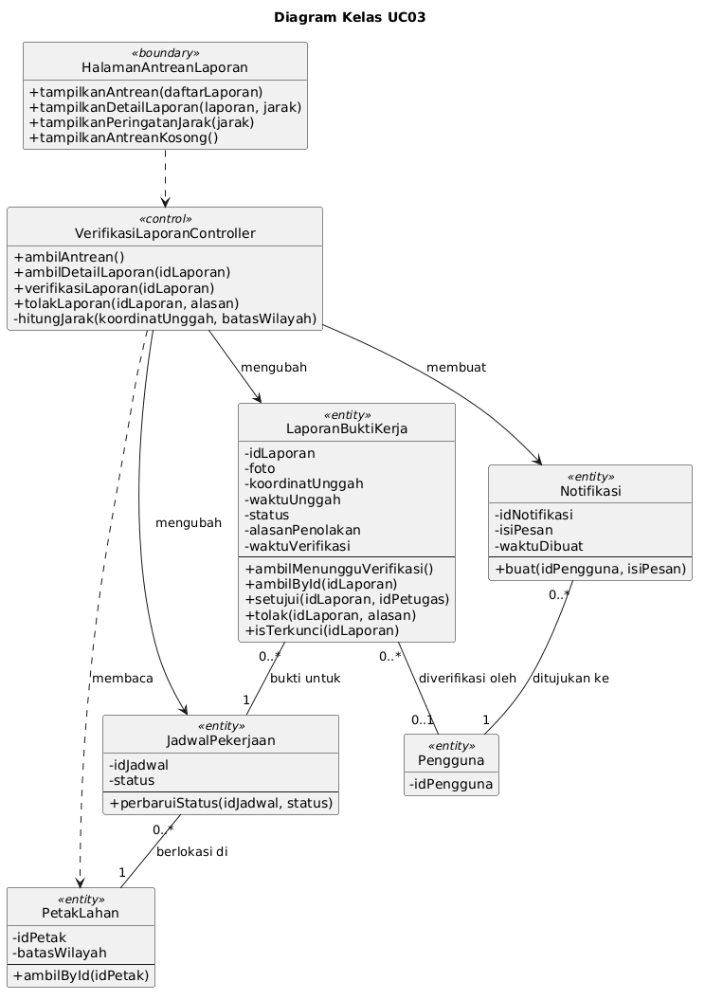
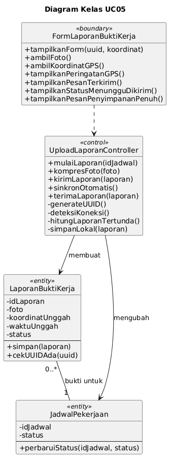
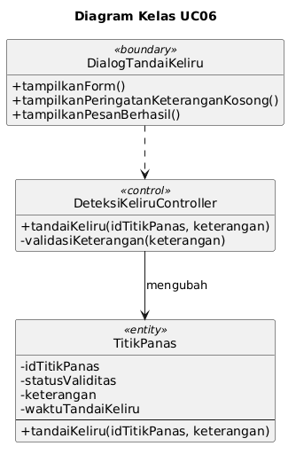
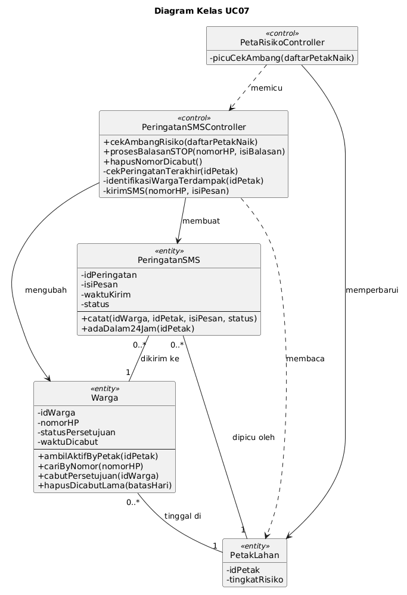
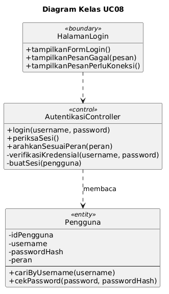

<h1>
IF2150 REKAYASA PERANGKAT LUNAK
 
TUGAS 5
 
DESKRIPSI PERANCANGAN PERANGKAT LUNAK (DPPL)
</h1>
 

## *SIGAP*

### Untuk: *Amanda Aurellia Salsabilla*

Dipersiapkan oleh:
| Informasi | Keterangan |
| --- | --- |
| Kelas | K-01 |
| Kelompok | G-08 |

| NIM | Nama |
|---|---|
| 13525022 | Muhammad Rafi Insyan Syiham Abrar |
| 13525037 | Muhammad Rafiif Ansyadya |
| 13525076 | Reinhard Mikhael Tandra |
| 13525094 | Arga Cyrano Simanjuntak |
| 13525136 | Jonathan Lewie |
---

## Daftar Perubahan

| Revisi | Deskripsi |
| :--- | :--- |
| A | Versi awal dokumen DPPL. |

---

# BAB 1: Pendahuluan

## 1.1 Tujuan Penulisan Dokumen
DPPL ini menguraikan rancangan perangkat lunak SIGAP sebagai lanjutan dari SKPL dan APL, dengan isi berupa lingkungan implementasi, komponen, realisasi setiap use case, dan diagram kelas perancangan. Dokumen ini punya dua kelompok pembaca. Tim pengembang Kelompok G-08 K-01 menjadikannya pegangan ketika menulis kode dan pengujian, sedangkan asisten dan dosen IF2150 menggunakannya untuk menilai apakah kebutuhan, rancangan, dan implementasi saling sesuai.

## 1.2 Lingkup Masalah
SIGAP merupakan sistem informasi berbasis peta yang bertujuan mencegah kebakaran lahan gambut di satu wilayah percontohan setingkat kecamatan. Sistem mengolah data titik panas NASA FIRMS dan data curah hujan Open-Meteo menjadi skor risiko untuk setiap petak lahan, kemudian menggunakan skor tersebut untuk menugaskan pekerjaan pencegahan kepada relawan. Relawan mengirimkan bukti kerja yang diverifikasi oleh petugas posko, dan pengiriman itu tetap dapat dilakukan ketika perangkat sedang luring. Apabila risiko di sekitar permukiman mencapai tingkat tinggi, sistem mengirimkan peringatan SMS (disimulasikan) kepada warga yang sudah terdaftar.

## 1.3 Definisi, Istilah, dan Singkatan

Tabel 1.3. Definisi Istilah dan Singkatan

| Singkatan, Akronim, atau Istilah | Penjelasan |
| :--- | :--- |
| P/L | Perangkat Lunak. |
| SKPL | Spesifikasi Kebutuhan Perangkat Lunak, yakni dokumen yang merangkum kebutuhan yang wajib dipenuhi aplikasi. |
| APL | Arsitektur Perangkat Lunak, yakni dokumen yang menetapkan pola arsitektur, komponen, dan model arsitektur aplikasi. |
| DPPL | Deskripsi Perancangan Perangkat Lunak, yakni dokumen yang sedang Anda baca. |
| UC | *Use Case*. |
| KF / KNF | Kebutuhan Fungsional / Kebutuhan Non-Fungsional dalam SKPL. |
| MVC | *Model-View-Controller*, pola yang memisahkan data (*Model*), antarmuka (*View*), dan logika pengendali (*Controller*). |
| BCE | *Boundary-Control-Entity*, pola pemodelan kelas dalam SKPL. DPPL menerjemahkan *boundary* menjadi *View*, *control* menjadi *Controller*, dan *entity* menjadi *Model*. |
| PWA | *Progressive Web App*, aplikasi web yang bisa dipasang di ponsel dan sebagian fiturnya tetap berjalan saat luring berkat *Service Worker*. |
| Service Worker | Skrip peramban yang bekerja di latar belakang untuk menyimpan berkas aplikasi sehingga aplikasi tetap terbuka ketika luring. |
| IndexedDB | Basis data bawaan peramban untuk menyimpan data berukuran besar, termasuk foto, langsung di perangkat pengguna. |
| UUID | *Universally Unique Identifier*, penanda unik laporan yang dibuat di perangkat relawan agar tidak terjadi laporan ganda. |
| JWT | *JSON Web Token*, token bertanda tangan yang diterbitkan server saat login; token ini memuat peran pengguna dan masa berlaku sesi. |
| REST | Gaya komunikasi antara klien dan server melalui HTTP dengan data berformat JSON. |
| Cron eksternal | Layanan penjadwal gratis di luar P/L yang memanggil endpoint pembaruan server setiap 3 jam. |
| *Bounding box* | Kotak persegi panjang yang dibatasi lintang dan bujur minimum serta maksimum, digunakan sebagai batas petak lahan. |
| Haversine | Rumus untuk menghitung jarak antara dua koordinat pada permukaan bumi. |
| Petak Lahan, Titik Panas, Skor Risiko, Tugas Aktif, Luring | Mengikuti definisi pada Tabel 1.3 SKPL. |

## 1.4 Aturan Penomoran
Pola ID mengikuti SKPL tanpa tambahan pola baru.

Tabel 1.4. Aturan Penomoran

| Hal/Bagian | Penomoran | Keterangan |
| :--- | :--- | :--- |
| Use Case | UCXX | UC01 hingga UC08, mengacu pada SKPL subbab 4.2. |
| Kelas | CXX | C01 hingga C24, mengacu pada SKPL subbab 5.1. Kelas perancangan menggunakan ID kelas analisis yang sama. |
| Kebutuhan Fungsional | KFXX | KF01 hingga KF24, mengacu pada SKPL Tabel 3.1. |
| Kebutuhan Non-Fungsional | KNFXX | KNF01 hingga KNF12, mengacu pada SKPL Tabel 3.2. |
| Aktor | AKXX | AK01 hingga AK03, mengacu pada SKPL subbab 4.1. |

## 1.5 Referensi
1. Kelompok G-08 K-01. *Spesifikasi Kebutuhan Perangkat Lunak (SKPL) SIGAP*. Tugas 5, IF2150 Rekayasa Perangkat Lunak, 2026.
2. Kelompok G-08 K-01. *Arsitektur Perangkat Lunak (APL) SIGAP*. Tugas 6, IF2150 Rekayasa Perangkat Lunak, 2026.
3. Sommerville, I. (2016). *Software Engineering* (10th ed.). Pearson. Chapter 6: *Architectural Design*.
4. Kruchten, P. (1995). The 4+1 View Model of Architecture. *IEEE Software*, 12(6), 42–50.
5. Express. *Express documentation*. https://expressjs.com
6. node-postgres. *node-postgres documentation*. https://node-postgres.com
7. Leaflet. *Leaflet API reference*. https://leafletjs.com/reference.html
8. MDN Web Docs. *Service Worker API* dan *IndexedDB API*. https://developer.mozilla.org/en-US/docs/Web/API/Service_Worker_API, https://developer.mozilla.org/en-US/docs/Web/API/IndexedDB_API

## 1.6 Deskripsi Umum Dokumen (Ikhtisar)
BAB 1 memuat tujuan, lingkup, istilah, aturan penomoran, dan referensi. BAB 2 menguraikan lingkungan implementasi, pola arsitektur acuan, identifikasi komponen, dan model arsitektur (*Logical View* serta *Physical View*) yang bersumber dari APL. BAB 3 mewujudkan setiap use case lewat identifikasi kelas, *sequence diagram* untuk tiap skenario, dan diagram kelas. BAB 4 menyajikan diagram kelas keseluruhan lengkap dengan daftar atribut dan metodenya, lalu BAB 5 berisi matriks kerunutan yang menghubungkan kelas perancangan dengan use case.

---

# BAB 2: Perancangan Arsitektur

## 2.1 Rancangan Lingkungan Implementasi

Tabel 2.1. Lingkungan Implementasi

| Aspek | Pilihan | Keterangan |
| :--- | :--- | :--- |
| *Operating system* | Pengembangan: Windows, Linux, atau macOS, menyesuaikan laptop masing-masing anggota. Server: Linux pada platform hosting. Klien petugas: Windows, Linux, atau macOS. Klien relawan: Android. | Aplikasi tidak terikat satu platform karena semua klien berjalan di peramban (SKPL subbab 2.5). |
| Bahasa pemrograman | JavaScript (ES modules) di sisi server dan klien, SQL, serta HTML dan CSS. | Satu bahasa di kedua sisi memungkinkan anggota tim saling menggantikan pengerjaan tugas. |
| Server | Node.js LTS 22 dengan Express. Pustaka yang dipakai: `pg` (koneksi PostgreSQL), `bcrypt` (hash password, KNF11), `jsonwebtoken` (sesi), dan `multer` (penerima unggahan foto). | Aplikasi berbentuk monolit tunggal yang sekaligus menyajikan berkas antarmuka untuk kedua klien. |
| Klien | HTML, CSS, dan JavaScript murni, tanpa *framework* dan tanpa proses *build*. Leaflet untuk peta (khusus klien petugas). *Service Worker* dan IndexedDB memakai API bawaan peramban. | Alasannya diuraikan di bawah tabel. |
| DBMS | PostgreSQL 16 pada layanan database gratis (Neon) untuk data di server. IndexedDB pada peramban relawan untuk laporan luring. | Layanan database sengaja dipisahkan dari hosting aplikasi (lihat catatan hosting). |
| Hosting aplikasi | Layanan web gratis (Render, paket Free) dengan HTTPS bawaan. | HTTPS wajib ada agar Geolocation API dan PWA bisa berfungsi (SKPL batasan 11). |
| Penjadwal | Layanan cron eksternal gratis yang memanggil endpoint pembaruan setiap 3 jam menggunakan token rahasia. | Mengacu pada APL subbab 3.2. |
| *Development tools* | Visual Studio Code, Git dan GitHub (repositori publik), draw.io untuk diagram, serta peramban dan `curl` untuk menguji endpoint. | Repositori bersifat publik, maka seluruh data harus fiktif (SKPL batasan 13). |
| *Filing system* | Kode tersimpan di repositori Git. Foto bukti kerja disimpan sebagai data biner (`bytea`) di PostgreSQL, bukan sebagai berkas di server. Di perangkat relawan, foto disimpan sebagai *Blob* di IndexedDB. | Berkas pada layanan hosting gratis bersifat sementara dan lenyap setiap kali server dijalankan ulang. Ukuran foto sudah dikompres hingga maksimal 500 KB (KNF09). |
| Data master dan data uji | Skrip Node.js yang mengisi akun, relawan, warga, grid petak, dan data titik panas historis FIRMS. | Mengikuti SKPL batasan 9 dan 10. Tidak tersedia halaman untuk mengelola data master. |

**Alasan tidak memakai *framework* front-end.** Antarmuka SIGAP hanya terdiri atas tujuh halaman dengan interaksi sederhana: formulir, daftar, dan satu peta. *Framework* menambah proses *build*, konfigurasi, serta konsep baru yang harus dipelajari tim, padahal kebutuhan SKPL tidak menuntutnya. Berkas statis juga lebih mudah di-*cache* oleh *Service Worker* untuk fitur luring. Tampilan relawan mengikuti KNF08: tombol aksi diletakkan di bagian bawah layar, kontras minimal 4,5:1, dan target sentuh minimal 48×48 dp.

**Catatan hosting.** Layanan web gratis tertidur setelah 15 menit tanpa permintaan dan memerlukan sekitar satu menit untuk aktif lagi, karena itu tim menghidupkan server terlebih dahulu sebelum pengujian dan demo (APL subbab 3.2). Tim tidak memakai database gratis dari penyedia hosting aplikasi karena masa berlakunya terbatas. Pilihan jatuh pada Neon: paket gratisnya tanpa batas waktu dan berkapasitas 0,5 GB, cukup untuk data uji dan foto terkompres pada skala demo.

## 2.2 Style/Pattern Arsitektur Acuan

SIGAP menggabungkan pola **Client-Server** dan **MVC**, mengikuti APL BAB 1. Client-Server dipilih karena petugas posko (laptop, koneksi stabil) dan relawan (ponsel Android kelas menengah ke bawah, sinyal lemah) memakai perangkat yang berbeda jauh; pekerjaan berat seperti pengambilan data FIRMS (KF02) dan pengiriman SMS (KF16) pun dipusatkan di server. MVC dipilih untuk memisahkan antarmuka dari logika bisnis. Dengan begitu, peta Leaflet dan formulir luring bisa dikerjakan terpisah dari *backend*, dan penyimpanan lokal relawan (KF12, KF13) cukup menjadi tanggung jawab *Controller*.

Penerapan MVC dalam implementasi:

- ***View***: halaman HTML beserta modul JavaScript yang menampilkan data dan meneruskan aksi pengguna ke *Controller*.
- ***Controller***: modul penangan *route* Express di server, ditambah modul JavaScript di PWA relawan untuk fungsi luring (bagian klien dari `DaftarTugasController`, `UploadLaporanController`, dan `AutentikasiController`).
- ***Model***: modul yang membungkus data dan aturan setiap entitas, termasuk kueri SQL ke PostgreSQL lewat `pg`. *View* tidak pernah membaca *Model* secara langsung; data tiba di *View* sebagai JSON dari *Controller* melalui HTTPS.

<i>Gambar 1. Arsitektur MVC pada P/L SIGAP</i>

<i>Gambar 2. Arsitektur Client-Server pada P/L SIGAP</i>

## 2.3 Identifikasi Komponen / Modul / Subsistem

Ke-31 komponen di bawah ini bersumber dari Tabel 2.1 APL dan dikelompokkan menurut lapisannya. Nama komponen konsisten dengan yang tertera pada Gambar 1 sampai Gambar 4.

Tabel 2.3. Identifikasi Komponen/Modul/Subsistem

| Nama Komponen/Modul/Subsistem | Jenis | Penjelasan |
| :--- | :--- | :--- |
| `HalamanLogin` | View | Formulir masuk bagi petugas dan relawan, berikut pesan ketika login gagal. |
| `HalamanPetaRisiko` | View | Peta risiko per petak untuk petugas. Halaman ini memuat waktu pembaruan, keterangan cache, atribusi sumber data, pernyataan batasan skor, dan notifikasi petugas. |
| `FormPenyusunanJadwal` | View | Formulir penyusunan jadwal; menampilkan daftar relawan aktif, rekomendasi petak, dan pesan ketika kapasitas penuh. |
| `HalamanAntreanLaporan` | View | Antrean serta detail laporan bukti kerja yang menunggu verifikasi, lengkap dengan peringatan jarak. |
| `HalamanDaftarTugas` | View | Daftar dan detail tugas relawan, penanda luring, formulir pembatalan, serta notifikasi relawan. |
| `FormLaporanBuktiKerja` | View | Formulir laporan untuk mengambil foto, mengisi koordinat GPS, dan menampilkan peringatan bila GPS mati. |
| `DialogTandaiKeliru` | View | Formulir keterangan untuk menandai sebuah titik panas sebagai deteksi keliru. |
| `AutentikasiController` | Controller | Memverifikasi kredensial, menerbitkan dan memeriksa token sesi, lalu mengarahkan pengguna sesuai perannya. Bagian klien mengecek masa berlaku token ketika luring. |
| `PetaRisikoController` | Controller | Menerima pemicu cron, mengambil data titik panas dan curah hujan, menghitung skor, dan menyimpan hasilnya. Jika pengambilan data gagal, controller ini memakai cache. Ia juga memicu pengecekan ambang SMS dan menyediakan data peta serta notifikasi petugas. |
| `JadwalController` | Controller | Menyusun rekomendasi petak, memvalidasi batas 3 tugas aktif per relawan, menyimpan jadwal, dan membuat notifikasi penugasan. |
| `VerifikasiLaporanController` | Controller | Menghitung jarak laporan terhadap batas petak, memproses persetujuan atau penolakan, mengunci laporan, memperbarui status tugas, dan membuat notifikasi untuk relawan. |
| `DaftarTugasController` | Controller | Mengambil tugas relawan dengan urutan berdasarkan skor petak, memproses pembatalan tugas, dan membuat notifikasi untuk petugas. Bagian klien menyimpan salinan tugas di IndexedDB. |
| `UploadLaporanController` | Controller | Bagian klien membuat UUID, mengompres foto, mendeteksi koneksi, menyimpan laporan saat luring, dan menyinkronkannya kemudian. Bagian server menerima laporan, menolak UUID ganda, dan mengubah status tugas. |
| `DeteksiKeliruController` | Controller | Memvalidasi keterangan dan mengubah status titik panas menjadi keliru. |
| `PeringatanSMSController` | Controller | Mengecek petak yang naik ke tingkat tinggi beserta batas 24 jam, mengirim SMS (simulasi) kepada warga yang persetujuannya masih aktif, memproses balasan STOP, dan menghapus nomor yang sudah dicabut. |
| `PetakLahan` | Model | Batas wilayah (*bounding box*), skor, tingkat risiko, dan waktu pembaruan terakhir untuk satu petak. |
| `TitikPanas` | Model | Titik panas dari FIRMS beserta status validitas dan keterangan penandaan keliru. |
| `JadwalPekerjaan` | Model | Satu tugas pencegahan, dengan data jenis pekerjaan, status, tanggal, dan alasan pembatalan. |
| `RelawanLapangan` | Model | Identitas, kontak, dan status keaktifan relawan. |
| `LaporanBuktiKerja` | Model | UUID, foto, koordinat unggahan, jarak ke petak, status verifikasi, dan waktu verifikasi. |
| `Warga` | Model | Nomor HP penerima SMS, status persetujuan, dan waktu pencabutan. |
| `PeringatanSMS` | Model | Log pengiriman SMS yang mencatat isi pesan, waktu kirim, dan status. |
| `Pengguna` | Model | Akun berisi username, hash password, dan peran. |
| `Notifikasi` | Model | Notifikasi dalam aplikasi, berisi isi pesan, waktu pembuatan, dan status sudah dibaca. |
| `DatabaseServer` | Penyimpanan Data | PostgreSQL 16 yang menampung seluruh data *Model* di server. |
| `PenyimpananLokal` | Penyimpanan Data | IndexedDB di perangkat relawan untuk menyimpan salinan tugas dan laporan luring. |
| `NasaFirmsAPI` | Integrasi Eksternal | Sumber data titik panas (NASA FIRMS Area API). |
| `OpenMeteoAPI` | Integrasi Eksternal | Sumber data curah hujan harian, termasuk data beberapa hari sebelumnya. |
| `SMSGatewaySimulasi` | Integrasi Eksternal | Gateway SMS tiruan yang mencatat log pengiriman dan meneruskan balasan STOP dari halaman simulasi. |
| `OpenStreetMapTile` | Integrasi Eksternal | Penyedia *tile* peta dasar yang dimuat langsung oleh peramban petugas. |
| `CronEksternal` | Integrasi Eksternal | Penjadwal yang memanggil endpoint pembaruan server setiap 3 jam. |

## 2.4 Model Arsitektur Perangkat Lunak

Model arsitektur ini menggunakan dua *view* dari model 4+1 (Kruchten, 1995) sebagaimana ditetapkan APL BAB 3. *Process View* dan *Development View* tidak dibuat: alur dinamis setiap fitur sudah dijelaskan oleh *sequence diagram* di BAB 3, dan kedua *view* di bawah telah melingkupi semua komponen.

### 2.4.1 Logical View

*Logical View* dipilih karena memperlihatkan pembagian tanggung jawab antarkomponen menurut MVC, sehingga setiap kebutuhan SKPL dapat dilacak ke satu *View*, satu *Controller*, dan *Model* yang diaksesnya. Diagram ini punya dua kekhususan. Pertama, `PetaRisikoController` dipicu pula oleh `CronEksternal`, tidak hanya oleh *View*. Kedua, `PeringatanSMSController` tidak memiliki *View* karena warga tidak membuka antarmuka apa pun (AK03).

<i>Gambar 3. Logical View SIGAP</i>

Tabel 2.4.1. Pemanggil dan *Model* yang Diakses Tiap *Controller*

| *Controller* | Dipanggil oleh | *Model* yang diakses | Komponen lain |
| :--- | :--- | :--- | :--- |
| `PetaRisikoController` | `HalamanPetaRisiko`, `CronEksternal` | `PetakLahan`, `TitikPanas`, `Notifikasi` | `NasaFirmsAPI`, `OpenMeteoAPI`, memicu `PeringatanSMSController` |
| `PeringatanSMSController` | `PetaRisikoController`, `SMSGatewaySimulasi` (balasan STOP) | `Warga`, `PeringatanSMS`, `PetakLahan` (baca) | `SMSGatewaySimulasi` |
| `JadwalController` | `FormPenyusunanJadwal` | `JadwalPekerjaan`, `RelawanLapangan`, `PetakLahan` (baca), `Notifikasi` | - |
| `VerifikasiLaporanController` | `HalamanAntreanLaporan` | `LaporanBuktiKerja`, `JadwalPekerjaan`, `Pengguna` (baca), `Notifikasi` | - |
| `DaftarTugasController` | `HalamanDaftarTugas` | `JadwalPekerjaan`, `PetakLahan` (baca), `Notifikasi`, `Pengguna` (baca) | `PenyimpananLokal` |
| `UploadLaporanController` | `FormLaporanBuktiKerja` | `LaporanBuktiKerja`, `JadwalPekerjaan` | `PenyimpananLokal` |
| `DeteksiKeliruController` | `DialogTandaiKeliru` | `TitikPanas` | - |
| `AutentikasiController` | `HalamanLogin` | `Pengguna` | - |

### 2.4.2 Physical View

*Physical View* dipilih karena pembagian node pada pola Client-Server menjadi inti lingkungan operasi, yaitu klien petugas, klien relawan, server aplikasi, dan server basis data. *View* ini juga memperlihatkan bahwa sebagian *Controller* berjalan di perangkat relawan agar fitur luring tetap hidup.

<i>Gambar 4. Physical View SIGAP</i>

Tabel 2.4.2. Penempatan Komponen pada Node

| Node | Lingkungan eksekusi | Komponen |
| :--- | :--- | :--- |
| Laptop petugas posko | Peramban modern (Chrome, Edge, Firefox) dengan Leaflet | `HalamanLogin`, `HalamanPetaRisiko`, `FormPenyusunanJadwal`, `HalamanAntreanLaporan` |
| Ponsel Android relawan | Chrome Android, PWA dengan *Service Worker* | `HalamanLogin`, `HalamanDaftarTugas`, `FormLaporanBuktiKerja`, `DialogTandaiKeliru`, `PenyimpananLokal`, bagian klien dari `AutentikasiController`, `DaftarTugasController`, `UploadLaporanController` |
| Server aplikasi | Node.js LTS 22 + Express (hosting gratis) | Delapan *Controller* dan sembilan *Model* (bagian server dari ketiga *Controller* di atas juga berada di sini) |
| Server basis data | PostgreSQL 16 | `DatabaseServer` |
| Sistem eksternal | Di luar P/L | `CronEksternal`, `NasaFirmsAPI`, `OpenMeteoAPI`, `SMSGatewaySimulasi`, `OpenStreetMapTile` |

Keputusan rancangan yang lahir dari *view* ini:

1. **Monolit modular.** Semua *Controller* dan *Model* berjalan dalam satu proses Express yang sekaligus menyajikan berkas antarmuka kedua klien, jadi hanya satu layanan yang perlu dideploy.
2. ***Controller* terbelah antara klien dan server.** Logika luring (UUID, kompresi foto, penyimpanan lokal, pemeriksaan masa berlaku token) berjalan di PWA. Penerimaan data, penolakan UUID ganda (KNF03), dan penerbitan token berjalan di server.
3. **Sesi memakai JWT** dengan masa berlaku 7 hari sejak login, sehingga perangkat dapat memeriksa masa berlakunya sendiri saat luring (KF20).
4. **Endpoint pembaruan dilindungi token rahasia.** Token tersebut dan MAP_KEY FIRMS disimpan sebagai *environment variable* di server dan tidak ikut masuk repositori publik.
5. **API eksternal hanya dipanggil dari server.** Satu-satunya pengecualian adalah *tile* peta, yang dimuat langsung oleh peramban petugas.
6. **Penanda prototipe.** Antarmuka menampilkan tulisan "Prototipe: data historis dan SMS disimulasikan".

---

# BAB 3: Realisasi Use Case
## 3.1 Use Case 01: *Memantau Peta Risiko Kebakaran*

**ID Use Case:** *UC01*  
**Nama Use Case:** *Memantau Peta Risiko Kebakaran*

### 3.1.1 Identifikasi Kelas

Tabel 3.1. Identifikasi Kelas Use Case UC01

| No | Nama Kelas Perancangan | Nama Kelas Analisis Terkait |
|:--- | :--- | :--- |
| 1 | `HalamanPetaRisiko` | `HalamanPetaRisiko` |
| 2 | `PetaRisikoController` | `PetaRisikoController` |
| 3 | `PetakLahan` | `PetakLahan` |
| 4 | `TitikPanas` | `TitikPanas` |
|||

### 3.1.2 Sequence Diagram

- **Skenario Normal**

<i>Gambar 5. Sequence Diagram UC01</i>

- **Skenario Alternatif 1: Pembaruan data terakhir gagal**

<i>Gambar 6. Sequence Diagram UC01 - Pembaruan data terakhir gagal</i>

### 3.1.3 Diagram Kelas

<i>Gambar 7. Diagram Kelas UC01</i>

## 3.2 Use Case 02: *Menyusun dan Menugaskan Jadwal Pencegahan*

**ID Use Case:** *UC02*  
**Nama Use Case:** *Menyusun dan Menugaskan Jadwal Pencegahan*

### 3.2.1 Identifikasi Kelas

Tabel 3.2. Identifikasi Kelas Use Case UC02

| No | Nama Kelas Perancangan | Nama Kelas Analisis Terkait |
|:--- | :--- | :--- |
| 1 | `FormPenyusunanJadwal` | `FormPenyusunanJadwal` |
| 2 | `JadwalController` | `JadwalController` |
| 3 | `JadwalPekerjaan` | `JadwalPekerjaan` |
| 4 | `RelawanLapangan` | `RelawanLapangan` |
| 5 | `PetakLahan` | `PetakLahan` |
| 6 | `Notifikasi` | `Notifikasi` |
|||

### 3.2.2 Sequence Diagram

- **Skenario Normal**

<i>Gambar 8. Sequence Diagram UC02</i>

- **Skenario Alternatif 1: Pembaruan data terakhir gagal**

<i>Gambar 9. Sequence Diagram UC02 - Kapasitas relawan penuh</i>

### 3.2.3 Diagram Kelas

<i>Gambar 10. Diagram Kelas UC02</i>

## 3.3 Use Case 03: *Memverifikasi Laporan Bukti Kerja*

**ID Use Case:** *UC03*  
**Nama Use Case:** *Memverifikasi Laporan Bukti Kerja*

### 3.3.1 Identifikasi Kelas

Tabel 3.3. Identifikasi Kelas Use Case UC03

| No | Nama Kelas Perancangan | Nama Kelas Analisis Terkait |
|:--- | :--- | :--- |
| 1 | `HalamanAntreanLaporan` | `HalamanAntreanLaporan` |
| 2 | `VerifikasiLaporanController` | `VerifikasiLaporanController` |
| 3 | `LaporanBuktiKerja` | `LaporanBuktiKerja` |
| 4 | `JadwalPekerjaan` | `JadwalPekerjaan` |
| 5 | `Pengguna` | `Pengguna` |
| 6 | `Notifikasi` | `Notifikasi` |
|||

### 3.3.2 Sequence Diagram

- **Skenario Normal**

<i>Gambar 11. Sequence Diagram UC03</i>

- **Skenario Alternatif 1: Jarak koordinat melebihi 200 meter**

<i>Gambar 12. Sequence Diagram UC03 - Jarak koordinat melebihi 200 meter</i>

- **Skenario Alternatif 2: Petugas menolak laporan**

<i>Gambar 13. Sequence Diagram UC03 - Petugas menolak laporan</i>

- **Skenario Alternatif 3: Tidak ada laporan pada antrean**

<i>Gambar 14. Sequence Diagram UC03 - Tidak ada laporan pada antrean</i>

### 3.3.3 Diagram Kelas

<i>Gambar 15. Diagram Kelas UC03</i>

## 3.4 Use Case 04: *Melihat Daftar Tugas Prioritas*

**ID Use Case:** *UC04*  
**Nama Use Case:** *Melihat Daftar Tugas Prioritas*

### 3.4.1 Identifikasi Kelas

Tabel 3.4. Identifikasi Kelas Use Case UC04

| No | Nama Kelas Perancangan | Nama Kelas Analisis Terkait |
|:--- | :--- | :--- |
| 1 | `HalamanDaftarTugas` | `HalamanDaftarTugas` |
| 2 | `DaftarTugasController` | `DaftarTugasController` |
| 3 | `JadwalPekerjaan` | `JadwalPekerjaan` |
| 4 | `PetakLahan` | `PetakLahan` |
| 4 | `Notifikasi` | `Notifikasi` |
|||

### 3.4.2 Sequence Diagram

- **Skenario Normal**

<i>Gambar 16. Sequence Diagram UC04</i>

- **Skenario Alternatif 1: Perangkat luring**

<i>Gambar 17. Sequence Diagram UC04 - Perangkat luring</i>

- **Skenario Alternatif 2: Belum ada tugas**

<i>Gambar 18. Sequence Diagram UC04 - Belum ada tugas</i>

- **Skenario Alternatif 3: Relawan membatalkan tugas karena kondisi tidak aman**

<i>Gambar 19. Sequence Diagram UC04 - Relawan membatalkan tugas karena kondisi tidak aman</i>

### 3.4.3 Diagram Kelas

<i>Gambar 20. Diagram Kelas UC04</i>

## 3.5 Use Case 05: *Mengunggah Laporan Bukti Kerja*

**ID Use Case:** *UC05*  
**Nama Use Case:** *Mengunggah Laporan Bukti Kerja*

### 3.5.1 Identifikasi Kelas

Tabel 3.5. Identifikasi Kelas Use Case UC05

| No | Nama Kelas Perancangan | Nama Kelas Analisis Terkait |
|:--- | :--- | :--- |
| 1 | `FormLaporanBuktiKerja` | `FormLaporanBuktiKerja` |
| 2 | `UploadLaporanController` | `UploadLaporanController` |
| 3 | `LaporanBuktiKerja` | `LaporanBuktiKerja` |
| 4 | `JadwalPekerjaan` | `JadwalPekerjaan` |
|||

### 3.5.2 Sequence Diagram

- **Skenario Normal**

<i>Gambar 21. Sequence Diagram UC05</i>

- **Skenario Alternatif 1: Perangkat tidak terhubung ke internet**

<i>Gambar 22. Sequence Diagram UC05 - Perangkat tidak terhubung ke internet</i>

- **Skenario Alternatif 2: GPS perangkat belum dinyalakan**

<i>Gambar 23. Sequence Diagram UC05 - GPS perangkat belum dinyalakan</i>

- **Skenario Alternatif 3: Penyimpanan lokal penuh**

<i>Gambar 24. Sequence Diagram UC05 - Penyimpanan lokal penuh</i>

### 3.5.3 Diagram Kelas

<i>Gambar 25. Diagram Kelas UC05</i>

## 3.6 Use Case 06: *Menandai Titik Panas sebagai Deteksi Keliru*

**ID Use Case:** *UC06*  
**Nama Use Case:** *Menandai Titik Panas sebagai Deteksi Keliru*

### 3.6.1 Identifikasi Kelas

Tabel 3.6. Identifikasi Kelas Use Case UC06

| No | Nama Kelas Perancangan | Nama Kelas Analisis Terkait |
|:--- | :--- | :--- |
| 1 | `DialogTandaiKeliru` | `DialogTandaiKeliru` |
| 2 | `DeteksiKeliruController` | `DeteksiKeliruController` |
| 3 | `TitikPanas` | `TitikPanas` |
|||

### 3.6.2 Sequence Diagram

- **Skenario Normal**

<i>Gambar 26. Sequence Diagram UC06</i>

- **Skenario Alternatif 1: Relawan tidak mengisi kolom keterangan**

<i>Gambar 27. Sequence Diagram UC06 - Relawan tidak mengisi kolom keterangan</i>

### 3.6.3 Diagram Kelas

<i>Gambar 28. Diagram Kelas UC06</i>

## 3.7 Use Case 07: *Menerima Peringatan Dini via SMS*

**ID Use Case:** *UC07*  
**Nama Use Case:** *Menerima Peringatan Dini via SMS*

### 3.7.1 Identifikasi Kelas

Tabel 3.7. Identifikasi Kelas Use Case UC07

| No | Nama Kelas Perancangan | Nama Kelas Analisis Terkait |
|:--- | :--- | :--- |
| 1 | `PeringatanSMSController` | `PeringatanSMSController` |
| 2 | `Warga` | `Warga` |
| 3 | `PeringatanSMS` | `PeringatanSMS` |
| 4 | `PetakLahan` | `PetakLahan` |
|||

### 3.7.2 Sequence Diagram

- **Skenario Normal**

<i>Gambar 29. Sequence Diagram UC07</i>

- **Skenario Alternatif 1: Nomor tidak aktif**

<i>Gambar 30. Sequence Diagram UC07 - Nomor tidak aktif</i>

- **Skenario Alternatif 2: Warga berhenti berlangganan**

<i>Gambar 31. Sequence Diagram UC07 - Warga berhenti berlangganan</i>

### 3.7.3 Diagram Kelas

<i>Gambar 32. Diagram Kelas UC07</i>

## 3.8 Use Case 08: *Masuk ke Sistem*

**ID Use Case:** *UC08*  
**Nama Use Case:** *Masuk ke Sistem*

### 3.8.1 Identifikasi Kelas

Tabel 3.8. Identifikasi Kelas Use Case UC08

| No | Nama Kelas Perancangan | Nama Kelas Analisis Terkait |
|:--- | :--- | :--- |
| 1 | `HalamanLogin` | `HalamanLogin` |
| 2 | `AutentikasiController` | `AutentikasiController` |
| 3 | `Pengguna` | `Pengguna` |
|||

### 3.8.2 Sequence Diagram

- **Skenario Normal**

<i>Gambar 33. Sequence Diagram UC08</i>

- **Skenario Alternatif 1: Kredensial tidak valid**

<i>Gambar 34. Sequence Diagram UC08 - Kredensial tidak valid</i>

- **Skenario Alternatif 2: Relawan membuka aplikasi saat luring**

<i>Gambar 35. Sequence Diagram UC08 - Relawan membuka aplikasi saat luring</i>

### 3.8.3 Diagram Kelas

<i>Gambar 36. Diagram Kelas UC08</i>

# BAB 4: Diagram Kelas Keseluruhan

<i>Gambar 37. Diagram Kelas Perancangan Keseluruhan SIGAP</i>

Tabel 4.1. Daftar Kelas Perancangan Keseluruhan

| ID Kelas | Nama Kelas | Atribut | Metode/Operasi |
| :--- | :--- | :--- | :--- |
| C01 | `HalamanPetaRisiko` | - | `tampilkanPeta()`, `tampilkanKeteranganCache()`, `tampilkanAtribusi()` |
| C02 | `PetaRisikoController` | - | `ambilDataTitikPanas()`, `ambilDataCuaca()`, `hitungSkorRisiko()`, `ambilDataCache()`, `picuCekAmbang()` |
| C03 | `PetakLahan` | `idPetak`, `batasWilayah`, `skorRisiko`, `tingkatRisiko`, `waktuUpdateTerakhir` | `perbaruiSkor()`, `simpanCache()`, `getTingkatRisiko()` |
| C04 | `TitikPanas` | `idTitikPanas`, `koordinat`, `waktuDeteksi`, `statusValiditas`, `keterangan`, `waktuTandaiKeliru` | `getStatus()`, `tandaiKeliru()`, `isDikecualikan()` |
| C05 | `FormPenyusunanJadwal` | - | `tampilkanForm()`, `tampilkanRekomendasi()`, `tampilkanDaftarRelawanAktif()`, `tampilkanPesanKapasitasPenuh()` |
| C06 | `JadwalController` | - | `buatRekomendasi()`, `validasiKapasitas()`, `buatJadwal()`, `kirimNotifikasiTugas()` |
| C07 | `JadwalPekerjaan` | `idJadwal`, `jenisPekerjaan`, `status`, `tanggal`, `alasanPembatalan` | `perbaruiStatus()`, `batalkan()` |
| C08 | `RelawanLapangan` | `idRelawan`, `nama`, `kontak`, `statusAktif` | `getStatusAktif()`, `hitungTugasAktif()` |
| C09 | `HalamanAntreanLaporan` | - | `tampilkanAntrean()`, `tampilkanDetailLaporan()`, `tampilkanPeringatanJarak()`, `tampilkanAntreanKosong()` |
| C10 | `VerifikasiLaporanController` | - | `hitungJarak()`, `verifikasiLaporan()`, `tolakLaporan()`, `kunciLaporan()`, `perbaruiStatusTugas()` |
| C11 | `LaporanBuktiKerja` | `idLaporan`, `foto`, `koordinatUnggah`, `waktuUnggah`, `jarakKeTugas`, `status`, `alasanPenolakan`, `waktuVerifikasi` | `getStatus()`, `isTerkunci()` |
| C12 | `HalamanDaftarTugas` | - | `tampilkanDaftarTugas()`, `tampilkanDetailTugas()`, `tampilkanPenandaLuring()`, `tampilkanFormPembatalan()`, `tampilkanNotifikasi()` |
| C13 | `DaftarTugasController` | - | `ambilTugasRelawan()`, `urutkanBerdasarkanSkorRisiko()`, `simpanSalinanLokal()`, `batalkanTugasTidakAman()` |
| C14 | `FormLaporanBuktiKerja` | - | `tampilkanForm()`, `ambilFoto()`, `ambilKoordinatGPS()`, `tampilkanPeringatanGPS()` |
| C15 | `UploadLaporanController` | - | `generateUUID()`, `kompresFoto()`, `deteksiKoneksi()`, `simpanLokal()`, `sinkronOtomatis()` |
| C16 | `DialogTandaiKeliru` | - | `tampilkanForm()`, `tampilkanPeringatanKeteranganKosong()` |
| C17 | `DeteksiKeliruController` | - | `validasiKeterangan()`, `ubahStatusTitikPanas()` |
| C18 | `PeringatanSMSController` | - | `cekAmbangRisiko()`, `cekPeringatanTerakhir()`, `identifikasiWargaTerdampak()`, `kirimSMS()`, `prosesBalasanSTOP()`, `hapusNomorDicabut()` |
| C19 | `Warga` | `idWarga`, `nomorHP`, `statusPersetujuan`, `waktuDicabut` | `cabutPersetujuan()` |
| C20 | `PeringatanSMS` | `idPeringatan`, `isiPesan`, `waktuKirim`, `status` | - |
| C21 | `HalamanLogin` | - | `tampilkanFormLogin()`, `tampilkanPesanGagal()` |
| C22 | `AutentikasiController` | - | `verifikasiKredensial()`, `buatSesi()`, `periksaSesi()`, `arahkanSesuaiPeran()` |
| C23 | `Pengguna` | `idPengguna`, `username`, `passwordHash`, `peran` | `cekPassword()`, `getPeran()` |
| C24 | `Notifikasi` | `idNotifikasi`, `isiPesan`, `waktuDibuat`, `sudahDibaca` | `tandaiDibaca()` |

 

# BAB 5: Matriks Kerunutan
Tabel 7.1. Matriks Kerunutan Kelas terhadap Use Case
| Kelas | Use Case Terkait |
| :--- | :--- |
| C01-HalamanPetaRisiko | UC01-Memantau Peta Risiko Kebakaran |
| C02-PetaRisikoController | UC01-Memantau Peta Risiko Kebakaran |
| C03-PetakLahan | UC01-Memantau Peta Risiko Kebakaran, UC02-Menyusun dan Menugaskan Jadwal Pencegahan, UC04-Melihat Daftar Tugas Prioritas, UC07-Menerima Peringatan Dini via SMS |
| C04-TitikPanas | UC01-Memantau Peta Risiko Kebakaran, UC06-Menandai Titik Panas sebagai Deteksi Keliru |
| C05-FormPenyusunanJadwal | UC02-Menyusun dan Menugaskan Jadwal Pencegahan |
| C06-JadwalController | UC02-Menyusun dan Menugaskan Jadwal Pencegahan |
| C07-JadwalPekerjaan | UC02-Menyusun dan Menugaskan Jadwal Pencegahan, UC03-Memverifikasi Laporan Bukti Kerja, UC04-Melihat Daftar Tugas Prioritas, UC05-Mengunggah Laporan Bukti Kerja |
| C08-RelawanLapangan | UC02-Menyusun dan Menugaskan Jadwal Pencegahan |
| C09-HalamanAntreanLaporan | UC03-Memverifikasi Laporan Bukti Kerja |
| C10-VerifikasiLaporanController | UC03-Memverifikasi Laporan Bukti Kerja |
| C11-VerifikasiLaporanController | UC03-Memverifikasi Laporan Bukti Kerja, UC05-Mengunggah Laporan Bukti Kerja |
| C12-HalamanDaftarTugas | UC04-Melihat Daftar Tugas Prioritas |
| C13-DaftarTugasController | UC04-Melihat Daftar Tugas Prioritas |
| C14-FormLaporanBuktiKerja | UC05-Mengunggah Laporan Bukti Kerja |
| C15-UploadLaporanController | UC05-Mengunggah Laporan Bukti Kerja |
| C16-DialogTandaiKeliru | UC06-Menandai Titik Panas sebagai Deteksi Keliru |
| C17-DeteksiKeliruController | UC06-Menandai Titik Panas sebagai Deteksi Keliru |
| C18-PeringatanSMSController | UC07-Menerima Peringatan Dini via SMS |
| C19-Warga | UC07-Menerima Peringatan Dini via SMS |
| C20-PeringatanSMS | UC07-Menerima Peringatan Dini via SMS |
| C21-HalamanLogin | UC08-Masuk ke Sistem |
| C22-AutentikasiController | UC08-Masuk ke Sistem |
| C23-Pengguna | UC03-Memverifikasi Laporan Bukti Kerja, UC08-Masuk ke Sistem |
| C24-Notifikasi | UC02-Menyusun dan Menugaskan Jadwal Pencegahan, UC03-Memverifikasi Laporan Bukti Kerja, UC04-Melihat Daftar Tugas Prioritas |
