<h1>
IF2150 REKAYASA PERANGKAT LUNAK
<br>
TUGAS 8
<br>
DESKRIPSI PERANCANGAN PERANGKAT LUNAK (DPPL)
</h1>
<br>

## *SIGAP*
<p align="center">
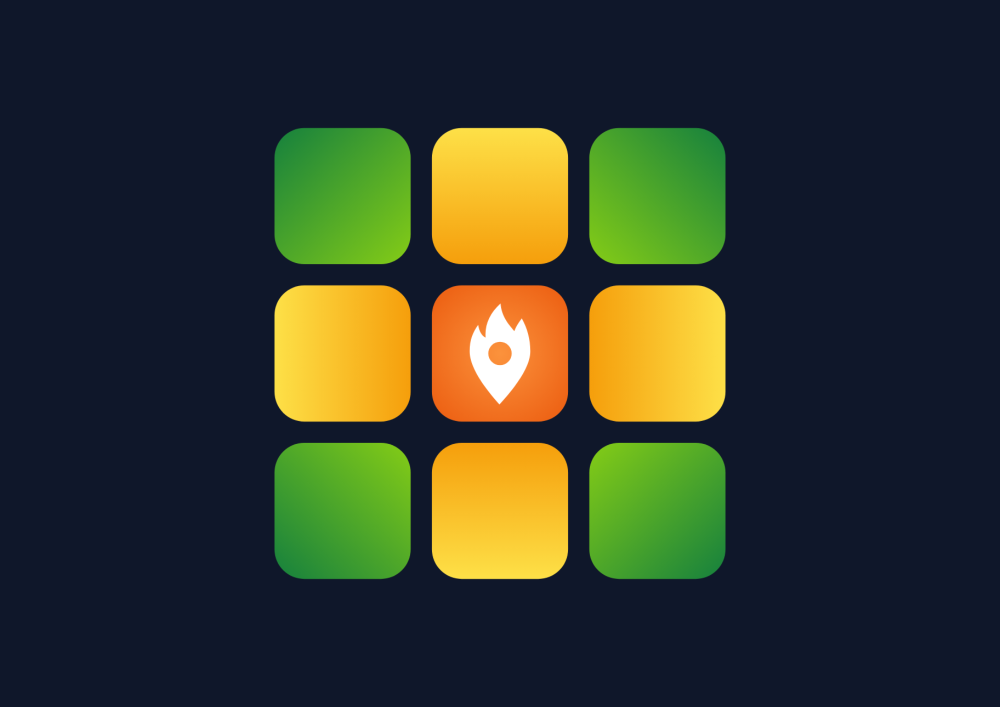

</p>

### Untuk: *Amanda Aurellia Salsabilla*

Dipersiapkan oleh:
| Informasi | Keterangan |
| --- | --- |
| Kelas | K-01 |
| Kelompok | G-08 |

| NIM | Nama |
|---|---|
| 13525022 | Muhammad Rafi Insyan Syiham Abrar |
| 13525037 | Muhammad Rafiif Ansyadya |
| 13525076 | Reinhard Mikhael Tandra |
| 13525094 | Arga Cyrano Simanjuntak |
| 13525136 | Jonathan Lewie |
---

## Daftar Perubahan

| Revisi | Deskripsi |
| :--- | :--- |
| A | Melanjutkan DPPL Tugas 7. |
| B | Operasi `isDikecualikan(titik)` pada C04 diubah menjadi `isDikecualikan(titik, titikBaru)` karena pengecekan deteksi baru dalam radius 500 m (KF15) butuh daftar titik pembanding. |

---

# BAB 1: Pendahuluan

## 1.1 Tujuan Penulisan Dokumen
DPPL ini menguraikan rancangan perangkat lunak SIGAP sebagai lanjutan dari SKPL dan APL, dengan isi berupa lingkungan implementasi, komponen, realisasi setiap use case, diagram kelas perancangan, rincian operasi dan algoritma setiap kelas, serta rancangan antarmuka. Pembacanya ada dua. Yang pertama tim pengembang (Kelompok G-08 K-01) sebagai pegangan waktu menulis kode dan menguji. Yang kedua asisten dan dosen IF2150, untuk mengecek apakah kebutuhan, rancangan, dan implementasinya terhubung sesuai dokumen.

## 1.2 Lingkup Masalah
SIGAP merupakan sistem informasi berbasis peta yang bertujuan mencegah kebakaran lahan gambut di satu wilayah percontohan setingkat kecamatan. Sistem mengolah data titik panas NASA FIRMS dan data curah hujan Open-Meteo menjadi skor risiko untuk setiap petak lahan, kemudian menggunakan skor tersebut untuk menugaskan pekerjaan pencegahan kepada relawan. Relawan mengirimkan bukti kerja yang diverifikasi oleh petugas posko, dan pengiriman itu tetap dapat dilakukan ketika perangkat sedang luring. Apabila risiko di sekitar permukiman mencapai tingkat tinggi, sistem mengirimkan peringatan SMS (disimulasikan) kepada warga yang sudah terdaftar.

## 1.3 Definisi, Istilah, dan Singkatan

Tabel 1.3. Definisi Istilah dan Singkatan

| Singkatan, Akronim, atau Istilah | Penjelasan |
| :--- | :--- |
| P/L | Perangkat Lunak. |
| SKPL | Spesifikasi Kebutuhan Perangkat Lunak, yakni dokumen yang merangkum kebutuhan yang wajib dipenuhi aplikasi. |
| APL | Arsitektur Perangkat Lunak, yakni dokumen yang menetapkan pola arsitektur, komponen, dan model arsitektur aplikasi. |
| DPPL | Deskripsi Perancangan Perangkat Lunak. |
| UC | *Use Case*. |
| KF / KNF | Kebutuhan Fungsional / Kebutuhan Non-Fungsional dalam SKPL. |
| MVC | *Model-View-Controller*, pola yang memisahkan data (*Model*), antarmuka (*View*), dan logika pengendali (*Controller*). |
| BCE | *Boundary-Control-Entity*, pola pemodelan kelas dalam SKPL. DPPL menerjemahkan *boundary* menjadi *View*, *control* menjadi *Controller*, dan *entity* menjadi *Model*. |
| PWA | *Progressive Web App*, aplikasi web yang bisa dipasang di ponsel dan sebagian fiturnya tetap berjalan saat luring berkat *Service Worker*. |
| Service Worker | Skrip peramban yang bekerja di latar belakang untuk menyimpan berkas aplikasi sehingga aplikasi tetap terbuka ketika luring. |
| IndexedDB | Basis data bawaan peramban untuk menyimpan data berukuran besar, termasuk foto, langsung di perangkat pengguna. |
| UUID | *Universally Unique Identifier*, penanda unik laporan yang dibuat di perangkat relawan agar tidak terjadi laporan ganda. |
| JWT | *JSON Web Token*, token bertanda tangan yang diterbitkan server saat login; token ini memuat peran pengguna dan masa berlaku sesi. |
| REST | Gaya komunikasi antara klien dan server melalui HTTP dengan data berformat JSON. |
| Cron eksternal | Layanan penjadwal gratis di luar P/L yang memanggil endpoint pembaruan server setiap 3 jam. |
| *Bounding box* | Kotak persegi panjang yang dibatasi lintang dan bujur minimum serta maksimum, digunakan sebagai batas petak lahan. |
| Haversine | Rumus untuk menghitung jarak antara dua koordinat pada permukaan bumi. |
| Petak Lahan, Titik Panas, Skor Risiko, Tugas Aktif, Luring | Mengikuti definisi pada Tabel 1.3 SKPL. |

## 1.4 Aturan Penomoran

Tabel 1.4. Aturan Penomoran

| Hal/Bagian | Penomoran | Keterangan |
| :--- | :--- | :--- |
| Use Case | UCXX | UC01 hingga UC08, mengacu pada SKPL subbab 4.2. |
| Kelas | CXX | C01 hingga C24, mengacu pada SKPL subbab 5.1. Kelas perancangan menggunakan ID kelas analisis yang sama. |
| Kebutuhan Fungsional | KFXX | KF01 hingga KF24, mengacu pada SKPL Tabel 3.1. |
| Kebutuhan Non-Fungsional | KNFXX | KNF01 hingga KNF12, mengacu pada SKPL Tabel 3.2. |
| Aktor | AKXX | AK01 hingga AK03, mengacu pada SKPL subbab 4.1. |
| Algoritma | Algo-XXX | Algo-001 hingga Algo-015, diurutkan menurut ID kelas pada BAB 5. |
| Query | Q-XXX | Q-001 hingga Q-030, diurutkan menurut ID kelas pada BAB 5. |
| Layar antarmuka | I-XX | I-01 hingga I-08 pada BAB 6. |
| Objek antarmuka | IXX-YY | XX adalah nomor layar dan YY nomor urut objek pada layar tersebut, misalnya I01-04. |

## 1.5 Referensi
1. Kelompok G-08 K-01. *Spesifikasi Kebutuhan Perangkat Lunak (SKPL) SIGAP*. Tugas 5, IF2150 Rekayasa Perangkat Lunak, 2026.
2. Kelompok G-08 K-01. *Arsitektur Perangkat Lunak (APL) SIGAP*. Tugas 6, IF2150 Rekayasa Perangkat Lunak, 2026.
3. Kelompok G-08 K-01. *Deskripsi Perancangan Perangkat Lunak (DPPL) SIGAP*. Tugas 7, IF2150 Rekayasa Perangkat Lunak, 2026.
4. Sommerville, I. (2016). *Software Engineering* (10th ed.). Pearson. Chapter 6: *Architectural Design*.
5. Kruchten, P. (1995). The 4+1 View Model of Architecture. *IEEE Software*, 12(6), 42–50.
6. Express. *Express documentation*. https://expressjs.com
7. node-postgres. *node-postgres documentation*. https://node-postgres.com
8. PostgreSQL. *PostgreSQL 16 Documentation*. https://www.postgresql.org/docs/16/
9. Leaflet. *Leaflet API reference*. https://leafletjs.com/reference.html
10. MDN Web Docs. *Service Worker API*, *IndexedDB API*, *Geolocation API*, dan *HTMLCanvasElement.toBlob()*. https://developer.mozilla.org/en-US/docs/Web/API

## 1.6 Deskripsi Umum Dokumen (Ikhtisar)
BAB 1 memuat tujuan, lingkup, istilah, aturan penomoran, dan referensi. BAB 2 menguraikan lingkungan implementasi, pola arsitektur acuan, identifikasi komponen, dan model arsitektur (*Logical View* serta *Physical View*) yang bersumber dari APL. BAB 3 mewujudkan setiap use case lewat identifikasi kelas, *sequence diagram* untuk tiap skenario, dan diagram kelas. BAB 4 menyajikan diagram kelas keseluruhan beserta daftar atribut dan operasinya, BAB 5 merinci operasi, atribut, algoritma, dan query setiap kelas, BAB 6 berisi rancangan antarmuka setiap layar, dan BAB 7 berisi matriks kerunutan kelas terhadap use case.

---

# BAB 2: Perancangan Arsitektur

## 2.1 Rancangan Lingkungan Implementasi

Tabel 2.1. Lingkungan Implementasi

| Aspek | Pilihan | Keterangan |
| :--- | :--- | :--- |
| *Operating system* | Pengembangan: Windows, Linux, atau macOS, menyesuaikan laptop masing-masing anggota. Server: Linux pada platform hosting. Klien petugas: Windows, Linux, atau macOS. Klien relawan: Android. | Aplikasi tidak terikat satu platform karena semua klien berjalan di peramban (SKPL subbab 2.5). |
| Bahasa pemrograman | JavaScript (ES modules) di sisi server dan klien, SQL, serta HTML dan CSS. | Satu bahasa di kedua sisi memungkinkan anggota tim saling menggantikan pengerjaan tugas. |
| Server | Node.js LTS 22 dengan Express. Pustaka yang dipakai: `pg` (koneksi PostgreSQL), `bcrypt` (hash password, KNF11), `jsonwebtoken` (sesi), dan `multer` (penerima unggahan foto). | Aplikasi berbentuk monolit tunggal yang sekaligus menyajikan berkas antarmuka untuk kedua klien. |
| Klien | HTML, CSS, dan JavaScript murni, tanpa *framework* dan tanpa proses *build*. Leaflet untuk peta (khusus klien petugas). *Service Worker* dan IndexedDB memakai API bawaan peramban. | Alasannya diuraikan di bawah tabel. |
| DBMS | PostgreSQL 16 pada layanan database gratis (Neon) untuk data di server. IndexedDB pada peramban relawan untuk laporan luring. | Layanan database sengaja dipisahkan dari hosting aplikasi (lihat catatan hosting). |
| Hosting aplikasi | Layanan web gratis (Render, paket Free) dengan HTTPS bawaan. | HTTPS wajib ada agar Geolocation API dan PWA bisa berfungsi (SKPL batasan 11). |
| Penjadwal | Layanan cron eksternal gratis yang memanggil endpoint pembaruan setiap 3 jam menggunakan token rahasia. | Mengacu pada APL subbab 3.2. |
| *Development tools* | Visual Studio Code, Git dan GitHub (repositori publik), draw.io untuk diagram, serta peramban dan `curl` untuk menguji endpoint. | Repositori bersifat publik, maka seluruh data harus fiktif (SKPL batasan 13). |
| *Filing system* | Kode tersimpan di repositori Git. Foto bukti kerja disimpan sebagai data biner (`bytea`) di PostgreSQL, bukan sebagai berkas di server. Di perangkat relawan, foto disimpan sebagai *Blob* di IndexedDB. | Berkas pada layanan hosting gratis bersifat sementara dan lenyap setiap kali server dijalankan ulang. Ukuran foto sudah dikompres hingga maksimal 500 KB (KNF09). |
| Data master dan data uji | Skrip Node.js yang mengisi akun, relawan, warga, grid petak, dan data titik panas historis FIRMS. | Mengikuti SKPL batasan 9 dan 10. Tidak tersedia halaman untuk mengelola data master. |

**Alasan tidak memakai *framework* front-end.** Antarmuka SIGAP hanya terdiri atas tujuh halaman dengan interaksi sederhana: formulir, daftar, dan satu peta. Kalau pakai *framework*, tim harus mengurus proses *build* dan belajar konsep baru, sementara kebutuhan di SKPL sebenarnya tidak sampai butuh itu. Selain itu berkas statis lebih gampang di-*cache* oleh *Service Worker* untuk fitur luring. Tampilan relawan mengikuti KNF08 yaitu tombol aksi diletakkan di bagian bawah layar, kontras minimal 4,5:1, dan target sentuh minimal 48×48 dp.

**Catatan hosting.** Layanan web gratis tertidur setelah 15 menit tanpa permintaan dan memerlukan sekitar satu menit untuk aktif lagi, karena itu tim menghidupkan server terlebih dahulu sebelum pengujian dan demo (APL subbab 3.2). Tim tidak memakai database gratis dari penyedia hosting aplikasi karena masa berlakunya terbatas. Pilihan jatuh pada Neon: paket gratisnya tanpa batas waktu dan berkapasitas 0,5 GB, cukup untuk data uji dan foto terkompres pada skala demo.

## 2.2 Style/Pattern Arsitektur Acuan

SIGAP menggabungkan pola **Client-Server** dan **MVC**, mengikuti APL BAB 1. Client-Server dipilih karena petugas posko (laptop, koneksi stabil) dan relawan (ponsel Android kelas menengah ke bawah, sinyal lemah) memakai perangkat yang berbeda jauh; pekerjaan berat seperti pengambilan data FIRMS (KF02) dan pengiriman SMS (KF16) pun dipusatkan di server. MVC dipilih untuk memisahkan antarmuka dari logika bisnis. Dengan begitu, peta Leaflet dan formulir luring bisa dikerjakan terpisah dari *backend*, dan penyimpanan lokal relawan (KF12, KF13) cukup menjadi tanggung jawab *Controller*.

Penerapan MVC dalam implementasi:

- ***View***: halaman HTML beserta modul JavaScript yang menampilkan data dan meneruskan aksi pengguna ke *Controller*.
- ***Controller***: modul penangan *route* Express di server, ditambah modul JavaScript di PWA relawan untuk fungsi luring (bagian klien dari `DaftarTugasController`, `UploadLaporanController`, dan `AutentikasiController`).
- ***Model***: modul yang membungkus data dan aturan setiap entitas, termasuk kueri SQL ke PostgreSQL lewat `pg`. *View* tidak pernah membaca *Model* secara langsung; data tiba di *View* sebagai JSON dari *Controller* melalui HTTPS.

<p align="center">
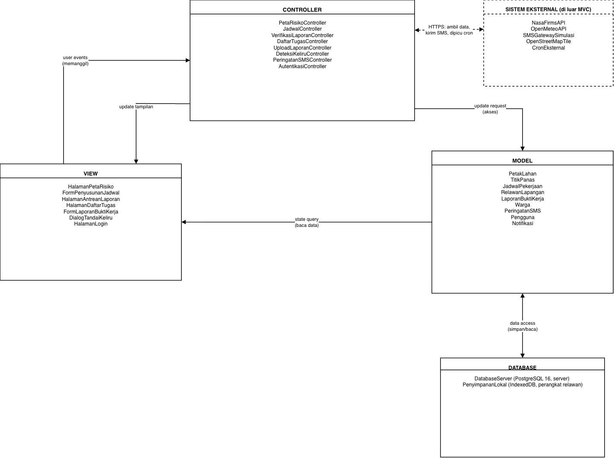
</p>
<p align="center">
<i>Gambar 1. Arsitektur MVC pada P/L SIGAP</i>
</p>

<p align="center">

</p>
<p align="center">
<i>Gambar 2. Arsitektur Client-Server pada P/L SIGAP</i>
</p>

## 2.3 Identifikasi Komponen / Modul / Subsistem

Tabel 2.3. Identifikasi Komponen/Modul/Subsistem

| Nama Komponen/Modul/Subsistem | Jenis | Penjelasan |
| :--- | :--- | :--- |
| `HalamanLogin` | View | Formulir masuk bagi petugas dan relawan, berikut pesan ketika login gagal. |
| `HalamanPetaRisiko` | View | Peta risiko per petak untuk petugas. Halaman ini memuat waktu pembaruan, keterangan cache, atribusi sumber data, pernyataan batasan skor, dan notifikasi petugas. |
| `FormPenyusunanJadwal` | View | Formulir penyusunan jadwal; menampilkan daftar relawan aktif, rekomendasi petak, dan pesan ketika kapasitas penuh. |
| `HalamanAntreanLaporan` | View | Antrean serta detail laporan bukti kerja yang menunggu verifikasi, lengkap dengan peringatan jarak. |
| `HalamanDaftarTugas` | View | Daftar dan detail tugas relawan, penanda luring, formulir pembatalan, serta notifikasi relawan. |
| `FormLaporanBuktiKerja` | View | Formulir laporan untuk mengambil foto, mengisi koordinat GPS, dan menampilkan peringatan bila GPS mati. |
| `DialogTandaiKeliru` | View | Formulir keterangan untuk menandai sebuah titik panas sebagai deteksi keliru. |
| `AutentikasiController` | Controller | Memverifikasi kredensial, menerbitkan dan memeriksa token sesi, lalu mengarahkan pengguna sesuai perannya. Bagian klien mengecek masa berlaku token ketika luring. |
| `PetaRisikoController` | Controller | Menerima pemicu cron, mengambil data titik panas dan curah hujan, menghitung skor, dan menyimpan hasilnya. Jika pengambilan data gagal, controller ini memakai cache. Ia juga memicu pengecekan ambang SMS dan menyediakan data peta serta notifikasi petugas. |
| `JadwalController` | Controller | Menyusun rekomendasi petak, memvalidasi batas 3 tugas aktif per relawan, menyimpan jadwal, dan membuat notifikasi penugasan. |
| `VerifikasiLaporanController` | Controller | Menghitung jarak laporan terhadap batas petak, memproses persetujuan atau penolakan, mengunci laporan, memperbarui status tugas, dan membuat notifikasi untuk relawan. |
| `DaftarTugasController` | Controller | Mengambil tugas relawan dengan urutan berdasarkan skor petak, memproses pembatalan tugas, dan membuat notifikasi untuk petugas. Bagian klien menyimpan salinan tugas di IndexedDB. |
| `UploadLaporanController` | Controller | Bagian klien membuat UUID, mengompres foto, mendeteksi koneksi, menyimpan laporan saat luring, dan menyinkronkannya kemudian. Bagian server menerima laporan, menolak UUID ganda, dan mengubah status tugas. |
| `DeteksiKeliruController` | Controller | Memvalidasi keterangan dan mengubah status titik panas menjadi keliru. |
| `PeringatanSMSController` | Controller | Mengecek petak yang naik ke tingkat tinggi beserta batas 24 jam, mengirim SMS (simulasi) kepada warga yang persetujuannya masih aktif, memproses balasan STOP, dan menghapus nomor yang sudah dicabut. |
| `PetakLahan` | Model | Batas wilayah (*bounding box*), skor, tingkat risiko, dan waktu pembaruan terakhir untuk satu petak. |
| `TitikPanas` | Model | Titik panas dari FIRMS beserta status validitas dan keterangan penandaan keliru. |
| `JadwalPekerjaan` | Model | Satu tugas pencegahan, dengan data jenis pekerjaan, status, tanggal, dan alasan pembatalan. |
| `RelawanLapangan` | Model | Identitas, kontak, dan status keaktifan relawan. |
| `LaporanBuktiKerja` | Model | UUID, foto, koordinat unggahan, jarak ke petak, status verifikasi, dan waktu verifikasi. |
| `Warga` | Model | Nomor HP penerima SMS, status persetujuan, dan waktu pencabutan. |
| `PeringatanSMS` | Model | Log pengiriman SMS yang mencatat isi pesan, waktu kirim, dan status. |
| `Pengguna` | Model | Akun berisi username, hash password, dan peran. |
| `Notifikasi` | Model | Notifikasi dalam aplikasi, berisi isi pesan, waktu pembuatan, dan status sudah dibaca. |
| `DatabaseServer` | Penyimpanan Data | PostgreSQL 16 yang menampung seluruh data *Model* di server. |
| `PenyimpananLokal` | Penyimpanan Data | IndexedDB di perangkat relawan untuk menyimpan salinan tugas dan laporan luring. |
| `NasaFirmsAPI` | Integrasi Eksternal | Sumber data titik panas (NASA FIRMS Area API). |
| `OpenMeteoAPI` | Integrasi Eksternal | Sumber data curah hujan harian, termasuk data beberapa hari sebelumnya. |
| `SMSGatewaySimulasi` | Integrasi Eksternal | Gateway SMS tiruan yang mencatat log pengiriman dan meneruskan balasan STOP dari halaman simulasi. |
| `OpenStreetMapTile` | Integrasi Eksternal | Penyedia *tile* peta dasar yang dimuat langsung oleh peramban petugas. |
| `CronEksternal` | Integrasi Eksternal | Penjadwal yang memanggil endpoint pembaruan server setiap 3 jam. |

## 2.4 Model Arsitektur Perangkat Lunak

Model arsitektur ini menggunakan dua *view* dari model 4+1 (Kruchten, 1995) sebagaimana ditetapkan APL BAB 3. *Process View* dan *Development View* tidak dibuat: alur dinamis setiap fitur sudah dijelaskan oleh *sequence diagram* di BAB 3, dan kedua *view* di bawah telah melingkupi semua komponen.

### 2.4.1 Logical View

*Logical View* dipilih karena memperlihatkan pembagian tanggung jawab antarkomponen menurut MVC, sehingga setiap kebutuhan SKPL dapat dilacak ke satu *View*, satu *Controller*, dan *Model* yang diaksesnya. Ada dua hal yang agak beda di diagram ini: `PetaRisikoController` juga dipanggil oleh `CronEksternal` (bukan cuma dari *View*), dan `PeringatanSMSController` tidak punya *View* sama sekali karena warga memang tidak membuka antarmuka apa pun (AK03).

<p align="center">

</p>
<p align="center">
<i>Gambar 3. Logical View SIGAP</i>
</p>

Tabel 2.4.1. Pemanggil dan *Model* yang Diakses Tiap *Controller*

| *Controller* | Dipanggil oleh | *Model* yang diakses | Komponen lain |
| :--- | :--- | :--- | :--- |
| `PetaRisikoController` | `HalamanPetaRisiko`, `CronEksternal` | `PetakLahan`, `TitikPanas`, `Notifikasi` | `NasaFirmsAPI`, `OpenMeteoAPI`, memicu `PeringatanSMSController` |
| `PeringatanSMSController` | `PetaRisikoController`, `SMSGatewaySimulasi` (balasan STOP) | `Warga`, `PeringatanSMS`, `PetakLahan` (baca) | `SMSGatewaySimulasi` |
| `JadwalController` | `FormPenyusunanJadwal` | `JadwalPekerjaan`, `RelawanLapangan`, `PetakLahan` (baca), `Notifikasi` | - |
| `VerifikasiLaporanController` | `HalamanAntreanLaporan` | `LaporanBuktiKerja`, `JadwalPekerjaan`, `PetakLahan` (baca), `Pengguna` (baca), `Notifikasi` | - |
| `DaftarTugasController` | `HalamanDaftarTugas` | `JadwalPekerjaan`, `PetakLahan` (baca), `Notifikasi`, `Pengguna` (baca) | `PenyimpananLokal` |
| `UploadLaporanController` | `FormLaporanBuktiKerja` | `LaporanBuktiKerja`, `JadwalPekerjaan` | `PenyimpananLokal` |
| `DeteksiKeliruController` | `DialogTandaiKeliru` | `TitikPanas` | - |
| `AutentikasiController` | `HalamanLogin` | `Pengguna` | - |

### 2.4.2 Physical View

*Physical View* dipilih karena pembagian node pada pola Client-Server menjadi inti lingkungan operasi, yaitu klien petugas, klien relawan, server aplikasi, dan server basis data. *View* ini juga memperlihatkan bahwa sebagian *Controller* berjalan di perangkat relawan agar fitur luring tetap hidup.

<p align="center">
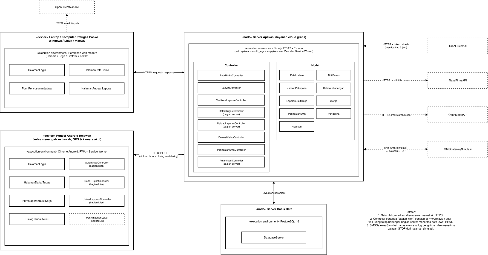
</p>
<p align="center">
<i>Gambar 4. Physical View SIGAP</i>
</p>

Tabel 2.4.2. Penempatan Komponen pada Node

| Node | Lingkungan eksekusi | Komponen |
| :--- | :--- | :--- |
| Laptop petugas posko | Peramban modern (Chrome, Edge, Firefox) dengan Leaflet | `HalamanLogin`, `HalamanPetaRisiko`, `FormPenyusunanJadwal`, `HalamanAntreanLaporan` |
| Ponsel Android relawan | Chrome Android, PWA dengan *Service Worker* | `HalamanLogin`, `HalamanDaftarTugas`, `FormLaporanBuktiKerja`, `DialogTandaiKeliru`, `PenyimpananLokal`, bagian klien dari `AutentikasiController`, `DaftarTugasController`, `UploadLaporanController` |
| Server aplikasi | Node.js LTS 22 + Express (hosting gratis) | Delapan *Controller* dan sembilan *Model* (bagian server dari ketiga *Controller* di atas juga berada di sini) |
| Server basis data | PostgreSQL 16 | `DatabaseServer` |
| Sistem eksternal | Di luar P/L | `CronEksternal`, `NasaFirmsAPI`, `OpenMeteoAPI`, `SMSGatewaySimulasi`, `OpenStreetMapTile` |

Dari *view* ini ada beberapa keputusan rancangan:

1. **Monolit modular.** Semua *Controller* dan *Model* berjalan dalam satu proses Express yang sekaligus menyajikan berkas antarmuka kedua klien, jadi hanya satu layanan yang perlu dideploy.
2. ***Controller* terbelah antara klien dan server.** Logika luring (UUID, kompresi foto, penyimpanan lokal, pemeriksaan masa berlaku token) berjalan di PWA. Penerimaan data, penolakan UUID ganda (KNF03), dan penerbitan token berjalan di server.
3. **Sesi memakai JWT** dengan masa berlaku 7 hari sejak login, sehingga perangkat dapat memeriksa masa berlakunya sendiri saat luring (KF20).
4. **Endpoint pembaruan dilindungi token rahasia.** Token tersebut dan MAP_KEY FIRMS disimpan sebagai *environment variable* di server dan tidak ikut masuk repositori publik.
5. **API eksternal hanya dipanggil dari server.** Satu-satunya pengecualian adalah *tile* peta, yang dimuat langsung oleh peramban petugas.
6. **Penanda prototipe.** Antarmuka menampilkan tulisan "Prototipe: data historis dan SMS disimulasikan".

---

# BAB 3: Realisasi Use Case

Setiap skenario normal dan alternatif pada SKPL subbab 4.4 digambarkan sebagai satu *sequence diagram*. Beberapa catatan supaya diagram di bab ini lebih mudah dibaca:

1. Setiap pesan antarkelas memakai nama metode yang tercantum pada kelas tujuan di diagram kelas use case yang sama dan di Tabel 4.1. Pesan dari aktor ke *boundary* ditulis sebagai aksi pengguna, bukan nama metode.
2. `DaftarTugasController`, `UploadLaporanController`, dan `AutentikasiController` berjalan sebagian di PWA relawan dan sebagian di server (subbab 2.4.2), sehingga digambar sebagai dua *lifeline*, `klien:` dan `server:`, dari kelas yang sama.
3. `PenyimpananLokal` (IndexedDB), `NasaFirmsAPI`, `OpenMeteoAPI`, dan `SMSGatewaySimulasi` muncul sebagai *lifeline* komponen, bukan kelas, sesuai Tabel 2.3. Pemicu dari `CronEksternal` digambar sebagai *found message* karena pengirimnya berada di luar P/L.
4. Fragmen `alt`, `opt`, dan `loop` dipakai untuk percabangan dan perulangan, sedangkan `ref` merujuk langkah yang sudah digambar pada diagram lain agar tidak diulang.
5. Nilai status yang dipakai pada *guard* dan pesan: status tugas `ditugaskan`, `menunggu verifikasi`, `selesai`, `dibatalkan`; status laporan `menunggu verifikasi`, `terverifikasi`, `ditolak`; status titik panas `valid`, `keliru`; status persetujuan warga `aktif`, `dicabut`; status SMS `terkirim`, `gagal`.
6. Tipe data pada diagram kelas memakai nama tipe JavaScript (`String`, `Number`, `Boolean`, `Date`, `Object`, `Blob`, `File`). `PetakLahan[]` berarti array berisi objek `PetakLahan`. Operasi *Model* dan sebagian operasi *Controller* bersifat `async` di kode; tipe kembalian yang ditulis adalah nilai setelah `await`.
## 3.1 Use Case 01: *Memantau Peta Risiko Kebakaran*

**ID Use Case:** *UC01*  
**Nama Use Case:** *Memantau Peta Risiko Kebakaran*

### 3.1.1 Identifikasi Kelas

Tabel 3.1. Identifikasi Kelas Use Case UC01

| No | Nama Kelas Perancangan | Nama Kelas Analisis Terkait |
|:--- | :--- | :--- |
| 1 | `HalamanPetaRisiko` | `HalamanPetaRisiko` |
| 2 | `PetaRisikoController` | `PetaRisikoController` |
| 3 | `PetakLahan` | `PetakLahan` |
| 4 | `TitikPanas` | `TitikPanas` |
|||

### 3.1.2 Sequence Diagram

Diagram UC01 memuat dua bagian, yaitu pembaruan skor oleh `CronEksternal` setiap 3 jam (KF02) dan pembukaan peta oleh petugas (KF01). Data dianggap belum diperbarui (KF04) bila `waktuUpdateTerakhir` lebih tua dari 3 jam, yaitu satu siklus pembaruan. Pengecekannya ada di `isDataUsang()`, jadi server tidak perlu menyimpan status gagal secara terpisah.

- **Skenario Normal**

<p align="center">
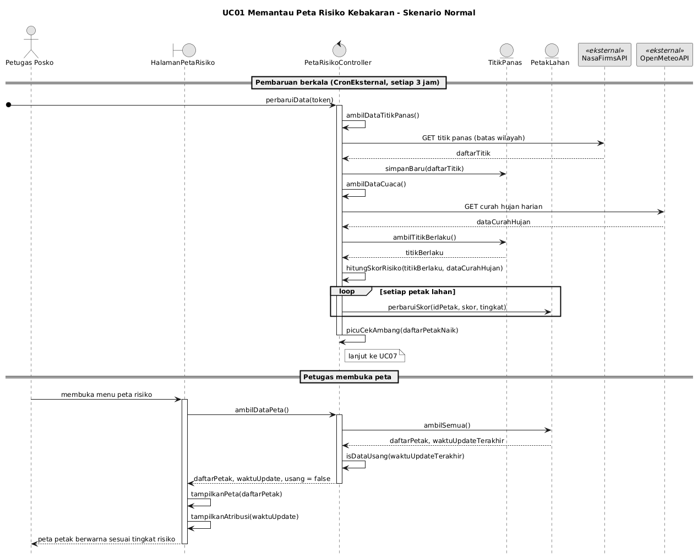
</p>
<p align="center">
<i>Gambar 5. Sequence Diagram UC01</i>
</p>

- **Skenario Alternatif 1: Pembaruan data terakhir gagal**

<p align="center">
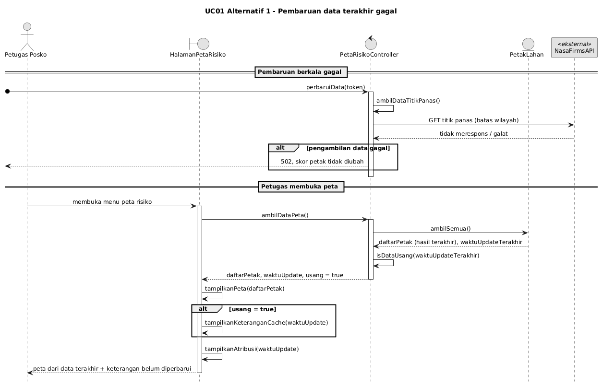
</p>
<p align="center">
<i>Gambar 6. Sequence Diagram UC01 - Pembaruan data terakhir gagal</i>
</p>

### 3.1.3 Diagram Kelas

<p align="center">
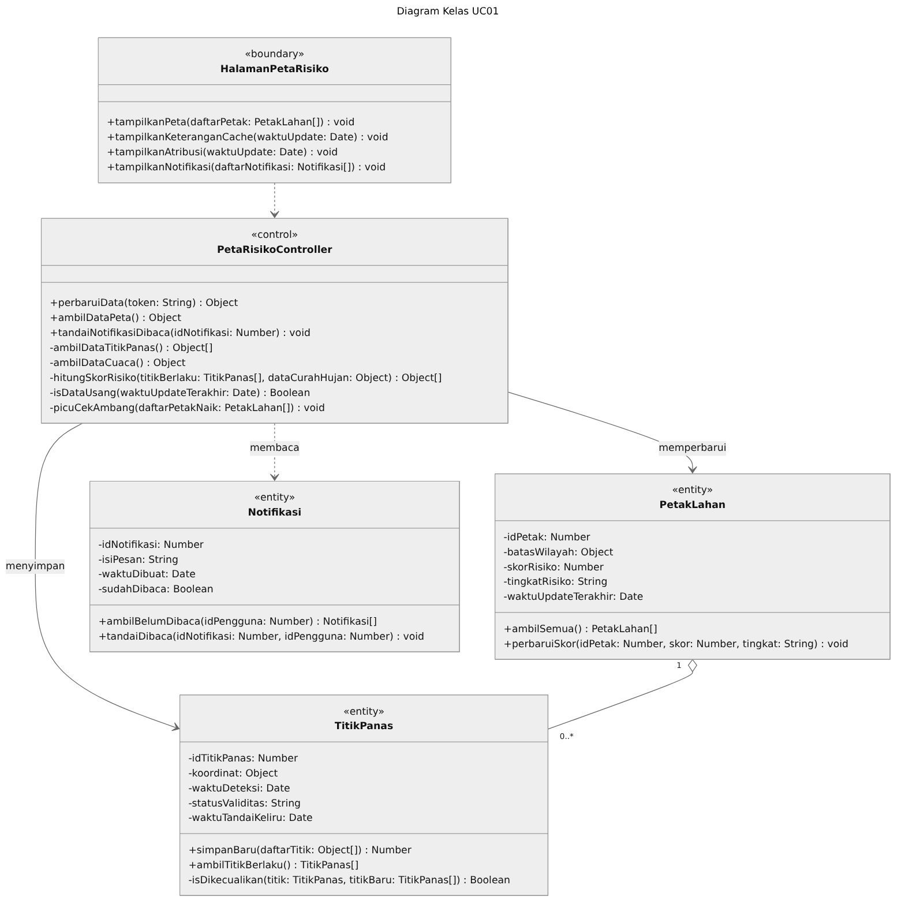
</p>
<p align="center">
<i>Gambar 7. Diagram Kelas UC01</i>
</p>

## 3.2 Use Case 02: *Menyusun dan Menugaskan Jadwal Pencegahan*

**ID Use Case:** *UC02*  
**Nama Use Case:** *Menyusun dan Menugaskan Jadwal Pencegahan*

### 3.2.1 Identifikasi Kelas

Tabel 3.2. Identifikasi Kelas Use Case UC02

| No | Nama Kelas Perancangan | Nama Kelas Analisis Terkait |
|:--- | :--- | :--- |
| 1 | `FormPenyusunanJadwal` | `FormPenyusunanJadwal` |
| 2 | `JadwalController` | `JadwalController` |
| 3 | `JadwalPekerjaan` | `JadwalPekerjaan` |
| 4 | `RelawanLapangan` | `RelawanLapangan` |
| 5 | `PetakLahan` | `PetakLahan` |
| 6 | `Notifikasi` | `Notifikasi` |
|||

### 3.2.2 Sequence Diagram

- **Skenario Normal**

<p align="center">
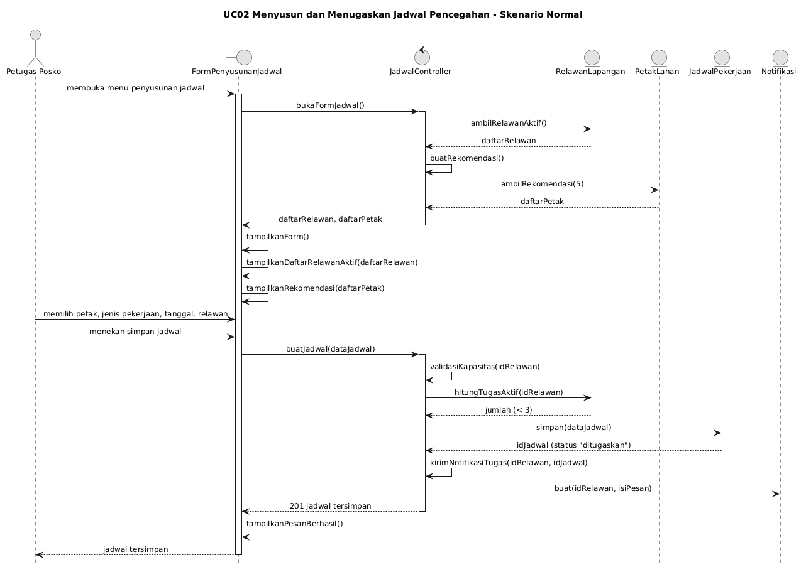
</p>
<p align="center">
<i>Gambar 8. Sequence Diagram UC02</i>
</p>

- **Skenario Alternatif 1: Kapasitas relawan penuh**

<p align="center">
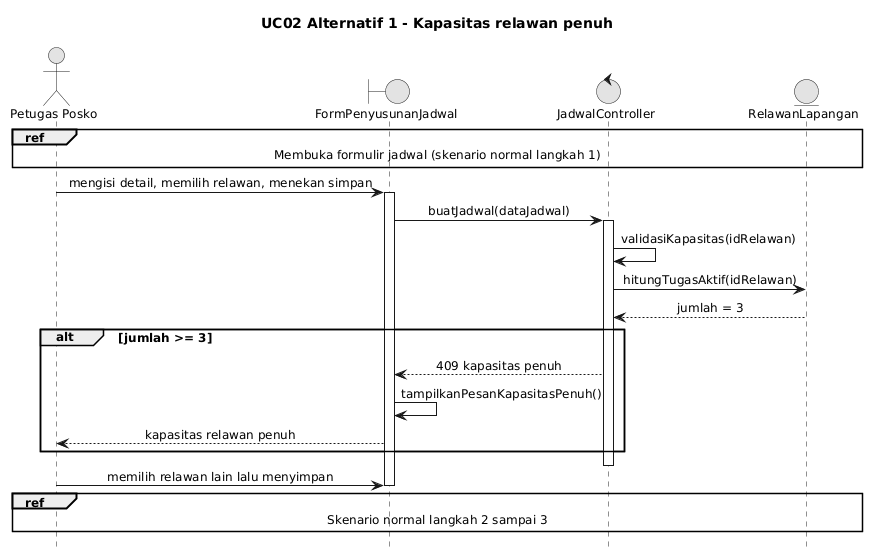
</p>
<p align="center">
<i>Gambar 9. Sequence Diagram UC02 - Kapasitas relawan penuh</i>
</p>

### 3.2.3 Diagram Kelas

<p align="center">
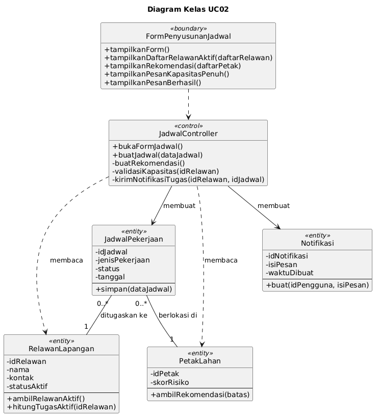
</p>
<p align="center">
<i>Gambar 10. Diagram Kelas UC02</i>
</p>

## 3.3 Use Case 03: *Memverifikasi Laporan Bukti Kerja*

**ID Use Case:** *UC03*  
**Nama Use Case:** *Memverifikasi Laporan Bukti Kerja*

### 3.3.1 Identifikasi Kelas

Tabel 3.3. Identifikasi Kelas Use Case UC03

| No | Nama Kelas Perancangan | Nama Kelas Analisis Terkait |
|:--- | :--- | :--- |
| 1 | `HalamanAntreanLaporan` | `HalamanAntreanLaporan` |
| 2 | `VerifikasiLaporanController` | `VerifikasiLaporanController` |
| 3 | `LaporanBuktiKerja` | `LaporanBuktiKerja` |
| 4 | `JadwalPekerjaan` | `JadwalPekerjaan` |
| 5 | `PetakLahan` | `PetakLahan` |
| 6 | `Pengguna` | `Pengguna` |
| 7 | `Notifikasi` | `Notifikasi` |
|||

### 3.3.2 Sequence Diagram

- **Skenario Normal**

<p align="center">
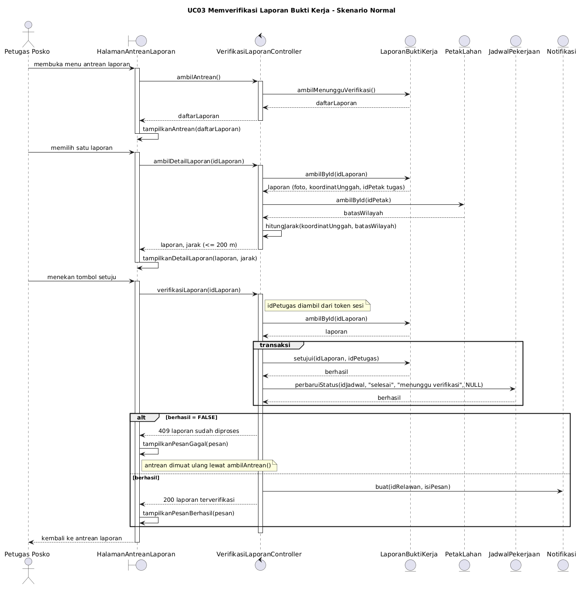
</p>
<p align="center">
<i>Gambar 11. Sequence Diagram UC03</i>
</p>

- **Skenario Alternatif 1: Jarak koordinat melebihi 200 meter**

<p align="center">
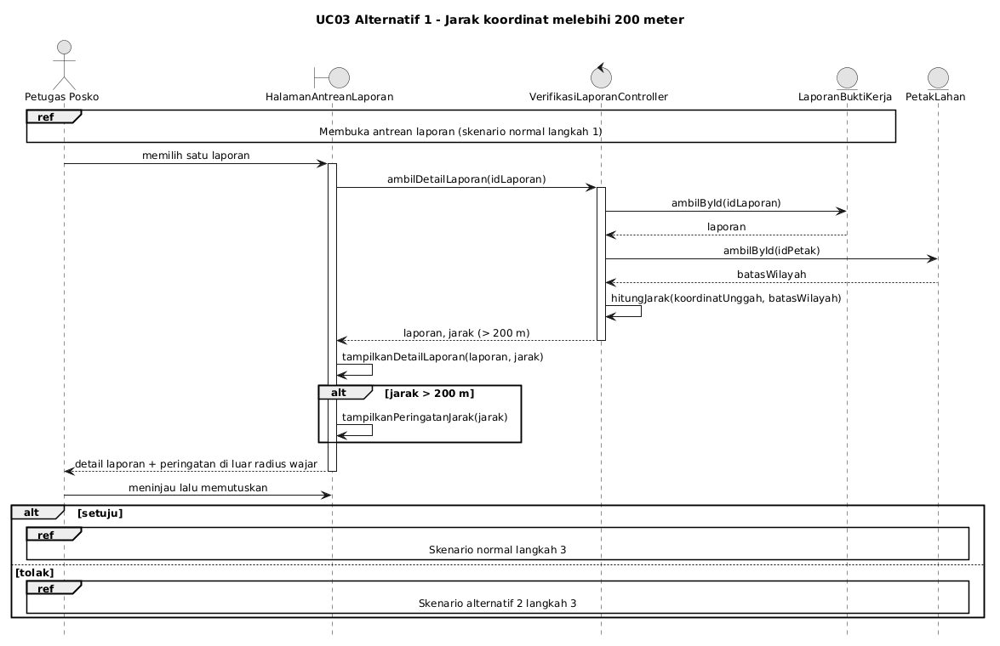
</p>
<p align="center">
<i>Gambar 12. Sequence Diagram UC03 - Jarak koordinat melebihi 200 meter</i>
</p>

- **Skenario Alternatif 2: Petugas menolak laporan**

<p align="center">
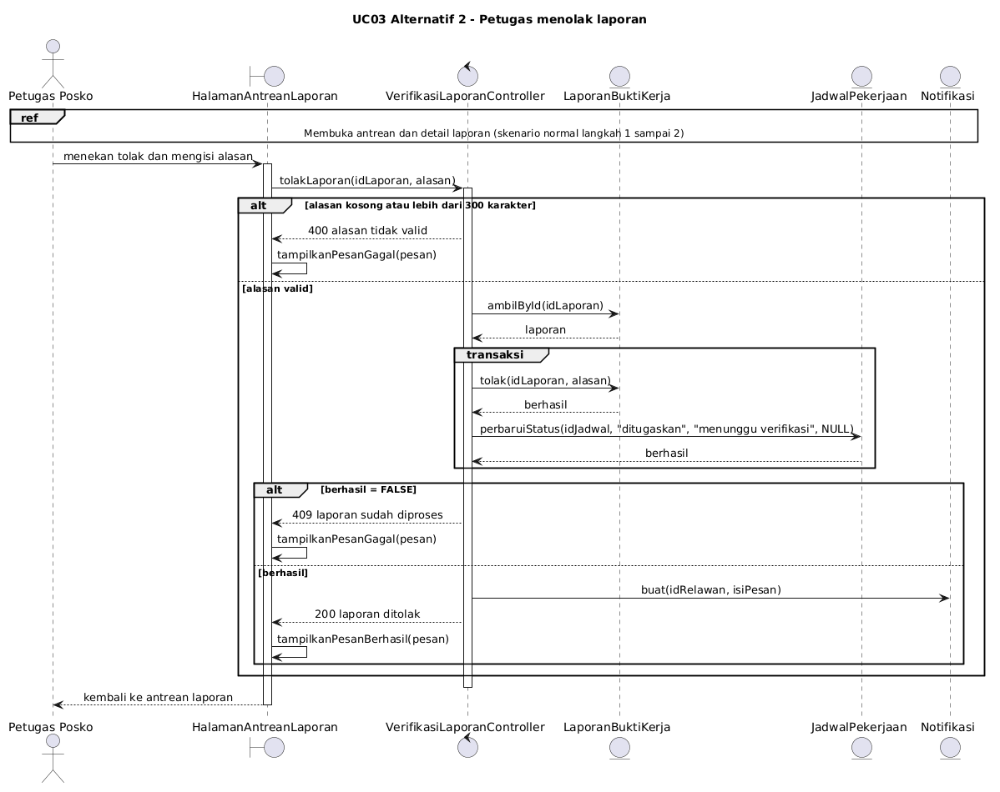
</p>
<p align="center">
<i>Gambar 13. Sequence Diagram UC03 - Petugas menolak laporan</i>
</p>

- **Skenario Alternatif 3: Tidak ada laporan pada antrean**

<p align="center">
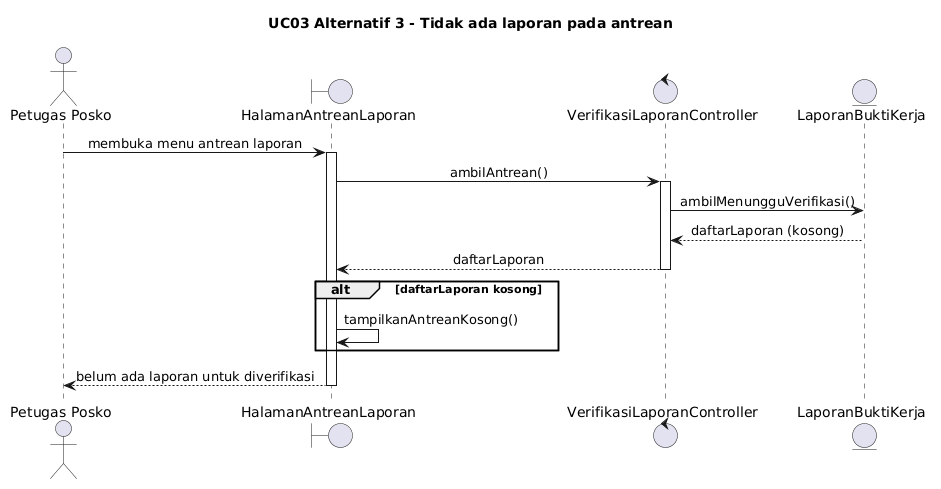
</p>
<p align="center">
<i>Gambar 14. Sequence Diagram UC03 - Tidak ada laporan pada antrean</i>
</p>

### 3.3.3 Diagram Kelas

<p align="center">
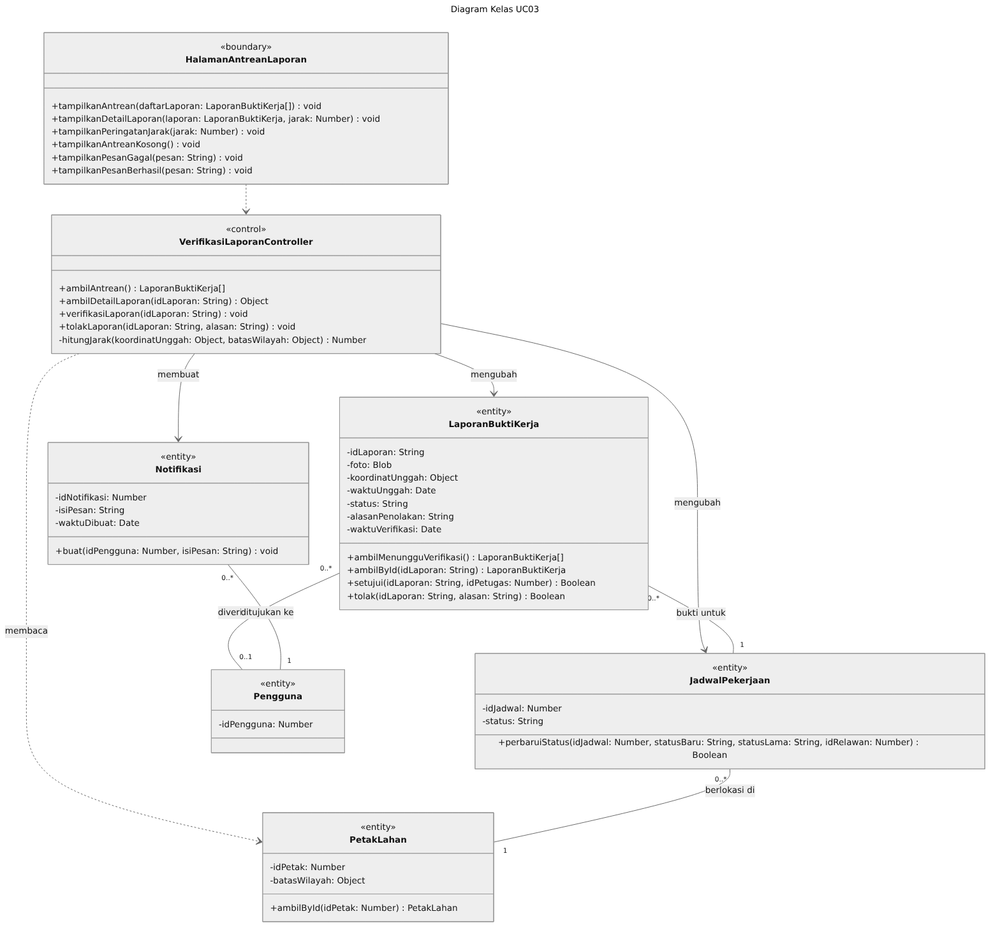
</p>
<p align="center">
<i>Gambar 15. Diagram Kelas UC03</i>
</p>

## 3.4 Use Case 04: *Melihat Daftar Tugas Prioritas*

**ID Use Case:** *UC04*  
**Nama Use Case:** *Melihat Daftar Tugas Prioritas*

### 3.4.1 Identifikasi Kelas

Tabel 3.4. Identifikasi Kelas Use Case UC04

| No | Nama Kelas Perancangan | Nama Kelas Analisis Terkait |
|:--- | :--- | :--- |
| 1 | `HalamanDaftarTugas` | `HalamanDaftarTugas` |
| 2 | `DaftarTugasController` | `DaftarTugasController` |
| 3 | `JadwalPekerjaan` | `JadwalPekerjaan` |
| 4 | `PetakLahan` | `PetakLahan` |
| 5 | `Pengguna` | `Pengguna` |
| 6 | `Notifikasi` | `Notifikasi` |
|||

### 3.4.2 Sequence Diagram

- **Skenario Normal**

<p align="center">
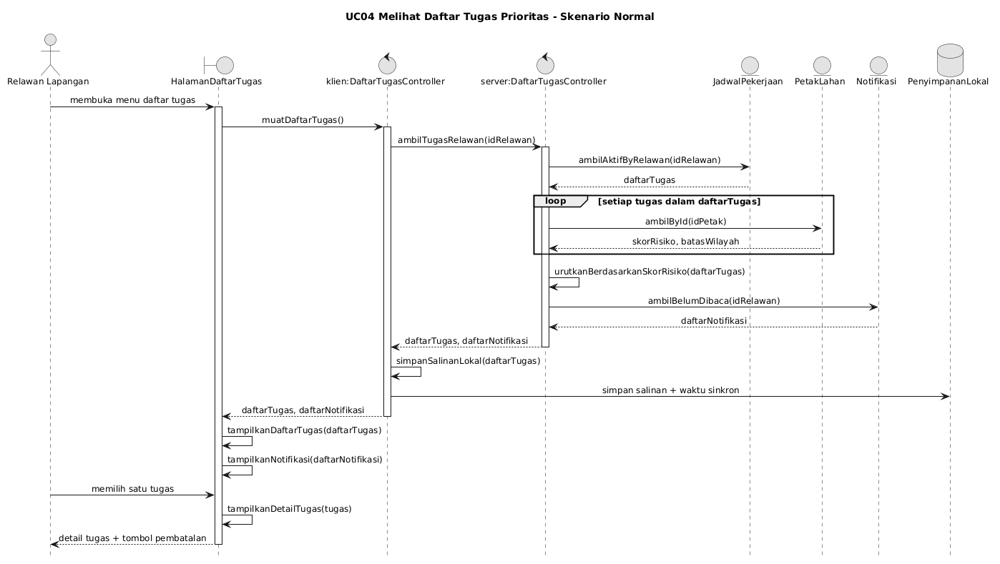
</p>
<p align="center">
<i>Gambar 16. Sequence Diagram UC04</i>
</p>

- **Skenario Alternatif 1: Perangkat luring**

<p align="center">
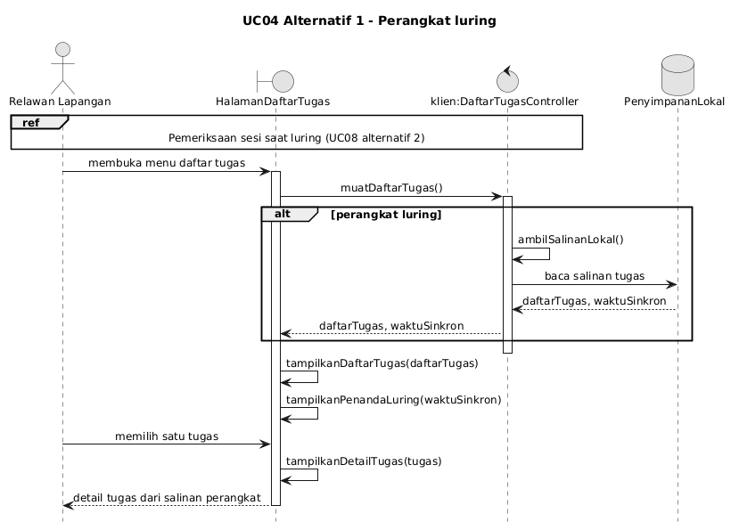
</p>
<p align="center">
<i>Gambar 17. Sequence Diagram UC04 - Perangkat luring</i>
</p>

- **Skenario Alternatif 2: Belum ada tugas**

<p align="center">
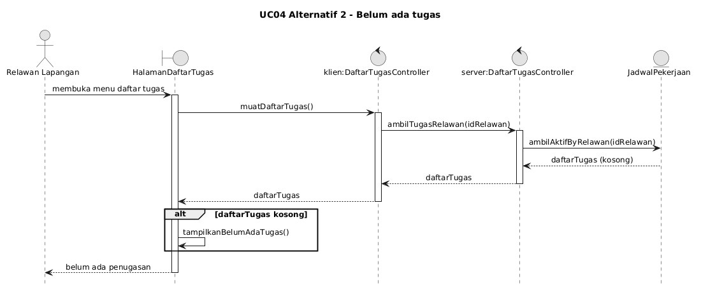
</p>
<p align="center">
<i>Gambar 18. Sequence Diagram UC04 - Belum ada tugas</i>
</p>

- **Skenario Alternatif 3: Relawan membatalkan tugas karena kondisi tidak aman**

<p align="center">
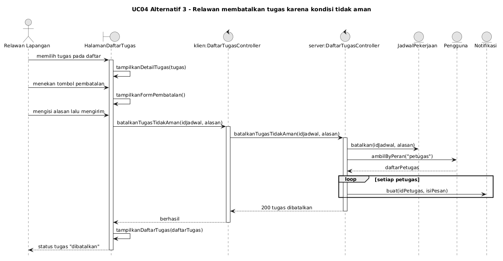
</p>
<p align="center">
<i>Gambar 19. Sequence Diagram UC04 - Relawan membatalkan tugas karena kondisi tidak aman</i>
</p>

### 3.4.3 Diagram Kelas

<p align="center">
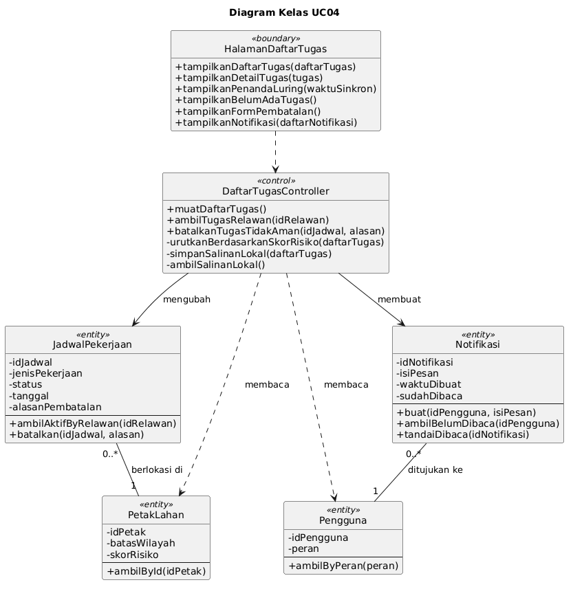
</p>
<p align="center">
<i>Gambar 20. Diagram Kelas UC04</i>
</p>

## 3.5 Use Case 05: *Mengunggah Laporan Bukti Kerja*

**ID Use Case:** *UC05*  
**Nama Use Case:** *Mengunggah Laporan Bukti Kerja*

### 3.5.1 Identifikasi Kelas

Tabel 3.5. Identifikasi Kelas Use Case UC05

| No | Nama Kelas Perancangan | Nama Kelas Analisis Terkait |
|:--- | :--- | :--- |
| 1 | `FormLaporanBuktiKerja` | `FormLaporanBuktiKerja` |
| 2 | `UploadLaporanController` | `UploadLaporanController` |
| 3 | `LaporanBuktiKerja` | `LaporanBuktiKerja` |
| 4 | `JadwalPekerjaan` | `JadwalPekerjaan` |
|||

### 3.5.2 Sequence Diagram

- **Skenario Normal**

<p align="center">
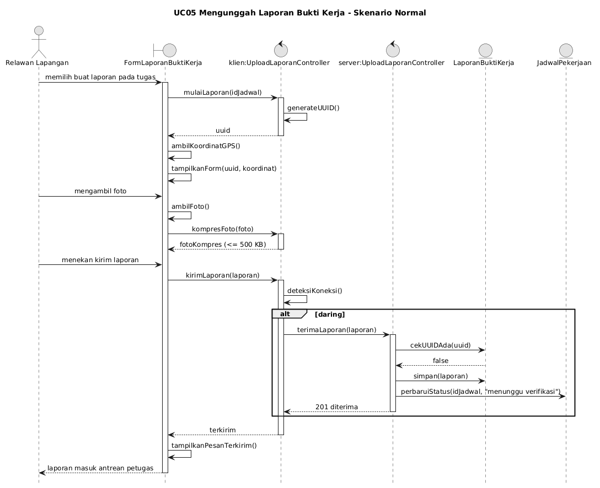
</p>
<p align="center">
<i>Gambar 21. Sequence Diagram UC05</i>
</p>

- **Skenario Alternatif 1: Perangkat tidak terhubung ke internet**

<p align="center">
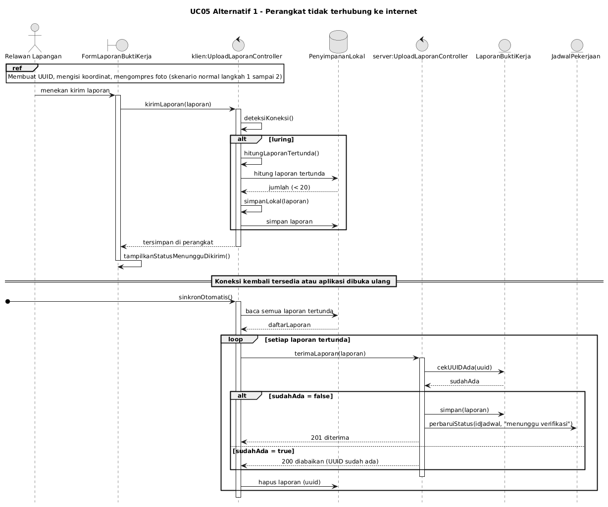
</p>
<p align="center">
<i>Gambar 22. Sequence Diagram UC05 - Perangkat tidak terhubung ke internet</i>
</p>

- **Skenario Alternatif 2: GPS perangkat belum dinyalakan**

<p align="center">
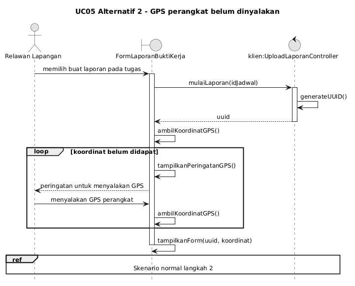
</p>
<p align="center">
<i>Gambar 23. Sequence Diagram UC05 - GPS perangkat belum dinyalakan</i>
</p>

- **Skenario Alternatif 3: Penyimpanan lokal penuh**

<p align="center">
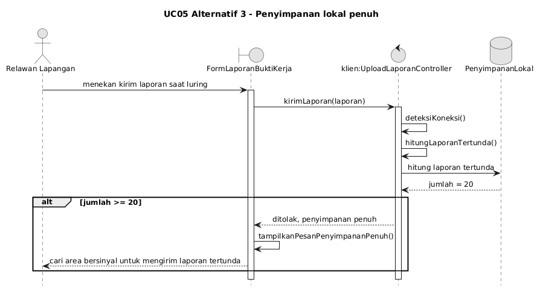
</p>
<p align="center">
<i>Gambar 24. Sequence Diagram UC05 - Penyimpanan lokal penuh</i>
</p>

### 3.5.3 Diagram Kelas

<p align="center">

</p>
<p align="center">
<i>Gambar 25. Diagram Kelas UC05</i>
</p>

## 3.6 Use Case 06: *Menandai Titik Panas sebagai Deteksi Keliru*

**ID Use Case:** *UC06*  
**Nama Use Case:** *Menandai Titik Panas sebagai Deteksi Keliru*

### 3.6.1 Identifikasi Kelas

Tabel 3.6. Identifikasi Kelas Use Case UC06

| No | Nama Kelas Perancangan | Nama Kelas Analisis Terkait |
|:--- | :--- | :--- |
| 1 | `DialogTandaiKeliru` | `DialogTandaiKeliru` |
| 2 | `DeteksiKeliruController` | `DeteksiKeliruController` |
| 3 | `TitikPanas` | `TitikPanas` |
|||

### 3.6.2 Sequence Diagram

- **Skenario Normal**

<p align="center">
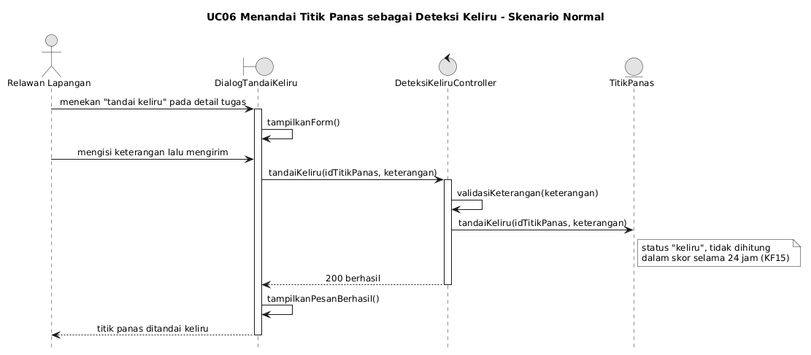
</p>
<p align="center">
<i>Gambar 26. Sequence Diagram UC06</i>
</p>

- **Skenario Alternatif 1: Relawan tidak mengisi kolom keterangan**

<p align="center">
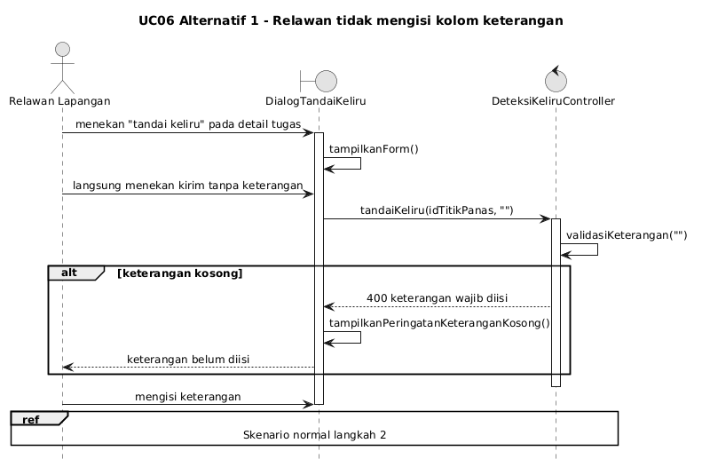
</p>
<p align="center">
<i>Gambar 27. Sequence Diagram UC06 - Relawan tidak mengisi kolom keterangan</i>
</p>

### 3.6.3 Diagram Kelas

<p align="center">
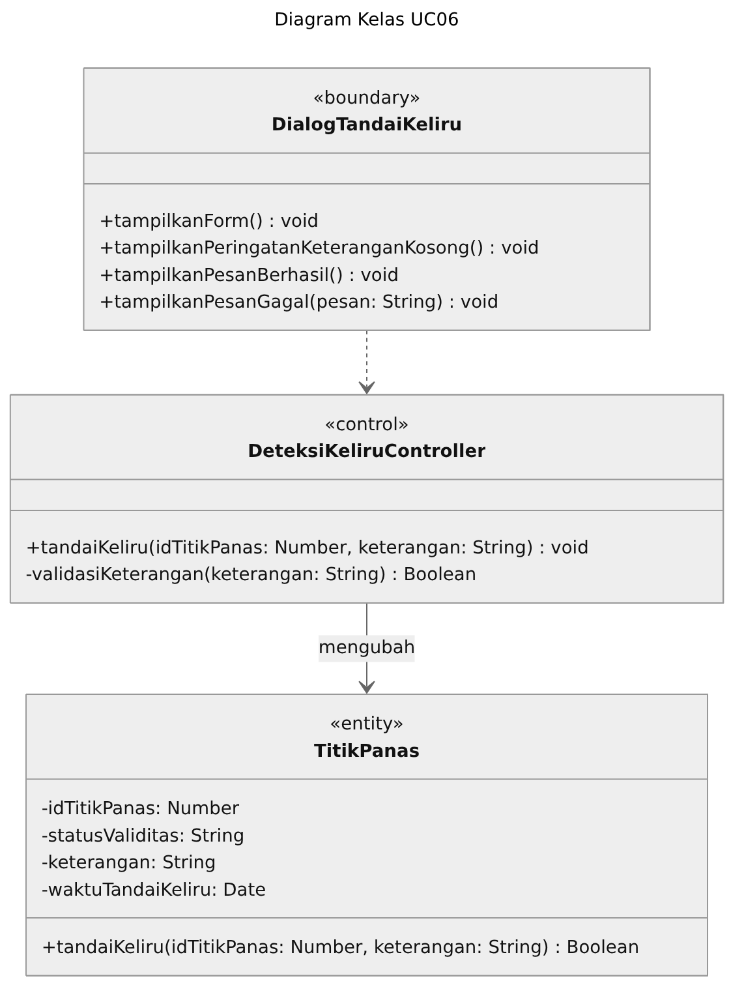
</p>
<p align="center">
<i>Gambar 28. Diagram Kelas UC06</i>
</p>

## 3.7 Use Case 07: *Menerima Peringatan Dini via SMS*

**ID Use Case:** *UC07*  
**Nama Use Case:** *Menerima Peringatan Dini via SMS*

### 3.7.1 Identifikasi Kelas

Tabel 3.7. Identifikasi Kelas Use Case UC07

| No | Nama Kelas Perancangan | Nama Kelas Analisis Terkait |
|:--- | :--- | :--- |
| 1 | `PetaRisikoController` | `PetaRisikoController` |
| 2 | `PeringatanSMSController` | `PeringatanSMSController` |
| 3 | `Warga` | `Warga` |
| 4 | `PeringatanSMS` | `PeringatanSMS` |
| 5 | `PetakLahan` | `PetakLahan` |
|||

### 3.7.2 Sequence Diagram

- **Skenario Normal**

<p align="center">
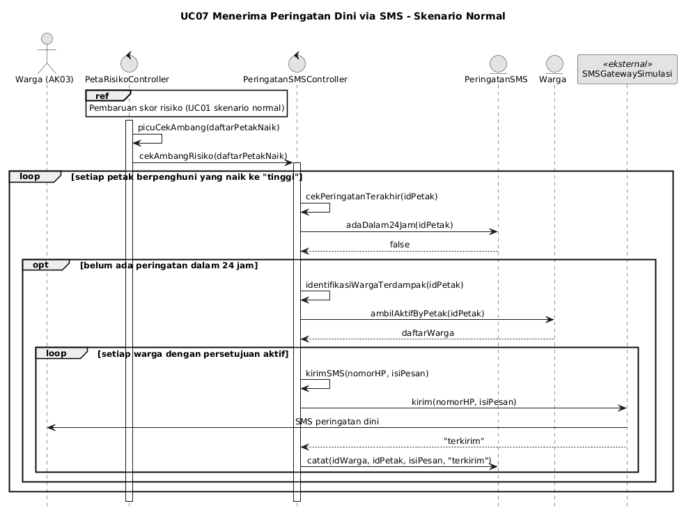
</p>
<p align="center">
<i>Gambar 29. Sequence Diagram UC07</i>
</p>

- **Skenario Alternatif 1: Nomor tidak aktif**

<p align="center">
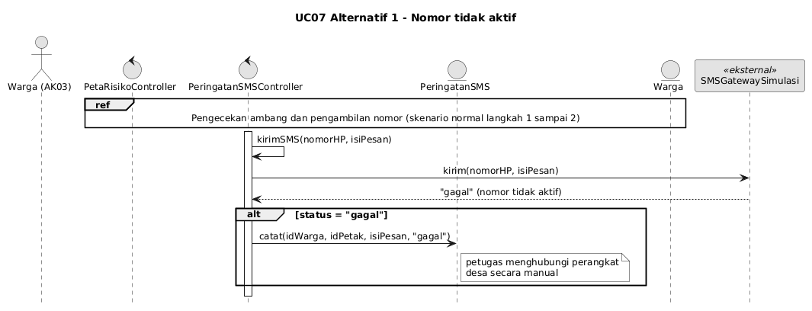
</p>
<p align="center">
<i>Gambar 30. Sequence Diagram UC07 - Nomor tidak aktif</i>
</p>

- **Skenario Alternatif 2: Warga berhenti berlangganan**

<p align="center">
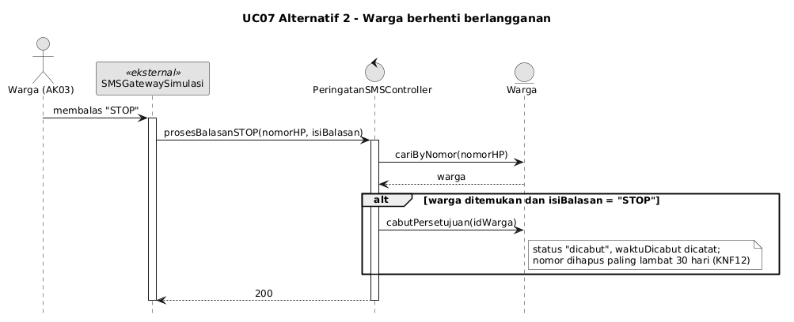
</p>
<p align="center">
<i>Gambar 31. Sequence Diagram UC07 - Warga berhenti berlangganan</i>
</p>

### 3.7.3 Diagram Kelas

<p align="center">
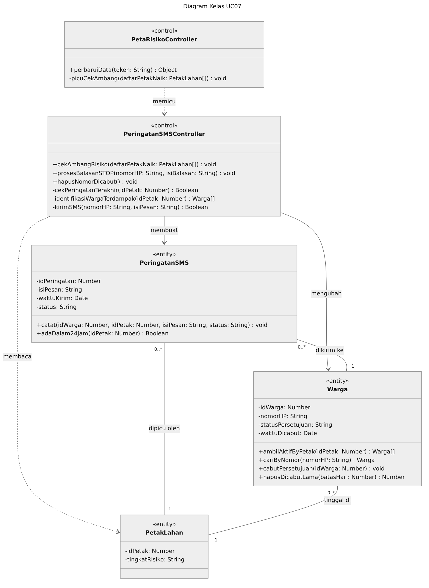
</p>
<p align="center">
<i>Gambar 32. Diagram Kelas UC07</i>
</p>

## 3.8 Use Case 08: *Masuk ke Sistem*

**ID Use Case:** *UC08*  
**Nama Use Case:** *Masuk ke Sistem*

### 3.8.1 Identifikasi Kelas

Tabel 3.8. Identifikasi Kelas Use Case UC08

| No | Nama Kelas Perancangan | Nama Kelas Analisis Terkait |
|:--- | :--- | :--- |
| 1 | `HalamanLogin` | `HalamanLogin` |
| 2 | `AutentikasiController` | `AutentikasiController` |
| 3 | `Pengguna` | `Pengguna` |
|||

### 3.8.2 Sequence Diagram

- **Skenario Normal**

<p align="center">
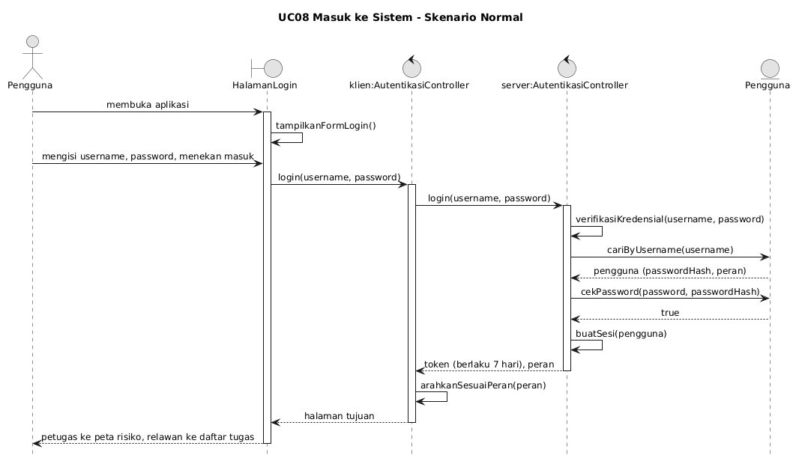
</p>
<p align="center">
<i>Gambar 33. Sequence Diagram UC08</i>
</p>

- **Skenario Alternatif 1: Kredensial tidak valid**

<p align="center">
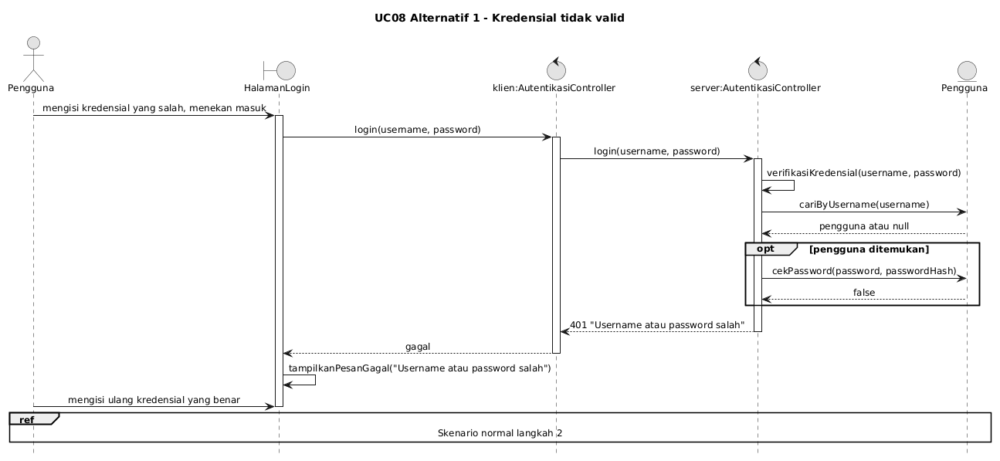
</p>
<p align="center">
<i>Gambar 34. Sequence Diagram UC08 - Kredensial tidak valid</i>
</p>

- **Skenario Alternatif 2: Relawan membuka aplikasi saat luring**

<p align="center">
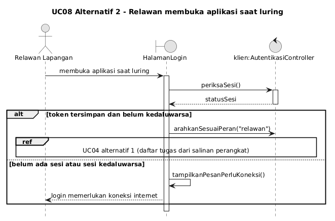
</p>
<p align="center">
<i>Gambar 35. Sequence Diagram UC08 - Relawan membuka aplikasi saat luring</i>
</p>

### 3.8.3 Diagram Kelas

<p align="center">

</p>
<p align="center">
<i>Gambar 36. Diagram Kelas UC08</i>
</p>


# BAB 4: Diagram Kelas Keseluruhan

## 4.1 Diagram Kelas

<p align="center">
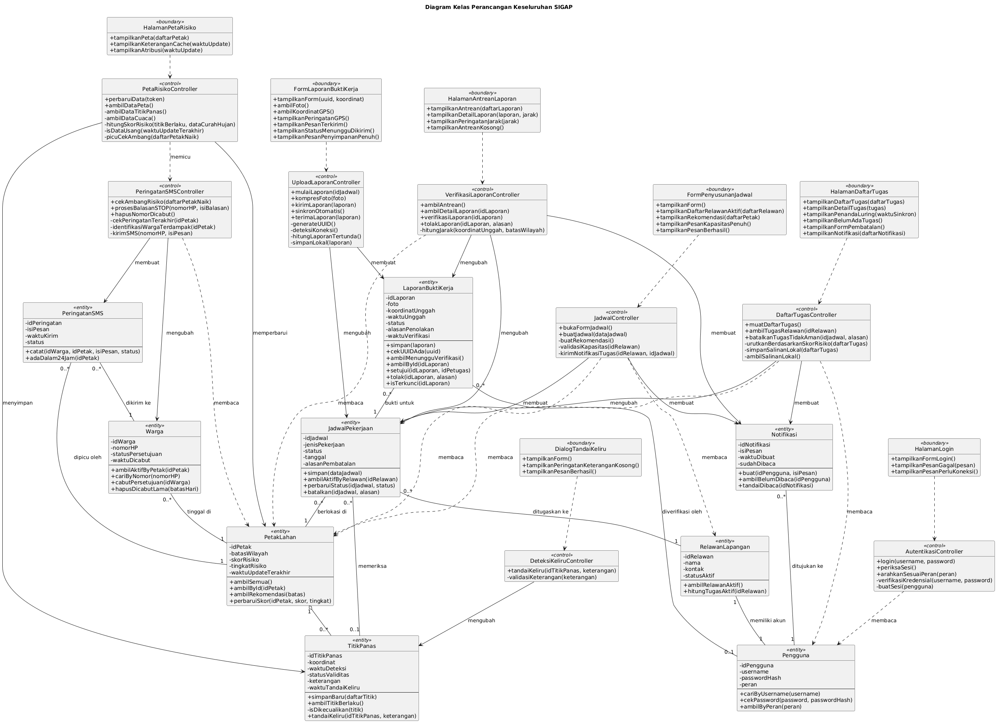
</p>
<p align="center">
<i>Gambar 37. Diagram Kelas Perancangan Keseluruhan SIGAP</i>
</p>

Tabel 4.1. Daftar Kelas Perancangan Keseluruhan

| ID Kelas | Nama Kelas | Atribut | Metode/Operasi |
| :--- | :--- | :--- | :--- |
| C01 | `HalamanPetaRisiko` | - | `+tampilkanPeta(daftarPetak: PetakLahan[]): void`<br>`+tampilkanKeteranganCache(waktuUpdate: Date): void`<br>`+tampilkanAtribusi(waktuUpdate: Date): void` |
| C02 | `PetaRisikoController` | - | `+perbaruiData(token: String): Object`<br>`+ambilDataPeta(): Object`<br>`-ambilDataTitikPanas(): Object[]`<br>`-ambilDataCuaca(): Object`<br>`-hitungSkorRisiko(titikBerlaku: TitikPanas[], dataCurahHujan: Object): Object[]`<br>`-isDataUsang(waktuUpdateTerakhir: Date): Boolean`<br>`-picuCekAmbang(daftarPetakNaik: PetakLahan[]): void` |
| C03 | `PetakLahan` | `-idPetak: Number`<br>`-batasWilayah: Object {latMin, latMaks, lngMin, lngMaks}`<br>`-skorRisiko: Number`<br>`-tingkatRisiko: String ('rendah' / 'sedang' / 'tinggi')`<br>`-waktuUpdateTerakhir: Date` | `+ambilSemua(): PetakLahan[]`<br>`+ambilById(idPetak: Number): PetakLahan`<br>`+ambilRekomendasi(batas: Number): PetakLahan[]`<br>`+perbaruiSkor(idPetak: Number, skor: Number, tingkat: String): void` |
| C04 | `TitikPanas` | `-idTitikPanas: Number`<br>`-koordinat: Object {lat, lng}`<br>`-waktuDeteksi: Date`<br>`-statusValiditas: String ('valid' / 'keliru')`<br>`-keterangan: String`<br>`-waktuTandaiKeliru: Date` | `+simpanBaru(daftarTitik: Object[]): Number`<br>`+ambilTitikBerlaku(): TitikPanas[]`<br>`-isDikecualikan(titik: TitikPanas, titikBaru: TitikPanas[]): Boolean`<br>`+tandaiKeliru(idTitikPanas: Number, keterangan: String): void` |
| C05 | `FormPenyusunanJadwal` | - | `+tampilkanForm(): void`<br>`+tampilkanDaftarRelawanAktif(daftarRelawan: RelawanLapangan[]): void`<br>`+tampilkanRekomendasi(daftarPetak: PetakLahan[]): void`<br>`+tampilkanPesanKapasitasPenuh(): void`<br>`+tampilkanPesanBerhasil(): void` |
| C06 | `JadwalController` | - | `+bukaFormJadwal(): Object`<br>`+buatJadwal(dataJadwal: Object): JadwalPekerjaan`<br>`-buatRekomendasi(): PetakLahan[]`<br>`-validasiKapasitas(idRelawan: Number): Boolean`<br>`-kirimNotifikasiTugas(idRelawan: Number, idJadwal: Number): void` |
| C07 | `JadwalPekerjaan` | `-idJadwal: Number`<br>`-jenisPekerjaan: String`<br>`-status: String ('ditugaskan' / 'menunggu verifikasi' / 'selesai' / 'dibatalkan')`<br>`-tanggal: Date`<br>`-alasanPembatalan: String` | `+simpan(dataJadwal: Object): JadwalPekerjaan`<br>`+ambilAktifByRelawan(idRelawan: Number): JadwalPekerjaan[]`<br>`+perbaruiStatus(idJadwal: Number, status: String): void`<br>`+batalkan(idJadwal: Number, alasan: String): Boolean` |
| C08 | `RelawanLapangan` | `-idRelawan: Number`<br>`-nama: String`<br>`-kontak: String`<br>`-statusAktif: Boolean` | `+ambilRelawanAktif(): RelawanLapangan[]`<br>`+hitungTugasAktif(idRelawan: Number): Number` |
| C09 | `HalamanAntreanLaporan` | - | `+tampilkanAntrean(daftarLaporan: LaporanBuktiKerja[]): void`<br>`+tampilkanDetailLaporan(laporan: LaporanBuktiKerja, jarak: Number): void`<br>`+tampilkanPeringatanJarak(jarak: Number): void`<br>`+tampilkanAntreanKosong(): void` |
| C10 | `VerifikasiLaporanController` | - | `+ambilAntrean(): LaporanBuktiKerja[]`<br>`+ambilDetailLaporan(idLaporan: String): Object`<br>`+verifikasiLaporan(idLaporan: String): void`<br>`+tolakLaporan(idLaporan: String, alasan: String): void`<br>`-hitungJarak(koordinatUnggah: Object, batasWilayah: Object): Number` |
| C11 | `LaporanBuktiKerja` | `-idLaporan: String (UUID)`<br>`-foto: Blob (klien) / Buffer (server)`<br>`-koordinatUnggah: Object {lat, lng}`<br>`-waktuUnggah: Date`<br>`-status: String ('menunggu verifikasi' / 'terverifikasi' / 'ditolak')`<br>`-alasanPenolakan: String`<br>`-waktuVerifikasi: Date` | `+simpan(laporan: Object): void`<br>`+cekUUIDAda(uuid: String): Boolean`<br>`+ambilMenungguVerifikasi(): LaporanBuktiKerja[]`<br>`+ambilById(idLaporan: String): LaporanBuktiKerja`<br>`+setujui(idLaporan: String, idPetugas: Number): void`<br>`+tolak(idLaporan: String, alasan: String): void`<br>`+isTerkunci(idLaporan: String): Boolean` |
| C12 | `HalamanDaftarTugas` | - | `+tampilkanDaftarTugas(daftarTugas: JadwalPekerjaan[]): void`<br>`+tampilkanDetailTugas(tugas: JadwalPekerjaan): void`<br>`+tampilkanPenandaLuring(waktuSinkron: Date): void`<br>`+tampilkanBelumAdaTugas(): void`<br>`+tampilkanFormPembatalan(): void`<br>`+tampilkanNotifikasi(daftarNotifikasi: Notifikasi[]): void`<br>`+tampilkanPesanGagal(pesan: String): void` |
| C13 | `DaftarTugasController` | - | `+muatDaftarTugas(): void`<br>`+ambilTugasRelawan(idRelawan: Number): JadwalPekerjaan[]`<br>`+batalkanTugasTidakAman(idJadwal: Number, alasan: String): void`<br>`+tandaiNotifikasiDibaca(idNotifikasi: Number): void`<br>`-urutkanBerdasarkanSkorRisiko(daftarTugas: JadwalPekerjaan[]): JadwalPekerjaan[]`<br>`-simpanSalinanLokal(daftarTugas: JadwalPekerjaan[]): void`<br>`-ambilSalinanLokal(): Object` |
| C14 | `FormLaporanBuktiKerja` | - | `+tampilkanForm(uuid: String, koordinat: Object): void`<br>`+ambilFoto(): File`<br>`+ambilKoordinatGPS(): Object`<br>`+tampilkanPeringatanGPS(): void`<br>`+tampilkanPesanTerkirim(): void`<br>`+tampilkanStatusMenungguDikirim(): void`<br>`+tampilkanPesanPenyimpananPenuh(): void`<br>`+tampilkanPesanDitolak(pesan: String): void` |
| C15 | `UploadLaporanController` | - | `+mulaiLaporan(idJadwal: Number): void`<br>`+kompresFoto(foto: File): Blob`<br>`+kirimLaporan(laporan: Object): void`<br>`+sinkronOtomatis(): void`<br>`+terimaLaporan(laporan: Object): Object`<br>`-generateUUID(): String`<br>`-deteksiKoneksi(): Boolean`<br>`-hitungLaporanTertunda(): Number`<br>`-simpanLokal(laporan: Object): void` |
| C16 | `DialogTandaiKeliru` | - | `+tampilkanForm(): void`<br>`+tampilkanPeringatanKeteranganKosong(): void`<br>`+tampilkanPesanBerhasil(): void` |
| C17 | `DeteksiKeliruController` | - | `+tandaiKeliru(idTitikPanas: Number, keterangan: String): void`<br>`-validasiKeterangan(keterangan: String): Boolean` |
| C18 | `PeringatanSMSController` | - | `+cekAmbangRisiko(daftarPetakNaik: PetakLahan[]): void`<br>`+prosesBalasanSTOP(nomorHP: String, isiBalasan: String): void`<br>`+hapusNomorDicabut(): void`<br>`-cekPeringatanTerakhir(idPetak: Number): Boolean`<br>`-identifikasiWargaTerdampak(idPetak: Number): Warga[]`<br>`-kirimSMS(nomorHP: String, isiPesan: String): Boolean` |
| C19 | `Warga` | `-idWarga: Number`<br>`-nomorHP: String`<br>`-statusPersetujuan: String ('aktif' / 'dicabut')`<br>`-waktuDicabut: Date` | `+ambilAktifByPetak(idPetak: Number): Warga[]`<br>`+cariByNomor(nomorHP: String): Warga`<br>`+cabutPersetujuan(idWarga: Number): void`<br>`+hapusDicabutLama(batasHari: Number): Number` |
| C20 | `PeringatanSMS` | `-idPeringatan: Number`<br>`-isiPesan: String`<br>`-waktuKirim: Date`<br>`-status: String ('terkirim' / 'gagal')` | `+catat(idWarga: Number, idPetak: Number, isiPesan: String, status: String): void`<br>`+adaDalam24Jam(idPetak: Number): Boolean` |
| C21 | `HalamanLogin` | - | `+tampilkanFormLogin(): void`<br>`+tampilkanPesanGagal(pesan: String): void`<br>`+tampilkanPesanPerluKoneksi(): void` |
| C22 | `AutentikasiController` | - | `+login(username: String, password: String): Object`<br>`+periksaSesi(): Boolean`<br>`+arahkanSesuaiPeran(peran: String): void`<br>`-verifikasiKredensial(username: String, password: String): Pengguna`<br>`-buatSesi(pengguna: Pengguna): String` |
| C23 | `Pengguna` | `-idPengguna: Number`<br>`-username: String`<br>`#passwordHash: String`<br>`-peran: String ('petugas' / 'relawan')` | `+cariByUsername(username: String): Pengguna`<br>`+cekPassword(password: String, passwordHash: String): Boolean`<br>`+ambilByPeran(peran: String): Pengguna[]` |
| C24 | `Notifikasi` | `-idNotifikasi: Number`<br>`-isiPesan: String`<br>`-waktuDibuat: Date`<br>`-sudahDibaca: Boolean` | `+buat(idPengguna: Number, isiPesan: String): void`<br>`+ambilBelumDibaca(idPengguna: Number): Notifikasi[]`<br>`+tandaiDibaca(idNotifikasi: Number): void` |

<br>

---

# BAB 5: Perancangan Rinci Kelas

Bagian ini diisi dengan daftar seluruh kelas dalam tabel berikut:

Tabel 5.1. Daftar Kelas Perancangan dan Kelas Analisis Terkait

| No | Nama Kelas Perancangan | Nama Kelas Analisis Terkait |
| :--- | :--- | :--- |
| 1 | *[Nama kelas perancangan]* | *[Nama kelas analisis pada SKPL atau -]* |
| 2 | *[Nama kelas perancangan]* | *[Nama kelas analisis pada SKPL atau -]* |
| ... | *...* | *...* |

Untuk **setiap kelas**, identifikasi operasi berdasarkan tanggung jawab kelas beserta *visibility*-nya, serta atribut beserta *visibility* dan tipenya. Buat subbab tersendiri untuk setiap kelas.

## 5.1 Kelas HalamanPetaRisiko

**Nama Kelas:** HalamanPetaRisiko  
**ID Kelas:** C01

Tabel 5.1.1. Operasi Kelas HalamanPetaRisiko

| Nama Operasi | Visibility (private, public) | Keterangan |
| :--- | :--- | :--- |
| tampilkanPeta(daftarPetak: PetakLahan[]): void | Public | Menampilkan peta interaktif Leaflet dengan setiap petak lahan diberi warna sesuai tingkat risiko terakhir ('rendah', 'sedang', 'tinggi') yang diterima dari controller (KF01) |
| tampilkanKeteranganCache(waktuUpdate: Date): void | Public | Menampilkan pesan keterangan bahwa data yang tampil berasal dari cache hasil pembaruan terakhir beserta waktu pembaruan tersebut ketika pengambilan data API eksternal gagal (KF04) |
| tampilkanAtribusi(waktuUpdate: Date): void | Public | Menampilkan atribusi sumber data (NASA FIRMS & Open-Meteo), waktu pembaruan data terakhir, serta pernyataan batasan bahwa skor risiko adalah alat bantu keputusan (KF23) |
| tampilkanNotifikasi(daftarNotifikasi: Notifikasi[]): void | Public | Menampilkan notifikasi dalam aplikasi untuk petugas posko, misalnya pemberitahuan pembatalan tugas oleh relawan karena kondisi tidak aman (KF21) |

Tabel 5.1.2. Atribut Kelas HalamanPetaRisiko

| Nama Atribut | Visibility (private, public) | Tipe |
| :--- | :--- | :--- |
| - | - | - |

HalamanPetaRisiko tidak memiliki atribut karena seluruh data peta, *cache*, dan notifikasi dikirim langsung oleh `PetaRisikoController`.

## 5.2 Kelas PetaRisikoController

**Nama Kelas:** PetaRisikoController  
**ID Kelas:** C02

Tabel 5.2.1. Operasi Kelas PetaRisikoController

| Nama Operasi | Visibility (private, public) | Keterangan |
| :--- | :--- | :--- |
| perbaruiData(token: String): Object | Public | (Server) Endpoint yang dipanggil oleh `CronEksternal` setiap 3 jam. Memvalidasi token rahasia, mengambil data titik panas dan cuaca, menghitung skor risiko baru, memperbarui database, serta memicu pengecekan SMS peringatan (KF02, KF16). Lihat Algo-001 |
| ambilDataPeta(): Object | Public | (Server) Mengambil seluruh petak lahan dari `PetakLahan.ambilSemua()`. Jika data usang (> 3 jam) akibat pembaruan cron sebelumnya gagal, respons menyertakan penanda *cache* (KF01, KF04). Lihat Algo-002 |
| ambilDataTitikPanas(): Object[] | Private | (Server) Memanggil NASA FIRMS Area API untuk *bounding box* wilayah percontohan dan mengembalikan daftar titik panas NRT 24 jam terakhir (KF02, KF03) |
| ambilDataCuaca(): Object | Private | (Server) Memanggil Open-Meteo Forecast API untuk mengambil total curah hujan 24 jam terakhir dan riwayat hari sebelumnya guna menghitung jumlah hari kering (KF02) |
| hitungSkorRisiko(titikBerlaku: TitikPanas[], dataCurahHujan: Object): Object[] | Private | (Server) Menghitung skor risiko per petak dengan rumus $\text{skor} = w_1 \times \text{jumlahTitik} + w_3 \times \text{hariKering} - w_2 \times \text{curahHujan}$, lalu menentukan `tingkatRisiko` ('rendah', 'sedang', 'tinggi') (KF02) |
| isDataUsang(waktuUpdateTerakhir: Date): Boolean | Private | (Server) Memeriksa apakah selisih waktu saat ini dengan `waktuUpdateTerakhir` melebihi 3 jam (KF04) |
| picuCekAmbang(daftarPetakNaik: PetakLahan[]): void | Private | (Server) Memanggil `PeringatanSMSController.cekAmbangRisiko()` untuk daftar petak yang mengalami kenaikan tingkat risiko ke 'tinggi' (KF16) |

Tabel 5.2.2. Atribut Kelas PetaRisikoController

| Nama Atribut | Visibility (private, public) | Tipe |
| :--- | :--- | :--- |
| - | - | - |

PetaRisikoController tidak memiliki atribut. Data dibaca dan disimpan melalui entitas *Model* `PetakLahan`, `TitikPanas`, dan `Notifikasi`.

### 5.2.1 Algoritma

**Nama Kelas:** PetaRisikoController  
**Nama Operasi:** perbaruiData(token: String): Object  
**ID Algoritma:** Algo-001

```text
IF token != SECRET_CRON_TOKEN THEN
    RETURN respons 401 "Token rahasia tidak valid"
END IF

TRY
    dataTitik = ambilDataTitikPanas()
    dataCuaca = ambilDataCuaca()
    
    TitikPanas.simpanBaru(dataTitik)
    titikBerlaku = TitikPanas.ambilTitikBerlaku()
    
    hasilSkor = hitungSkorRisiko(titikBerlaku, dataCuaca)
    daftarPetakNaik = []
    
    FOR EACH item IN hasilSkor DO
        petakLama = PetakLahan.ambilById(item.idPetak)
        PetakLahan.perbaruiSkor(item.idPetak, item.skor, item.tingkatRisiko)
        
        IF petakLama.tingkatRisiko != 'tinggi' AND item.tingkatRisiko == 'tinggi' THEN
            TAMBAH item KE daftarPetakNaik
        END IF
    END FOR
    
    IF daftarPetakNaik TIDAK KOSONG THEN
        picuCekAmbang(daftarPetakNaik)
    END IF
    
    RETURN respons 200 "Pembaruan skor berhasil"
CATCH galat API atau Database
    RETURN respons 500 "Pembaruan skor gagal, menggunakan data cache terakhir"
END TRY
```

### 5.2.2 Algoritma

**Nama Kelas:** PetaRisikoController  
**Nama Operasi:** ambilDataPeta(): Object  
**ID Algoritma:** Algo-002

```text
daftarPetak = PetakLahan.ambilSemua()
IF daftarPetak KOSONG THEN
    RETURN { status: 404, pesan: "Data petak belum dikonfigurasi" }
END IF

waktuTerakhir = daftarPetak[0].waktuUpdateTerakhir
isUsang = isDataUsang(waktuTerakhir)

RETURN {
    status: 200,
    isUsang: isUsang,
    waktuUpdate: waktuTerakhir,
    daftarPetak: daftarPetak
}
```

## 5.3 Kelas PetakLahan

**Nama Kelas:** PetakLahan  
**ID Kelas:** C03

Tabel 5.3.1. Operasi Kelas PetakLahan

| Nama Operasi | Visibility (private, public) | Keterangan |
| :--- | :--- | :--- |
| ambilSemua(): PetakLahan[] | Public | Mengambil seluruh data petak lahan di dalam batas wilayah percontohan (Q-001) |
| ambilById(idPetak: Number): PetakLahan | Public | Mengambil data detail satu petak lahan berdasarkan ID (Q-002) |
| ambilRekomendasi(batas: Number): PetakLahan[] | Public | Mengambil petak lahan berskor risiko tertinggi yang belum memiliki tugas aktif berstatus 'ditugaskan' atau 'menunggu verifikasi', maksimal sebanyak jumlah `batas` (KF17, Q-003) |
| perbaruiSkor(idPetak: Number, skor: Number, tingkat: String): void | Public | Memperbarui nilai skor risiko, tingkat risiko, dan mencatat `waktuUpdateTerakhir` dengan waktu saat ini (KF02, Q-004) |

Tabel 5.3.2. Atribut Kelas PetakLahan

| Nama Atribut | Visibility (private, public) | Tipe |
| :--- | :--- | :--- |
| idPetak | Private | Number |
| batasWilayah | Private | Object {latMin: Number, latMaks: Number, lngMin: Number, lngMaks: Number} |
| skorRisiko | Private | Number |
| tingkatRisiko | Private | String ('rendah' / 'sedang' / 'tinggi') |
| waktuUpdateTerakhir | Private | Date |

### 5.3.1 Query

Tabel 5.3.3. Query Operasi PetakLahan

| No Query | Query | Keterangan |
| :--- | :--- | :--- |
| Q-001 | SELECT id_petak, lat_min, lat_maks, lng_min, lng_maks, skor_risiko, tingkat_risiko, waktu_update_terakhir <br> FROM petak_lahan <br> ORDER BY id_petak | Mengambil semua petak lahan untuk antarmuka peta risiko |
| Q-002 | SELECT id_petak, lat_min, lat_maks, lng_min, lng_maks, skor_risiko, tingkat_risiko, waktu_update_terakhir <br> FROM petak_lahan <br> WHERE id_petak = $1 | Mengambil satu petak lahan berdasarkan ID |
| Q-003 | SELECT p.id_petak, p.skor_risiko, p.tingkat_risiko <br> FROM petak_lahan p <br> WHERE p.id_petak NOT IN ( <br> &nbsp;&nbsp;SELECT id_petak FROM jadwal_pekerjaan <br> &nbsp;&nbsp;WHERE status IN ('ditugaskan', 'menunggu verifikasi') <br> ) <br> ORDER BY p.skor_risiko DESC <br> LIMIT $1 | Mengambil maksimal $1 petak lahan dengan skor risiko tertinggi yang belum memiliki tugas aktif sebagai rekomendasi penugasan |
| Q-004 | UPDATE petak_lahan <br> SET skor_risiko = $2, tingkat_risiko = $3, waktu_update_terakhir = NOW() <br> WHERE id_petak = $1 | Memperbarui nilai skor dan tingkat risiko petak hasil perhitungan baru |

## 5.4 Kelas TitikPanas

**Nama Kelas:** TitikPanas  
**ID Kelas:** C04

Tabel 5.4.1. Operasi Kelas TitikPanas

| Nama Operasi | Visibility (private, public) | Keterangan |
| :--- | :--- | :--- |
| simpanBaru(daftarTitik: Object[]): Number | Public | Menyimpan titik panas baru hasil penarikan data FIRMS yang belum pernah tercatat di basis data server (Q-005) |
| ambilTitikBerlaku(): TitikPanas[] | Public | Mengambil seluruh titik panas terdeteksi dalam 24 jam terakhir yang tidak dikecualikan dari perhitungan skor (KF02, KF15, Q-006) |
| isDikecualikan(titik: TitikPanas, titikBaru: TitikPanas[]): Boolean | Private | Memeriksa apakah suatu titik panas ditandai 'keliru' dalam 24 jam terakhir TANPA adanya titik panas baru dalam radius 500 meter dari koordinat titik tersebut (KF15). Lihat Algo-003 |
| tandaiKeliru(idTitikPanas: Number, keterangan: String): void | Public | Mengubah `statusValiditas` menjadi 'keliru', mencatat `keterangan`, dan menyimpan `waktuTandaiKeliru` (KF14, Q-007) |

Tabel 5.4.2. Atribut Kelas TitikPanas

| Nama Atribut | Visibility (private, public) | Tipe |
| :--- | :--- | :--- |
| idTitikPanas | Private | Number |
| koordinat | Private | Object {lat: Number, lng: Number} |
| waktuDeteksi | Private | Date |
| statusValiditas | Private | String ('valid' / 'keliru') |
| keterangan | Private | String |
| waktuTandaiKeliru | Private | Date |

### 5.4.1 Algoritma

**Nama Kelas:** TitikPanas  
**Nama Operasi:** isDikecualikan(titik: TitikPanas, titikBaru: TitikPanas[]): Boolean  
**ID Algoritma:** Algo-003

```text
IF titik.statusValiditas != 'keliru' THEN
    RETURN FALSE
END IF

selisihWaktu = (WAKTU_SEKARANG() - titik.waktuTandaiKeliru) DALAM_JAM
IF selisihWaktu > 24 THEN
    RETURN FALSE
END IF

FOR EACH titikPanasBaru IN titikBaru DO
    jarak = HITUNG_HAVERSINE(titik.koordinat, titikPanasBaru.koordinat)
    IF jarak <= 0.5 THEN
        RETURN FALSE
    END IF
END FOR

RETURN TRUE
```

*Catatan:* Jika penandaan keliru sudah lewat dari 24 jam atau ditemukan deteksi satelit baru dalam radius 500 m ($0,5\text{ km}$), fungsi mengembalikan `FALSE` sehingga titik panas tersebut kembali dihitung dalam kalkulasi skor risiko.

### 5.4.2 Query

Tabel 5.4.3. Query Operasi TitikPanas

| No Query | Query | Keterangan |
| :--- | :--- | :--- |
| Q-005 | INSERT INTO titik_panas (latitude, longitude, waktu_deteksi, status_validitas) <br> VALUES ($1, $2, $3, 'valid') <br> ON CONFLICT DO NOTHING | Menyimpan data titik panas baru dari FIRMS |
| Q-006 | SELECT id_titik_panas, latitude, longitude, waktu_deteksi, status_validitas, keterangan, waktu_tandai_keliru <br> FROM titik_panas <br> WHERE waktu_deteksi >= NOW() - INTERVAL '24 hours' | Mengambil seluruh titik panas terdeteksi 24 jam terakhir |
| Q-007 | UPDATE titik_panas <br> SET status_validitas = 'keliru', keterangan = $2, waktu_tandai_keliru = NOW() <br> WHERE id_titik_panas = $1 | Mengubah status titik panas menjadi deteksi keliru |

## 5.5 Kelas FormPenyusunanJadwal
 
**Nama Kelas:** FormPenyusunanJadwal  
**ID Kelas:** C05
 
Tabel 5.5.1. Operasi Kelas FormPenyusunanJadwal
 
| Nama Operasi | Visibility (private, public) | Keterangan |
| :--- | :--- | :--- |
| tampilkanForm(): void | Public | Menampilkan formulir penyusunan jadwal. Isinya pilihan relawan, pilihan petak, pilihan jenis pekerjaan, isian tanggal, dan tombol simpan. Saat halaman dibuka, View meminta data awal ke JadwalController.bukaFormJadwal(), lalu mengisi pilihan melalui dua operasi berikutnya (KF05) |
| tampilkanDaftarRelawanAktif(daftarRelawan: RelawanLapangan[]): void | Public | Mengisi pilihan relawan dengan nama relawan berstatus aktif. Relawan nonaktif tidak ada di daftar sehingga tidak bisa dipilih (KF05) |
| tampilkanRekomendasi(daftarPetak: PetakLahan[]): void | Public | Menampilkan maksimal 5 petak rekomendasi beserta skor dan tingkat risikonya. Memilih satu rekomendasi akan mengisi pilihan petak pada formulir. Jika daftar kosong, ditampilkan keterangan belum ada rekomendasi, dan petak tetap bisa dipilih manual (KF17) |
| tampilkanPesanKapasitasPenuh(): void | Public | Menampilkan pesan bahwa relawan yang dipilih sudah memiliki 3 tugas aktif. Isian lain tidak dikosongkan, jadi petugas cukup mengganti relawan lalu menyimpan lagi (KF06, UC02 alternatif 1) |
| tampilkanPesanBerhasil(): void | Public | Menampilkan konfirmasi bahwa jadwal tersimpan dan relawan sudah menerima notifikasi. Setelah itu formulir dikosongkan dan rekomendasi dimuat ulang agar sesuai dengan jadwal terbaru |
| tampilkanPesanGagal(pesan: String): void | Public | Menampilkan pesan dari respons 400 atau 500, misalnya petak tidak ditemukan atau server tidak dapat dihubungi. Isian formulir tidak dikosongkan |
 
Tabel 5.5.2. Atribut Kelas FormPenyusunanJadwal
 
| Nama Atribut | Visibility (private, public) | Tipe |
| :--- | :--- | :--- |
| - | - | - |
 
FormPenyusunanJadwal tidak memiliki atribut. Daftar relawan dan rekomendasi petak datang dari JadwalController, sedangkan isian petugas langsung dikirim sebagai dataJadwal saat tombol simpan ditekan.
 
## 5.6 Kelas JadwalController
 
**Nama Kelas:** JadwalController  
**ID Kelas:** C06
 
Tabel 5.6.1. Operasi Kelas JadwalController
 
| Nama Operasi | Visibility (private, public) | Keterangan |
| :--- | :--- | :--- |
| bukaFormJadwal(): Object | Public | Mengembalikan objek {daftarRelawan, rekomendasi}. daftarRelawan berasal dari RelawanLapangan.ambilRelawanAktif() dan rekomendasi berasal dari buatRekomendasi() (KF05, KF17) |
| buatJadwal(dataJadwal: Object): JadwalPekerjaan | Public | dataJadwal berisi {idRelawan, idPetak, jenisPekerjaan, tanggal}. Operasi ini memvalidasi isian, memeriksa kapasitas relawan, menyimpan jadwal berstatus 'ditugaskan', lalu membuat notifikasi untuk relawan (KF06, KF07). Lihat Algo-004 |
| buatRekomendasi(): PetakLahan[] | Private | Memanggil PetakLahan.ambilRekomendasi(5) dan mengembalikan hasilnya. Angka 5 adalah batas rekomendasi pada KF17 |
| validasiKapasitas(idRelawan: Number): Boolean | Private | Memanggil RelawanLapangan.hitungTugasAktif(idRelawan) dan bernilai TRUE jika hasilnya kurang dari 3. Tugas aktif adalah tugas berstatus 'ditugaskan' atau 'menunggu verifikasi' (KF06) |
| kirimNotifikasiTugas(idRelawan: Number, idJadwal: Number): void | Private | Memanggil Notifikasi.buat(idRelawan, isiPesan) dengan isi "Tugas baru #[idJadwal] sudah ditugaskan kepada Anda" (KF07). idRelawan bisa langsung dipakai sebagai idPengguna karena kolom id_relawan merujuk ke id_pengguna akun relawan, sama seperti yang dipakai Algo-007 |
 
Tabel 5.6.2. Atribut Kelas JadwalController
 
| Nama Atribut | Visibility (private, public) | Tipe |
| :--- | :--- | :--- |
| - | - | - |
 
JadwalController tidak memiliki atribut. Data jadwal, relawan, petak, dan notifikasi dibaca serta ditulis melalui *Model* masing-masing.
 
### 5.6.1 Algoritma
 
**Nama Kelas:** JadwalController  
**Nama Operasi:** buatJadwal(dataJadwal: Object): JadwalPekerjaan  
**ID Algoritma:** Algo-004
 
```text
IF dataJadwal.idRelawan, dataJadwal.idPetak, dataJadwal.jenisPekerjaan, ATAU dataJadwal.tanggal KOSONG THEN
    RETURN respons 400 "Semua isian jadwal wajib diisi"
END IF
 
IF NOT validasiKapasitas(dataJadwal.idRelawan) THEN
    RETURN respons 409 "Relawan sudah memiliki 3 tugas aktif"
END IF
 
TRY
    jadwal = JadwalPekerjaan.simpan(dataJadwal)
CATCH database menolak data (relawan atau petak tidak ada, jenis pekerjaan atau tanggal tidak valid)
    RETURN respons 400 "Data jadwal tidak valid"
END TRY
 
kirimNotifikasiTugas(dataJadwal.idRelawan, jadwal.idJadwal)
RETURN respons 201 jadwal
```
 
Pemeriksaan relawan, petak, jenis pekerjaan, dan format tanggal tidak ditulis ulang di controller. Pemeriksaan itu sudah dilakukan PostgreSQL lewat *foreign key*, `CHECK` constraint pada kolom jenis_pekerjaan, dan tipe kolom `DATE`, dengan kode galat 23503, 23514, dan 22007. Algoritma cukup menangkap ketiganya sebagai respons 400.
 
Kapasitas diperiksa sebelum jadwal disimpan, dan keduanya tidak berada dalam satu transaksi. Jika dua petugas menyimpan jadwal untuk relawan yang sama pada detik yang sama, relawan itu bisa mendapat 4 tugas aktif. Risiko ini diterima karena petugas posko di satu kecamatan hanya sedikit dan formulir diisi manual.
 
## 5.7 Kelas JadwalPekerjaan
 
**Nama Kelas:** JadwalPekerjaan  
**ID Kelas:** C07
 
Tabel 5.7.1. Operasi Kelas JadwalPekerjaan
 
| Nama Operasi | Visibility (private, public) | Keterangan |
| :--- | :--- | :--- |
| simpan(dataJadwal: Object): JadwalPekerjaan | Public | Dipanggil JadwalController.buatJadwal(). Menyimpan jadwal baru berstatus 'ditugaskan' dan mengembalikan objek JadwalPekerjaan beserta idJadwal yang dibuat database (KF07, Q-008) |
| ambilAktifByRelawan(idRelawan: Number): JadwalPekerjaan[] | Public | Dipanggil DaftarTugasController.ambilTugasRelawan(). Mengambil tugas milik satu relawan yang berstatus 'ditugaskan' atau 'menunggu verifikasi' (KF11, Q-009) |
| perbaruiStatus(idJadwal: Number, status: String): void | Public | Mengubah status satu tugas. Dipanggil UploadLaporanController.terimaLaporan() dengan status 'menunggu verifikasi', serta VerifikasiLaporanController dengan status 'selesai' ketika laporan disetujui atau 'ditugaskan' ketika laporan ditolak (KF13, KF24, Q-010) |
| batalkan(idJadwal: Number, alasan: String): Boolean | Public | Dipanggil DaftarTugasController.batalkanTugasTidakAman(). Mengubah status menjadi 'dibatalkan' dan menyimpan alasan, hanya jika status tugas masih 'ditugaskan'. Bernilai FALSE jika tidak ada baris yang berubah (KF21, Q-011) |
 
Tabel 5.7.2. Atribut Kelas JadwalPekerjaan
 
| Nama Atribut | Visibility (private, public) | Tipe |
| :--- | :--- | :--- |
| idJadwal | Private | Number |
| jenisPekerjaan | Private | String ('patroli' / 'pembasahan sekat kanal' / 'pengecekan titik panas') |
| status | Private | String ('ditugaskan' / 'menunggu verifikasi' / 'selesai' / 'dibatalkan') |
| tanggal | Private | Date |
| alasanPembatalan | Private | String |
 
Relawan penerima tugas dan petak tujuan disimpan sebagai kolom *foreign key* id_relawan dan id_petak. Keduanya digambarkan sebagai asosiasi ke RelawanLapangan dan PetakLahan pada diagram kelas, sehingga tidak dicantumkan lagi sebagai atribut.
 
### 5.7.1 Query
 
Tabel 5.7.3. Query Operasi JadwalPekerjaan
 
| No Query | Query | Keterangan |
| :--- | :--- | :--- |
| Q-008 | INSERT INTO jadwal_pekerjaan <br> (id_relawan, id_petak, jenis_pekerjaan, tanggal, status) <br> VALUES ($1, $2, $3, $4, 'ditugaskan') <br> RETURNING * | Menyimpan jadwal baru. `RETURNING *` mengembalikan baris baru beserta id_jadwal yang dibuat database, yang kemudian dipakai untuk isi notifikasi |
| Q-009 | SELECT id_jadwal, id_petak, jenis_pekerjaan, status, tanggal <br> FROM jadwal_pekerjaan <br> WHERE id_relawan = $1 <br> AND status IN ('ditugaskan', 'menunggu verifikasi') | Mengambil tugas aktif satu relawan. Skor risiko dan batas petak dilengkapi DaftarTugasController lewat PetakLahan.ambilById() (Gambar 16). Karena tugas aktif paling banyak 3 (KF06), tambahan kueri per tugas juga paling banyak 3 |
| Q-010 | UPDATE jadwal_pekerjaan <br> SET status = $2 <br> WHERE id_jadwal = $1 | Mengubah status tugas. Nilai $2 dibatasi `CHECK` constraint pada kolom status |
| Q-011 | UPDATE jadwal_pekerjaan <br> SET status = 'dibatalkan', alasan_pembatalan = $2 <br> WHERE id_jadwal = $1 AND status = 'ditugaskan' | Membatalkan tugas. Syarat status ditaruh di `WHERE` agar pengecekan dan perubahan terjadi dalam satu perintah. batalkan() mengembalikan TRUE jika `rowCount` lebih dari 0 |
 
## 5.8 Kelas RelawanLapangan
 
**Nama Kelas:** RelawanLapangan  
**ID Kelas:** C08
 
Tabel 5.8.1. Operasi Kelas RelawanLapangan
 
| Nama Operasi | Visibility (private, public) | Keterangan |
| :--- | :--- | :--- |
| ambilRelawanAktif(): RelawanLapangan[] | Public | Mengambil relawan berstatus aktif, diurutkan menurut nama, untuk pilihan relawan pada formulir jadwal (KF05, Q-012) |
| hitungTugasAktif(idRelawan: Number): Number | Public | Menghitung tugas relawan yang berstatus 'ditugaskan' atau 'menunggu verifikasi'. Hasilnya dipakai JadwalController.validasiKapasitas() (KF06, Q-013) |
 
Tabel 5.8.2. Atribut Kelas RelawanLapangan
 
| Nama Atribut | Visibility (private, public) | Tipe |
| :--- | :--- | :--- |
| idRelawan | Private | Number |
| nama | Private | String |
| kontak | Private | String |
| statusAktif | Private | Boolean |
 
### 5.8.1 Query
 
Tabel 5.8.3. Query Operasi RelawanLapangan
 
| No Query | Query | Keterangan |
| :--- | :--- | :--- |
| Q-012 | SELECT id_relawan, nama <br> FROM relawan_lapangan <br> WHERE status_aktif = TRUE <br> ORDER BY nama | Mengambil relawan aktif. Kolom kontak tidak diambil karena formulir jadwal hanya menampilkan nama |
| Q-013 | SELECT COUNT(*)::int AS jumlah <br> FROM jadwal_pekerjaan <br> WHERE id_relawan = $1 <br> AND status IN ('ditugaskan', 'menunggu verifikasi') | Menghitung tugas aktif relawan. `::int` dipakai karena `COUNT` di PostgreSQL bertipe `bigint`, yang oleh pustaka `pg` dikembalikan sebagai string |

## 5.9 Kelas HalamanAntreanLaporan

**Nama Kelas:** HalamanAntreanLaporan  
**ID Kelas:** C09

Tabel 5.9.1. Operasi Kelas HalamanAntreanLaporan

| Nama Operasi | Visibility (private, public) | Keterangan |
| :--- | :--- | :--- |
| tampilkanAntrean(daftarLaporan: LaporanBuktiKerja[]): void | Public | Menampilkan laporan berstatus 'menunggu verifikasi' sesuai urutan dari controller (waktu unggah paling lama di atas). Setiap baris memuat nama relawan, jenis pekerjaan, dan waktu unggah. Memilih satu baris memanggil VerifikasiLaporanController.ambilDetailLaporan() (KF08) |
| tampilkanDetailLaporan(laporan: LaporanBuktiKerja, jarak: Number): void | Public | Menampilkan foto, koordinat unggahan, petak lokasi tugas, dan jarak koordinat ke batas petak dalam meter (0 berarti koordinat berada di dalam petak), beserta tombol setuju dan tolak. Tombol tolak memunculkan kolom alasan penolakan, dan tombol kirim penolakan baru aktif setelah alasan terisi (KF08, KF09) |
| tampilkanPeringatanJarak(jarak: Number): void | Public | Menampilkan peringatan bahwa lokasi bukti kerja berada sejauh `jarak` meter dari batas petak tugas, melebihi batas 200 meter. Peringatan tidak menonaktifkan tombol setuju dan tolak karena keputusan tetap berada di tangan petugas (KF09, UC03 skenario alternatif 1) |
| tampilkanAntreanKosong(): void | Public | Menampilkan pesan bahwa antrean laporan sedang kosong (UC03 skenario alternatif 3) |

Tabel 5.9.2. Atribut Kelas HalamanAntreanLaporan

| Nama Atribut | Visibility (private, public) | Tipe |
| :--- | :--- | :--- |
| - | - | - |

HalamanAntreanLaporan tidak memiliki atribut karena seluruh data yang ditampilkannya datang dari parameter yang dikirim VerifikasiLaporanController.

## 5.10 Kelas VerifikasiLaporanController

**Nama Kelas:** VerifikasiLaporanController  
**ID Kelas:** C10

VerifikasiLaporanController berjalan di server sebagai *route handler* Express. Seluruh *endpoint*-nya hanya dapat diakses akun berperan 'petugas' karena mengembalikan foto bukti kerja dan mengubah status tugas (KNF05).

Tabel 5.10.1. Operasi Kelas VerifikasiLaporanController

| Nama Operasi | Visibility (private, public) | Keterangan |
| :--- | :--- | :--- |
| ambilAntrean(): LaporanBuktiKerja[] | Public | Mengambil laporan berstatus 'menunggu verifikasi' melalui LaporanBuktiKerja.ambilMenungguVerifikasi(). Halaman menampilkannya dengan tampilkanAntrean(), atau tampilkanAntreanKosong() jika daftar kosong (KF08) |
| ambilDetailLaporan(idLaporan: String): Object | Public | Mengambil laporan melalui LaporanBuktiKerja.ambilById() dan batas wilayah petak tugas melalui PetakLahan.ambilById(), menghitung jarak dengan hitungJarak(), lalu mengembalikan {laporan, petak, jarak, melebihiBatas}. Nilai melebihiBatas bernilai TRUE jika jarak lebih dari 200 meter, dan halaman memanggil tampilkanPeringatanJarak() untuk kondisi itu (KF09, KNF06). Membalas 404 jika laporan tidak ditemukan |
| verifikasiLaporan(idLaporan: String): void | Public | Menyetujui laporan, mengubah status tugas menjadi 'selesai', dan mengirim notifikasi ke relawan pengunggah (KF10, KF24). Lihat Algo-006 |
| tolakLaporan(idLaporan: String, alasan: String): void | Public | Memvalidasi alasan (membalas 400 jika kosong setelah spasi di tepi dihapus), lalu mengikuti pola Algo-006: memeriksa status laporan, memanggil LaporanBuktiKerja.tolak(), mengembalikan status tugas menjadi 'ditugaskan', dan mengirim notifikasi berisi alasan penolakan ke relawan agar relawan dapat mengunggah ulang bukti kerja (KF24, UC03 skenario alternatif 2) |
| hitungJarak(koordinatUnggah: Object, batasWilayah: Object): Number | Private | Menghitung jarak dalam meter dari koordinat unggahan ke titik terdekat pada batas petak dengan rumus haversine. Bernilai 0 jika koordinat berada di dalam petak (KF09, KNF06). Lihat Algo-005 |

Tabel 5.10.2. Atribut Kelas VerifikasiLaporanController

| Nama Atribut | Visibility (private, public) | Tipe |
| :--- | :--- | :--- |
| - | - | - |

VerifikasiLaporanController tidak memiliki atribut. Data laporan, tugas, dan petak tersimpan di DatabaseServer dan dibaca melalui *Model*.

### 5.10.1 Algoritma

**Nama Kelas:** VerifikasiLaporanController  
**Nama Operasi:** hitungJarak(koordinatUnggah: Object, batasWilayah: Object): Number  
**ID Algoritma:** Algo-005

```text
R = 6371000

latTerdekat = MIN(MAKS(koordinatUnggah.lat, batasWilayah.latMin), batasWilayah.latMaks)
lngTerdekat = MIN(MAKS(koordinatUnggah.lng, batasWilayah.lngMin), batasWilayah.lngMaks)

IF latTerdekat == koordinatUnggah.lat AND lngTerdekat == koordinatUnggah.lng THEN
    RETURN 0
END IF

lat1 = RADIAN(koordinatUnggah.lat)
lat2 = RADIAN(latTerdekat)
selisihLat = RADIAN(latTerdekat - koordinatUnggah.lat)
selisihLng = RADIAN(lngTerdekat - koordinatUnggah.lng)

a = SIN(selisihLat / 2)^2 + COS(lat1) * COS(lat2) * SIN(selisihLng / 2)^2
c = 2 * ATAN2(AKAR(a), AKAR(1 - a))
RETURN BULATKAN(R * c)
```

R adalah jari-jari rata-rata bumi dalam meter. Titik terdekat pada batas petak diperoleh dengan menjepit lintang dan bujur koordinat unggahan ke dalam rentang petak. Jika hasil jepitan sama dengan koordinat semula, koordinat berada di dalam petak dan jaraknya 0. Penjepitan dilakukan pada satuan derajat; untuk petak berukuran 1 km, selisihnya terhadap titik terdekat yang sebenarnya jauh di bawah akurasi GPS ponsel.

### 5.10.2 Algoritma

**Nama Kelas:** VerifikasiLaporanController  
**Nama Operasi:** verifikasiLaporan(idLaporan: String): void  
**ID Algoritma:** Algo-006

```text
idPetugas = id pengguna yang tersimpan di token sesi

laporan = LaporanBuktiKerja.ambilById(idLaporan)
IF laporan == NULL THEN
    RETURN respons 404 "Laporan tidak ditemukan"
END IF
IF laporan.status != 'menunggu verifikasi' THEN
    RETURN respons 409 "Laporan sudah diproses"
END IF

LaporanBuktiKerja.setujui(idLaporan, idPetugas)
JadwalPekerjaan.perbaruiStatus(laporan.idJadwal, 'selesai')

isiPesan = "Laporan untuk tugas #" + laporan.idJadwal + " disetujui petugas posko. Tugas dinyatakan selesai."
Notifikasi.buat(laporan.idRelawan, isiPesan)
RETURN respons 200 "Laporan disetujui"
```

Pemeriksaan status mencegah laporan yang sudah diputuskan diproses ulang, misalnya ketika dua petugas membuka laporan yang sama. Laporan yang disetujui berstatus 'terverifikasi' dan terkunci dari perubahan oleh relawan (KF10). Nilai idPetugas diambil dari token sesi, bukan dari masukan klien.

## 5.11 Kelas LaporanBuktiKerja

**Nama Kelas:** LaporanBuktiKerja  
**ID Kelas:** C11

Relasi LaporanBuktiKerja ke JadwalPekerjaan (0..* ke 1) dan ke Pengguna (0..* ke 0..1) disimpan sebagai kolom `id_jadwal` dan `id_petugas_verifikasi` pada tabel `laporan_bukti_kerja`, sehingga tidak dicantumkan sebagai atribut kelas. Koordinat unggahan disimpan sebagai dua kolom `lat_unggah` dan `lng_unggah`, sedangkan foto disimpan sebagai `BYTEA`.

Tabel 5.11.1. Operasi Kelas LaporanBuktiKerja

| Nama Operasi | Visibility (private, public) | Keterangan |
| :--- | :--- | :--- |
| simpan(laporan: Object): void | Public | Menyimpan laporan baru dengan status 'menunggu verifikasi'. Nilai waktuUnggah berasal dari perangkat relawan sehingga laporan luring tetap tercatat dengan waktu pembuatannya. Jika idLaporan sudah terdaftar, PostgreSQL menolak penyimpanan karena PRIMARY KEY dan galatnya diteruskan ke pemanggil (Algo-011, KNF03). Memakai Q-014 |
| cekUUIDAda(uuid: String): Boolean | Public | Mengembalikan TRUE jika UUID laporan sudah tersimpan di server (KNF03). Memakai Q-015 |
| ambilMenungguVerifikasi(): LaporanBuktiKerja[] | Public | Mengambil laporan berstatus 'menunggu verifikasi' beserta nama relawan dan jenis pekerjaan, diurutkan dari waktu unggah paling lama. Foto tidak ikut diambil agar daftar antrean ringan (KF08). Memakai Q-016 |
| ambilById(idLaporan: String): LaporanBuktiKerja | Public | Mengambil satu laporan lengkap dengan fotonya, beserta idPetak dan idRelawan dari tugas terkait. Mengembalikan null jika laporan tidak ditemukan. Memakai Q-017 |
| setujui(idLaporan: String, idPetugas: Number): void | Public | Mengubah status laporan menjadi 'terverifikasi' serta mencatat petugas pemverifikasi dan waktunya. Klausa WHERE hanya mengubah laporan yang masih 'menunggu verifikasi' (KF10). Memakai Q-018 |
| tolak(idLaporan: String, alasan: String): void | Public | Mengubah status laporan menjadi 'ditolak' serta menyimpan alasan penolakan dan waktu keputusan. Klausa WHERE hanya mengubah laporan yang masih 'menunggu verifikasi'. Memakai Q-019 |
| isTerkunci(idLaporan: String): Boolean | Public | Mengembalikan TRUE jika status laporan 'terverifikasi', yaitu laporan yang tidak boleh lagi diubah atas permintaan relawan (KF10). Status dibaca melalui ambilById() sehingga tidak memerlukan query tersendiri |

Tabel 5.11.2. Atribut Kelas LaporanBuktiKerja

| Nama Atribut | Visibility (private, public) | Tipe |
| :--- | :--- | :--- |
| idLaporan | Private | String (UUID) |
| foto | Private | Blob (klien) / Buffer (server) |
| koordinatUnggah | Private | Object {lat, lng} |
| waktuUnggah | Private | Date |
| status | Private | String ('menunggu verifikasi' / 'terverifikasi' / 'ditolak') |
| alasanPenolakan | Private | String |
| waktuVerifikasi | Private | Date |

### 5.11.1 Query

Tabel 5.11.3. Query Operasi LaporanBuktiKerja

| No Query | Query | Keterangan |
| :--- | :--- | :--- |
| Q-014 | INSERT INTO laporan_bukti_kerja <br> (id_laporan, id_jadwal, foto, <br> lat_unggah, lng_unggah, <br> waktu_unggah, status) <br> VALUES ($1, $2, $3, $4, $5, $6, <br> 'menunggu verifikasi') | Menyimpan laporan baru yang diterima server |
| Q-015 | SELECT 1 FROM laporan_bukti_kerja <br> WHERE id_laporan = $1 | Memeriksa apakah UUID laporan sudah tersimpan |
| Q-016 | SELECT l.id_laporan, l.waktu_unggah, <br> j.id_jadwal, j.jenis_pekerjaan, <br> r.nama AS nama_relawan <br> FROM laporan_bukti_kerja l <br> JOIN jadwal_pekerjaan j <br> ON j.id_jadwal = l.id_jadwal <br> JOIN relawan_lapangan r <br> ON r.id_relawan = j.id_relawan <br> WHERE l.status = 'menunggu verifikasi' <br> ORDER BY l.waktu_unggah ASC | Mengambil antrean laporan untuk petugas posko |
| Q-017 | SELECT l.*, j.id_petak, j.id_relawan <br> FROM laporan_bukti_kerja l <br> JOIN jadwal_pekerjaan j <br> ON j.id_jadwal = l.id_jadwal <br> WHERE l.id_laporan = $1 | Mengambil detail satu laporan beserta petak dan relawan dari tugas terkait |
| Q-018 | UPDATE laporan_bukti_kerja <br> SET status = 'terverifikasi', <br> id_petugas_verifikasi = $2, <br> waktu_verifikasi = NOW() <br> WHERE id_laporan = $1 <br> AND status = 'menunggu verifikasi' | Menyetujui laporan dan mencatat petugas pemverifikasi |
| Q-019 | UPDATE laporan_bukti_kerja <br> SET status = 'ditolak', <br> alasan_penolakan = $2, <br> waktu_verifikasi = NOW() <br> WHERE id_laporan = $1 <br> AND status = 'menunggu verifikasi' | Menolak laporan dan menyimpan alasan penolakan |

## 5.12 Kelas HalamanDaftarTugas

**Nama Kelas:** HalamanDaftarTugas  
**ID Kelas:** C12

Tabel 5.12.1. Operasi Kelas HalamanDaftarTugas

| Nama Operasi | Visibility (private, public) | Keterangan |
| :--- | :--- | :--- |
| tampilkanDaftarTugas(daftarTugas: JadwalPekerjaan[]): void | Public | Menampilkan tugas aktif relawan sesuai urutan yang diterima dari controller (skor risiko petak tertinggi di atas). Setiap baris memuat jenis pekerjaan, lokasi petak tujuan, skor risiko, dan status tugas (KF11) |
| tampilkanDetailTugas(tugas: JadwalPekerjaan): void | Public | Menampilkan detail satu tugas berupa petak lokasi tujuan, skor risiko, jenis pekerjaan, tombol buat laporan, dan tombol pembatalan karena tidak aman. Tombol pembatalan hanya muncul jika status tugas 'ditugaskan' (KF21). Untuk tugas berjenis 'pengecekan titik panas', ditampilkan juga tombol tandai keliru yang membawa `idTitikPanas` milik tugas tersebut ke DialogTandaiKeliru (KF14) |
| tampilkanPenandaLuring(waktuSinkron: Date): void | Public | Menampilkan penanda bahwa data yang tampil berasal dari salinan di perangkat beserta waktu sinkronisasi terakhir. Jika waktuSinkron bernilai null, penanda berisi keterangan bahwa daftar tugas belum pernah tersinkron |
| tampilkanBelumAdaTugas(): void | Public | Menampilkan pesan bahwa relawan belum memiliki penugasan |
| tampilkanFormPembatalan(): void | Public | Menampilkan kolom alasan pembatalan yang wajib diisi beserta tombol kirim. Tombol kirim meneruskan idJadwal dan alasan ke DaftarTugasController.batalkanTugasTidakAman() |
| tampilkanNotifikasi(daftarNotifikasi: Notifikasi[]): void | Public | Menampilkan notifikasi yang belum dibaca, misalnya penugasan baru (KF07) dan hasil verifikasi laporan (KF24) |
| tampilkanPesanGagal(pesan: String): void | Public | Menampilkan pesan kegagalan di dalam form pembatalan tanpa menutup form, misalnya ketika perangkat luring atau server menolak pembatalan (respons 400/409), sehingga alasan yang sudah diketik tidak hilang |

Tabel 5.12.2. Atribut Kelas HalamanDaftarTugas

| Nama Atribut | Visibility (private, public) | Tipe |
| :--- | :--- | :--- |
| - | - | - |

HalamanDaftarTugas tidak memiliki atribut karena seluruh data yang ditampilkannya datang dari parameter yang dikirim DaftarTugasController.

## 5.13 Kelas DaftarTugasController

**Nama Kelas:** DaftarTugasController  
**ID Kelas:** C13

DaftarTugasController berjalan pada dua node (subbab 2.4.2). Bagian server berupa *route handler* Express, sedangkan bagian klien di PWA relawan menyimpan data pada PenyimpananLokal yang terdiri atas dua *object store* IndexedDB: `salinanTugas` untuk salinan daftar tugas dan `laporanTertunda` untuk laporan luring yang dikelola C15.

Tabel 5.13.1. Operasi Kelas DaftarTugasController

| Nama Operasi | Visibility (private, public) | Keterangan |
| :--- | :--- | :--- |
| muatDaftarTugas(): void | Public | (Klien) Mengambil daftar tugas dari server dan menyimpan salinannya di perangkat. Jika server tidak dapat dihubungi, salinan terakhir di perangkat yang ditampilkan (KF11, KF20). Lihat Algo-007 |
| ambilTugasRelawan(idRelawan: Number): JadwalPekerjaan[] | Public | (Server) Klien memanggil *endpoint* tanpa mengirim id; server mengisi idRelawan dari token sesi. Mengambil tugas aktif relawan melalui JadwalPekerjaan.ambilAktifByRelawan(), melengkapi setiap tugas dengan skor risiko dan batas wilayah dari PetakLahan.ambilById(), lalu mengurutkannya. Respons *endpoint* juga menyertakan notifikasi belum dibaca dari Notifikasi.ambilBelumDibaca() (Gambar 16). Nilai idRelawan diambil dari token sesi, bukan dari masukan klien, agar relawan tidak dapat membuka tugas relawan lain |
| batalkanTugasTidakAman(idJadwal: Number, alasan: String): void | Public | (Klien) Meneruskan permintaan pembatalan ke server, lalu memanggil muatDaftarTugas() untuk memperbarui daftar. Jika permintaan gagal karena luring atau server membalas 400/409, klien memanggil HalamanDaftarTugas.tampilkanPesanGagal(). (Server) Memvalidasi alasan, mengubah status tugas menjadi 'dibatalkan' hanya jika tugas milik relawan pada token sesi dan masih berstatus 'ditugaskan', lalu membuat notifikasi untuk seluruh petugas posko (KF21). Lihat Algo-008 |
| tandaiNotifikasiDibaca(idNotifikasi: Number): void | Public | (Server) Dipanggil ketika relawan membuka notifikasi. Memanggil Notifikasi.tandaiDibaca(idNotifikasi, idPengguna) dengan idPengguna dari token sesi, sehingga relawan tidak dapat menandai notifikasi milik pengguna lain |
| urutkanBerdasarkanSkorRisiko(daftarTugas: JadwalPekerjaan[]): JadwalPekerjaan[] | Private | (Server) Mengurutkan daftar tugas dari skor risiko petak tertinggi ke terendah (KF11) |
| simpanSalinanLokal(daftarTugas: JadwalPekerjaan[]): void | Private | (Klien) Mengganti seluruh isi *object store* `salinanTugas` dengan daftar tugas terbaru dan mencatat waktu sinkronisasi saat itu. Daftar kosong tetap disimpan supaya tugas yang sudah dibatalkan atau selesai tidak tertinggal di salinan |
| ambilSalinanLokal(): Object | Private | (Klien) Membaca `salinanTugas` dan mengembalikan objek {daftarTugas, waktuSinkron}, atau null jika perangkat belum pernah tersinkron |

Tabel 5.13.2. Atribut Kelas DaftarTugasController

| Nama Atribut | Visibility (private, public) | Tipe |
| :--- | :--- | :--- |
| - | - | - |

DaftarTugasController tidak memiliki atribut. Di server, data tugas tersimpan di DatabaseServer dan dibaca melalui *Model*; di klien, salinannya tersimpan di PenyimpananLokal.

### 5.13.1 Algoritma

**Nama Kelas:** DaftarTugasController  
**Nama Operasi:** muatDaftarTugas(): void  
**ID Algoritma:** Algo-007

```text
IF NOT AutentikasiController.periksaSesi() THEN
    arahkan ke HalamanLogin
    RETURN
END IF

TRY
    respons = server.ambilTugasRelawan()
CATCH galat jaringan
    tampilkanDariSalinanLokal()
    RETURN
END TRY

IF respons.status == 401 THEN
    hapus token sesi di perangkat
    arahkan ke HalamanLogin
    RETURN
END IF

hasil = respons.data
simpanSalinanLokal(hasil.daftarTugas)
IF hasil.daftarTugas KOSONG THEN
    HalamanDaftarTugas.tampilkanBelumAdaTugas()
ELSE
    HalamanDaftarTugas.tampilkanDaftarTugas(hasil.daftarTugas)
END IF
HalamanDaftarTugas.tampilkanNotifikasi(hasil.daftarNotifikasi)

PROSEDUR tampilkanDariSalinanLokal()
    salinan = ambilSalinanLokal()
    IF salinan == NULL THEN
        HalamanDaftarTugas.tampilkanBelumAdaTugas()
        HalamanDaftarTugas.tampilkanPenandaLuring(NULL)
    ELSE
        IF salinan.daftarTugas KOSONG THEN
            HalamanDaftarTugas.tampilkanBelumAdaTugas()
        ELSE
            HalamanDaftarTugas.tampilkanDaftarTugas(salinan.daftarTugas)
        END IF
        HalamanDaftarTugas.tampilkanPenandaLuring(salinan.waktuSinkron)
    END IF
END PROSEDUR
```

Klien tidak mengirim idRelawan tetapi server membacanya dari token sesi agar relawan tidak dapat membuka tugas relawan lain. Respons 401 berarti token sudah kedaluwarsa atau tidak sah menurut server, sehingga relawan diarahkan ke login dan salinan lokal tidak ditampilkan seolah-olah perangkat luring. Algoritma ini menentukan kondisi luring dari gagal atau tidaknya permintaan ke server. Nilai `navigator.onLine` tidak dipakai sebagai dasar karena ponsel yang tersambung ke jaringan seluler bersinyal lemah tetap melaporkan TRUE walaupun permintaan HTTP tidak pernah sampai ke server.

### 5.13.2 Algoritma

**Nama Kelas:** DaftarTugasController  
**Nama Operasi:** batalkanTugasTidakAman(idJadwal: Number, alasan: String): void  
**ID Algoritma:** Algo-008

```text
idRelawan = id pengguna yang tersimpan di token sesi
alasan = HAPUS_SPASI_DI_TEPI(alasan)
IF alasan KOSONG THEN
    RETURN respons 400 "Alasan pembatalan wajib diisi"
END IF

berhasil = JadwalPekerjaan.batalkan(idJadwal, alasan, idRelawan)
IF NOT berhasil THEN
    RETURN respons 409 "Tugas tidak dapat dibatalkan"
END IF

isiPesan = "Tugas #" + idJadwal + " dibatalkan relawan karena kondisi tidak aman. Alasan: " + alasan
daftarPetugas = Pengguna.ambilByPeran('petugas')
FOR EACH petugas IN daftarPetugas DO
    Notifikasi.buat(petugas.idPengguna, isiPesan)
END FOR
RETURN respons 200 "Tugas dibatalkan"
```

`JadwalPekerjaan.batalkan()` menjalankan Q-011 dengan tambahan syarat `id_relawan = $3`, sehingga relawan tidak dapat membatalkan tugas relawan lain. Tugas yang bukan miliknya, tidak ada, atau tidak lagi berstatus 'ditugaskan' sama-sama menghasilkan `rowCount` 0 dan dibalas 409. Pembatalan hanya berlaku untuk tugas berstatus 'ditugaskan', mengikuti siklus status tugas pada SKPL subbab 3.1. Tugas berstatus 'menunggu verifikasi' sudah memiliki laporan di antrean petugas; jika tugas itu dibatalkan, petugas akan memverifikasi laporan untuk tugas yang sudah tidak berlaku.

## 5.14 Kelas FormLaporanBuktiKerja

**Nama Kelas:** FormLaporanBuktiKerja  
**ID Kelas:** C14

Tabel 5.14.1. Operasi Kelas FormLaporanBuktiKerja

| Nama Operasi | Visibility (private, public) | Keterangan |
| :--- | :--- | :--- |
| tampilkanForm(uuid: String, koordinat: Object): void | Public | Menampilkan formulir laporan untuk satu tugas, berisi koordinat {lat, lng} yang tidak dapat diubah relawan, tombol ambil foto, dan tombol kirim. Tombol kirim baru aktif setelah foto dan koordinat terisi |
| ambilFoto(): File | Public | Membuka kamera belakang melalui elemen input berkas (`accept="image/*"`, `capture="environment"`) dan mengembalikan berkas foto yang diambil relawan |
| ambilKoordinatGPS(): Object | Public | Meminta posisi perangkat melalui Geolocation API dengan akurasi tinggi dan mengembalikan {lat, lng}. Mengembalikan null jika GPS mati, izin lokasi ditolak, atau waktu tunggu habis. Lokasi hanya diambil pada saat ini (SKPL batasan 12) |
| tampilkanPeringatanGPS(): void | Public | Menampilkan peringatan agar relawan menyalakan GPS dan memberi izin lokasi, beserta tombol untuk mencoba mengambil koordinat lagi |
| tampilkanPesanTerkirim(): void | Public | Menampilkan pesan bahwa laporan sudah diterima server dan masuk antrean petugas posko |
| tampilkanStatusMenungguDikirim(): void | Public | Menampilkan status "menunggu dikirim" untuk laporan yang tersimpan di perangkat (KF12) |
| tampilkanPesanPenyimpananPenuh(): void | Public | Menampilkan pesan bahwa sudah ada 20 laporan yang belum terkirim, sehingga relawan perlu mencari area bersinyal untuk mengirim laporan tertunda terlebih dahulu (KNF09) |
| tampilkanPesanDitolak(pesan: String): void | Public | Menampilkan pesan bahwa server menolak laporan secara permanen (respons 400, 409, atau 413), misalnya tugas sudah dibatalkan atau foto melebihi 500 KB. Laporan seperti ini tidak disimpan untuk dikirim ulang |

Tabel 5.14.2. Atribut Kelas FormLaporanBuktiKerja

| Nama Atribut | Visibility (private, public) | Tipe |
| :--- | :--- | :--- |
| - | - | - |

FormLaporanBuktiKerja tidak memiliki atribut. UUID dan foto terkompres berasal dari UploadLaporanController, koordinat berasal dari ambilKoordinatGPS(), dan ketiganya diserahkan kembali ke controller saat relawan menekan tombol kirim.

## 5.15 Kelas UploadLaporanController

**Nama Kelas:** UploadLaporanController  
**ID Kelas:** C15

Pembagian klien dan server pada kelas ini sama dengan C13. Bagian klien menyimpan laporan luring pada *object store* `laporanTertunda` dengan idLaporan (UUID) sebagai *key*.

Tabel 5.15.1. Operasi Kelas UploadLaporanController

| Nama Operasi | Visibility (private, public) | Keterangan |
| :--- | :--- | :--- |
| mulaiLaporan(idJadwal: Number): void | Public | (Klien) Memulai laporan baru untuk satu tugas dengan memanggil generateUUID() dan menyerahkan UUID tersebut ke FormLaporanBuktiKerja |
| kompresFoto(foto: File): Blob | Public | (Klien) Menggambar foto ke elemen *canvas* dengan sisi terpanjang maksimal 1280 piksel, lalu mengubahnya ke JPEG melalui `canvas.toBlob()`. Kualitas dimulai dari 0,8 dan diturunkan 0,1 per percobaan sampai ukuran hasil tidak lebih dari 500 KB. Jika kualitas sudah 0,5 dan ukuran masih di atas 500 KB, sisi terpanjang dikecilkan menjadi 960 piksel lalu kualitas diulang dari 0,8. Percobaan dibatasi 10 kali agar proses pasti berhenti (KNF09) |
| kirimLaporan(laporan: Object): void | Public | (Klien) Mengirim laporan ke server jika daring. Jika luring atau server tidak dapat dihubungi, laporan disimpan di perangkat selama jumlah laporan tertunda belum mencapai 20 (KF12, KNF09). Lihat Algo-009 |
| sinkronOtomatis(): void | Public | (Klien) Mengirim ulang seluruh laporan tertunda ketika koneksi kembali (event `online`) atau saat aplikasi dibuka, lalu menghapus laporan yang sudah dikonfirmasi server (KF13). Lihat Algo-010 |
| terimaLaporan(laporan: Object): Object | Public | (Server) Menerima laporan, mengabaikan UUID yang sudah pernah diterima, lalu dalam satu transaksi mengubah status tugas menjadi 'menunggu verifikasi' dan menyimpan laporan. Laporan hanya diterima untuk tugas milik relawan pada token sesi yang masih berstatus 'ditugaskan' (KF13, KNF03). Foto diterima dengan `multer` yang dibatasi 500 KB. Lihat Algo-011 |
| generateUUID(): String | Private | (Klien) Membuat UUID dengan `crypto.randomUUID()`. UUID dibuat di perangkat agar laporan luring sudah memiliki identitas sebelum sampai ke server |
| deteksiKoneksi(): Boolean | Private | (Klien) Mengembalikan nilai `navigator.onLine`. Nilai FALSE pasti berarti luring, sedangkan nilai TRUE belum menjamin server dapat dihubungi, sehingga pengiriman tetap menangani galat jaringan |
| hitungLaporanTertunda(): Number | Private | (Klien) Mengembalikan jumlah data pada *object store* `laporanTertunda` |
| simpanLokal(laporan: Object): void | Private | (Klien) Menyimpan objek laporan {idLaporan, idJadwal, foto, koordinatUnggah, waktuUnggah} ke `laporanTertunda`. Foto disimpan langsung sebagai Blob |

Tabel 5.15.2. Atribut Kelas UploadLaporanController

| Nama Atribut | Visibility (private, public) | Tipe |
| :--- | :--- | :--- |
| - | - | - |

UploadLaporanController tidak memiliki atribut. Laporan yang sedang diisi berada di FormLaporanBuktiKerja, laporan tertunda di PenyimpananLokal, dan laporan yang sudah diterima server di DatabaseServer melalui LaporanBuktiKerja.

### 5.15.1 Algoritma

**Nama Kelas:** UploadLaporanController  
**Nama Operasi:** kirimLaporan(laporan: Object): void  
**ID Algoritma:** Algo-009

```text
respons = NULL
IF deteksiKoneksi() THEN
    TRY
        respons = server.terimaLaporan(laporan)
    CATCH galat jaringan
        respons = NULL
    END TRY
END IF

IF respons != NULL THEN
    IF respons.status == 200 OR respons.status == 201 THEN
        FormLaporanBuktiKerja.tampilkanPesanTerkirim()
        RETURN
    ELSE IF respons.status == 400 OR respons.status == 409 OR respons.status == 413 THEN
        FormLaporanBuktiKerja.tampilkanPesanDitolak(respons.pesan)
        RETURN
    END IF
END IF

IF hitungLaporanTertunda() >= 20 THEN
    FormLaporanBuktiKerja.tampilkanPesanPenyimpananPenuh()
    RETURN
END IF
TRY
    simpanLokal(laporan)
    FormLaporanBuktiKerja.tampilkanStatusMenungguDikirim()
CATCH QuotaExceededError
    FormLaporanBuktiKerja.tampilkanPesanPenyimpananPenuh()
END TRY

IF respons != NULL AND respons.status == 401 THEN
    arahkan ke HalamanLogin
END IF
```

Respons dibagi tiga. Respons 200/201 berarti laporan diterima. Respons 400, 409, dan 413 berarti server menolak laporan secara permanen, sehingga laporan tidak disimpan karena mengirim ulang tidak akan mengubah hasilnya. Galat jaringan, 5xx, dan 401 dianggap belum sampai: laporan disimpan di perangkat. Khusus 401, relawan diarahkan ke login dan laporan terkirim lewat sinkronOtomatis() setelah login ulang.

### 5.15.2 Algoritma

**Nama Kelas:** UploadLaporanController  
**Nama Operasi:** sinkronOtomatis(): void  
**ID Algoritma:** Algo-010

```text
IF NOT deteksiKoneksi() THEN
    RETURN
END IF

daftarLaporan = baca seluruh isi 'laporanTertunda' di PenyimpananLokal
FOR EACH laporan IN daftarLaporan DO
    TRY
        respons = server.terimaLaporan(laporan)
    CATCH galat jaringan
        BERHENTI
    END TRY
    IF respons.status == 200 OR respons.status == 201 THEN
        hapus laporan.idLaporan dari 'laporanTertunda'
    ELSE IF respons.status == 400 OR respons.status == 409 OR respons.status == 413 THEN
        hapus laporan.idLaporan dari 'laporanTertunda'
        FormLaporanBuktiKerja.tampilkanPesanDitolak(respons.pesan)
    ELSE IF respons.status == 401 THEN
        arahkan ke HalamanLogin
        BERHENTI
    END IF
END FOR
```

Laporan yang ditolak permanen dihapus agar tidak dikirim ulang terus dan tidak memakan jatah 20 laporan (KNF09). Respons 5xx tidak menghapus laporan, sehingga laporan ikut terkirim pada sinkronisasi berikutnya.

Klien menghapus laporan dari perangkat hanya setelah menerima balasan server. Misalkan koneksi terputus setelah server menyimpan laporan tetapi sebelum balasannya sampai: laporan masih ada di perangkat sehingga ikut terkirim pada sinkronisasi berikutnya, server membalas 200 karena UUID-nya sudah tercatat, dan klien baru menghapusnya saat itu. Mekanisme yang sama mencegah laporan ganda (KNF03) ketika event `online` dan pembukaan aplikasi memicu dua sinkronOtomatis() pada waktu yang hampir bersamaan.

### 5.15.3 Algoritma

**Nama Kelas:** UploadLaporanController  
**Nama Operasi:** terimaLaporan(laporan: Object): Object  
**ID Algoritma:** Algo-011

```text
idRelawan = id pengguna yang tersimpan di token sesi

IF laporan.idLaporan, laporan.idJadwal, laporan.foto, laporan.koordinatUnggah, ATAU laporan.waktuUnggah KOSONG THEN
    RETURN {status: 400, pesan: "Data laporan tidak lengkap"}
END IF

IF LaporanBuktiKerja.cekUUIDAda(laporan.idLaporan) THEN
    RETURN {status: 200, pesan: "Laporan sudah pernah diterima"}
END IF

MULAI TRANSAKSI
TRY
    berubah = JadwalPekerjaan.perbaruiStatus(laporan.idJadwal, 'menunggu verifikasi', 'ditugaskan', idRelawan)
    IF NOT berubah THEN
        BATALKAN TRANSAKSI
        RETURN {status: 409, pesan: "Tugas tidak dapat menerima laporan"}
    END IF
    LaporanBuktiKerja.simpan(laporan)
    SELESAIKAN TRANSAKSI
CATCH pelanggaran PRIMARY KEY pada id_laporan
    BATALKAN TRANSAKSI
    RETURN {status: 200, pesan: "Laporan sudah pernah diterima"}
END TRY

RETURN {status: 201, pesan: "Laporan diterima"}
```

Perubahan status tugas dan penyimpanan laporan dijalankan dalam satu transaksi (`BEGIN` dan `COMMIT` pada satu *client* `pg` dari *pool*). Jika salah satunya gagal, keduanya dibatalkan, sehingga tidak ada laporan tersimpan dengan status tugas yang masih 'ditugaskan'. `perbaruiStatus` hanya mengubah tugas milik relawan pada token sesi yang masih berstatus 'ditugaskan'; tugas relawan lain atau tugas yang sudah 'dibatalkan', 'menunggu verifikasi', atau 'selesai' menghasilkan 409. Pemeriksaan `cekUUIDAda()` di awal menangani pengiriman ulang biasa, sedangkan penangkapan pelanggaran PRIMARY KEY menangani dua pengiriman UUID yang sama pada saat bersamaan (KNF03). Foto di atas 500 KB sudah ditolak `multer` dengan respons 413 sebelum algoritma ini berjalan.
## 5.16 Kelas DialogTandaiKeliru
 
**Nama Kelas:** DialogTandaiKeliru  
**ID Kelas:** C16
 
Tabel 5.16.1. Operasi Kelas DialogTandaiKeliru
 
| Nama Operasi | Visibility (private, public) | Keterangan |
| :--- | :--- | :--- |
| tampilkanForm(): void | Public | Menampilkan dialog di atas detail tugas, berisi kolom keterangan (maksimal 200 karakter), tombol kirim, dan tombol batal. Dialog hanya bisa dibuka dari tugas berjenis 'pengecekan titik panas' (KF14). Tombol kirim meneruskan idTitikPanas dan keterangan ke DeteksiKeliruController.tandaiKeliru() |
| tampilkanPeringatanKeteranganKosong(): void | Public | Menampilkan peringatan di bawah kolom keterangan bahwa keterangan wajib diisi. Dialog tetap terbuka (UC06 alternatif 1) |
| tampilkanPesanBerhasil(): void | Public | Menutup dialog dan menampilkan konfirmasi bahwa titik panas sudah ditandai keliru dan tidak dihitung dalam skor risiko selama 24 jam, kecuali ada deteksi baru dalam radius 500 m (KF15) |
| tampilkanPesanGagal(pesan: String): void | Public | Menampilkan pesan ketika permintaan tidak sampai ke server, misalnya perangkat luring. Dialog tetap terbuka dan keterangan yang sudah diketik tidak hilang. Penandaan tidak disimpan di perangkat untuk dikirim belakangan karena penyimpanan luring pada SKPL hanya berlaku untuk laporan bukti kerja (KF12) |
 
Tabel 5.16.2. Atribut Kelas DialogTandaiKeliru
 
| Nama Atribut | Visibility (private, public) | Tipe |
| :--- | :--- | :--- |
| - | - | - |
 
DialogTandaiKeliru tidak memiliki atribut. idTitikPanas dibawa dari tugas yang sedang dibuka pada HalamanDaftarTugas, sedangkan keterangan dibaca dari kolom isian saat tombol kirim ditekan.
 
## 5.17 Kelas DeteksiKeliruController
 
**Nama Kelas:** DeteksiKeliruController  
**ID Kelas:** C17
 
Tabel 5.17.1. Operasi Kelas DeteksiKeliruController
 
| Nama Operasi | Visibility (private, public) | Keterangan |
| :--- | :--- | :--- |
| tandaiKeliru(idTitikPanas: Number, keterangan: String): void | Public | (Server) Hanya bisa dipanggil pengguna berperan relawan. Memanggil validasiKeterangan(); jika hasilnya FALSE, controller membalas 400 dan View memanggil tampilkanPeringatanKeteranganKosong(). Jika valid, controller memanggil TitikPanas.tandaiKeliru(idTitikPanas, keterangan) dengan keterangan yang spasi di tepinya sudah dibuang, lalu membalas 200 (KF14, KF15) |
| validasiKeterangan(keterangan: String): Boolean | Private | Bernilai TRUE jika keterangan adalah teks yang panjangnya 1 sampai 200 karakter setelah spasi di awal dan akhir dibuang. Keterangan berisi spasi saja dianggap kosong |
 
Tabel 5.17.2. Atribut Kelas DeteksiKeliruController
 
| Nama Atribut | Visibility (private, public) | Tipe |
| :--- | :--- | :--- |
| - | - | - |
 
DeteksiKeliruController tidak memiliki atribut. Status validitas, keterangan, dan waktu penandaan disimpan oleh TitikPanas melalui Q-007.

## 5.18 Kelas PeringatanSMSController

**Nama Kelas:** PeringatanSMSController  
**ID Kelas:** C18

Tabel 5.18.1. Operasi Kelas PeringatanSMSController

| Nama Operasi | Visibility (private, public) | Keterangan |
| :--- | :--- | :--- |
| cekAmbangRisiko(daftarPetakNaik: PetakLahan[]): void | Public | (Server) Dipanggil oleh `PetaRisikoController.picuCekAmbang()` untuk petak yang naik ke tingkat 'tinggi'. Untuk setiap petak yang belum menerima pesan peringatan dalam 24 jam terakhir, mengirim SMS peringatan kepada warga aktif di sekitar petak tersebut dan mencatat hasilnya (KF16). Lihat Algo-012  |
| prosesBalasanSTOP(nomorHP: String, isiBalasan: String): void | Public | (Server) Menerima dan memproses balasan dari warga apabila isi balasannya adalah "STOP" (tanpa membedakan huruf besar maupun huruf kecil), mencari warga lewat `Warga.cariByNomor()` lalu memanggil `Warga.cabutPersetujuan()` |
| hapusNomorDicabut(): void | Public | (Server) Memanggil `Warga.hapusDicabutLama(30)` untuk menghapus secara permanen data warga yang sudah 'dicabut' lebih dari 30 hari. Dipanggil di akhir `PetaRisikoController.perbaruiData()` |
| cekPeringatanTerakhir(idPetak: Number): Boolean | Private | (Server) Memanggil `PeringatanSMS.adaDalam24Jam(idPetak)`. TRUE berarti petak sudah pernah menerima peringatan dalam 24 jam terakhir |
| identifikasiWargaTerdampak(idPetak: Number): Warga[] | Private | (Server) Memanggil `Warga.ambilAktifByPetak(idPetak)`, yaitu warga yang berstatus 'aktif' yang juga terhubung dengan petak tersebut |
| kirimSMS(nomorHP: String, isiPesan: String): Boolean | Private | (Server) Mengirim pesan melalui `SMSGatewaySimulasi`. Bernilai TRUE jika gateway menerima pesan dan FALSE jika gagal menerima pesan |

Tabel 5.18.2. Atribut Kelas PeringatanSMSController

| Nama Atribut | Visibility (private, public) | Tipe |
| :--- | :--- | :--- |
| - | - | - |

PeringatanSMSController tidak memiliki atribut. Data warga dan log pengiriman disimpan melalui `Warga` dan `PeringatanSMS`

### 5.18.1 Algoritma

**Nama Kelas:** PeringatanSMSController  
**Nama Operasi:** cekAmbangRisiko(daftarPetakNaik: PetakLahan[]): void  
**ID Algoritma:** Algo-012 

```text
FOR EACH petakLahan IN daftarPetakNaik DO
    id = petakLahan.idPetak
    IF petakLahan.tingkatRisiko == 'tinggi' THEN
        isPernahDikirim = cekPeringatanTerakhir(id)
        IF NOT isPernahDikirim THEN
            daftarWarga = identifikasiWargaTerdampak(id)
            FOR EACH warga in daftarWarga DO
                IF warga.statusPersetujuan == 'aktif' THEN
                    pesan = "PERINGATAN!! Petak Lahan " + id + " yang dekat dengan anda berisiko tinggi terjadinya karhutla. Balas pesan ini dengan 'STOP' untuk berhenti menerima peringatan"
                    statusPengiriman = kirimSMS(warga.nomorHP, pesan)
                    PeringatanSMS.catat(warga.idWarga, id, pesan, statusPengiriman)
                END IF
            END FOR
        END IF
    END IF
END FOR
```

## 5.19 Kelas Warga

**Nama Kelas:** Warga  
**ID Kelas:** C19

Relasi Warga ke PetakLahan (N ke 1) disimpan sebagai kolom `id_petak` pada tabel `warga`, sehingga tidak dicantumkan sebagai atribut kelas.

Tabel 5.19.1. Operasi Kelas Warga

| Nama Operasi | Visibility (private, public) | Keterangan |
| :--- | :--- | :--- |
| ambilAktifByPetak(idPetak: Number): Warga[] | Public | Mengambil daftar warga yang status persetujuannya aktif dan terhubung dengan petak tertentu (KF16). Lihat Algo-013. Memakai Q-020|
| cariByNomor(nomorHP: String): Warga | Public | Mencari warga berdasarkan nomor HP yang terdaftar kepada sistem. Mengembalikan NULL jika tidak ditemukan. Memakai Q-021 |
| cabutPersetujuan(idWarga: Number): void | Public | Mengubah status persetujuan milik seorang warga yang 'aktif' menjadi 'dicabut' dan mencatat `waktuDicabut`. Memakai Q-022 |
| hapusDicabutLama(batasHari: Number): Number | Public | Menghapus data seorang warga yang statusnya sudah 'dicabut' secara permanen ketika sudah melewati `batasHari` dan mengembalikan jumlah baris yang dihapus. Memakai Q-023 |

Tabel 5.19.2. Atribut Kelas Warga

| Nama Atribut | Visibility (private, public) | Tipe |
| :--- | :--- | :--- |
| idWarga | Private | Number |
| nomorHP | Private | String |
| statusPersetujuan | Private | String('aktif'/'dicabut') |
| waktuDicabut | Private | Date |

### 5.19.1 Algoritma

**Nama Kelas:** Warga  
**Nama Operasi:** ambilAktifByPetak(idPetak: Number): Warga[]  
**ID Algoritma:** Algo-013

```text
daftarWargaAktif = KOSONG
hasilQuery = EKSEKUSI_QUERY(Q-020, idPetak)

FOR EACH baris IN hasilQuery DO
    IF baris.statusPersetujuan == 'aktif' THEN
        wargaBaru = BUAT_OBJEK Warga(baris.idWarga, baris.nomorHP, baris.statusPersetujuan)
        TAMBAH wargaBaru KE daftarWargaAktif
    END IF
END FOR
RETURN daftarWargaAktif
```


### 5.19.2 Algoritma/Query

Tabel 5.19.3. Query Operasi Warga

| No Query | Query | Keterangan |
| :--- | :--- | :--- |
| Q-020 | SELECT id_warga, nomor_hp, <br> status_persetujuan, waktu_dicabut FROM <br> Warga WHERE id_petak = $1 <br> AND status_persetujuan = 'aktif' | Mengambil daftar warga aktif di satu petak lahan |
| Q-021 | SELECT id_warga, nomor_hp, <br> status_persetujuan, waktu_dicabut FROM <br> Warga WHERE nomor_hp = $1 <br> LIMIT 1 | Mencari data warga berdasarkan nomor HP |
| Q-022 | UPDATE Warga SET <br> status_persetujuan = 'dicabut', <br> waktu_dicabut = NOW() <br> WHERE id_warga = $1 AND status_persetujuan = 'aktif' | Mencatat pencabutan persetujuan saat warga membalas SMS peringatan dengan 'STOP' |
| Q-023 | DELETE FROM Warga WHERE <br> status_persetujuan = 'dicabut' <br> AND waktu_dicabut < <br> NOW() - ($1 * INTERVAL '1 day') <br> RETURNING id_warga | Menghapus data warga secara permanen jika masa pencabutan telah melewati batas hari ($1) |


## 5.20 Kelas PeringatanSMS

**Nama Kelas:** PeringatanSMS  
**ID Kelas:** C20

Relasi PeringatanSMS ke Warga (N ke 1) dan ke PetakLahan (N ke 1) disimpan sebagai kolom `id_warga` dan `id_petak` pada tabel `peringatan_sms`, sehingga tidak dicantumkan sebagai atribut kelas.

Tabel 5.20.1. Operasi Kelas PeringatanSMS

| Nama Operasi | Visibility (private, public) | Keterangan |
| :--- | :--- | :--- |
| catat(idWarga: Number, idPetak: Number, isiPesan: String, status: String): void | Public | Menyimpan log pengiriman SMS peringatan kedalam basis data. `status` bernilai 'terkirim' atau 'gagal' (KF16). Memakai Q-025 |
| adaDalam24Jam(idPetak: Number): Boolean | Public | Mengembalikan TRUE apabila ada SMS peringatan yang berstatus 'terkirim' untuk suatu petak lahan dalam 24 jam terakhir (KF16). Lihat Algo-014. Memakai Q-024 |

Tabel 5.20.2. Atribut Kelas PeringatanSMS

| Nama Atribut | Visibility (private, public) | Tipe |
| :--- | :--- | :--- |
| idPeringatan | Private | Number |
| isiPesan | Private | String |
| waktuKirim | Private | Date |
| status | Private | String ('terkirim' / 'gagal') |

### 5.20.1 Algoritma

**Nama Kelas:** PeringatanSMS  
**Nama Operasi:** adaDalam24Jam(idPetak: Number): Boolean  
**ID Algoritma:** Algo-014

```text
jumlahPesanDikirim = EKSEKUSI_QUERY(Q-024, idPetak)
IF jumlahPesanDikirim > 0 THEN
    RETURN TRUE
ELSE 
    RETURN FALSE
END IF
```

### 5.20.2 Query

Tabel 5.20.3. Query Operasi PeringatanSMS 

| No Query | Query | Keterangan |
| :--- | :--- | :--- |
| Q-024 | SELECT COUNT(id_peringatan) <br> FROM peringatan_sms WHERE <br> id_petak = $1 AND <br> waktu_kirim >= NOW() - <br> INTERVAL '24 hours' AND <br> status = 'terkirim' | Menghitung jumlah pesan peringatan yang telah berhasil dikirim ke suatu petak dalam 24 jam terakhir |
| Q-025 | INSERT INTO peringatan_sms <br> (id_warga, id_petak, <br> isi_pesan, waktu_kirim, <br> status) VALUES ($1, $2, <br> $3, NOW(), $4) | Mencatat log pengiriman SMS ke basis data |


## 5.21 Kelas HalamanLogin

**Nama Kelas:** HalamanLogin  
**ID Kelas:** C21

Tabel 5.21.1. Operasi Kelas HalamanLogin

| Nama Operasi | Visibility (private, public) | Keterangan |
| :--- | :--- | :--- |
| tampilkanFormLogin(): void | Public | (Klien) Menampilkan kolom username, kolom password, dan tombol "Masuk". Bila salah satu kolom kosong, form tidak dikirim dan `tampilkanPesanGagal()` dipanggil. Bila terisi, tombol meneruskan username dan password ke `AutentikasiController.login()`. Jika server membalas 200, klien menyimpan token sesi di perangkat lalu memanggil `AutentikasiController.arahkanSesuaiPeran()`; jika 401, klien memanggil `tampilkanPesanGagal()` (KF18) |
| tampilkanPesanGagal(pesan: String): void | Public | (Klien) Menampilkan pesan di atas form apabila kredensial yang diisi pengguna tidak valid. Isi kolom username akan tetap, dan kolom password dikosongkan (KF18) |
| tampilkanPesanPerluKoneksi(): void | Public | (Klien) Menampilkan peringatan bahwa login memerlukan koneksi internet ketika perangkat luring dan belum ada sesi aktif. Jika token sesi di perangkat masih berlaku (7 hari), relawan langsung masuk tanpa melalui halaman ini (KF18, KF20) |

Tabel 5.21.2. Atribut Kelas HalamanLogin

| Nama Atribut | Visibility (private, public) | Tipe |
| :--- | :--- | :--- |
| - | - | - |

HalamanLogin tidak memiliki atribut. Username dan password dibaca dari kolom isian saat tombol "Masuk" ditekan dan tidak disimpan.

## 5.22 Kelas AutentikasiController

**Nama Kelas:** AutentikasiController  
**ID Kelas:** C22

Tabel 5.22.1. Operasi Kelas AutentikasiController

| Nama Operasi | Visibility (private, public) | Keterangan |
| :--- | :--- | :--- |
| login(username: String, password: String): Object | Public | (Server) Memanggil `verifikasiKredensial()`. Jika gagal, membalas 401. Jika berhasil, membalas 200 berisi token sesi dan data pengguna tanpa `passwordHash` (KF18). Lihat Algo-015 |
| periksaSesi(): Boolean | Public | (Klien) Membaca token sesi di perangkat dan memeriksa bahwa token ada dan juga belum melewati 7 hari, sehingga relawan yang luring tetap bisa masuk (KF20). Klien tidak memverifikasi tanda tangan token. Verifikasi tanda tangan dan pembatasan peran (KNF05) dilakukan middleware Express pada setiap endpoint server |
| arahkanSesuaiPeran(peran: String): void | Public | (Klien) Mengarahkan pengguna berperan 'petugas' ke HalamanPetaRisiko dan 'relawan' ke HalamanDaftarTugas |
| verifikasiKredensial(username: String, password: String): Pengguna | Private | (Server) Memanggil `Pengguna.cariByUsername()` lalu `Pengguna.cekPassword()`. Mengembalikan NULL apaila username tidak ditemukan atau password tidak cocok (KF18, KNF11) |
| buatSesi(pengguna: Pengguna): String | Private | 	(Server) Menerbitkan JWT dengan `jsonwebtoken` berisi idPengguna, peran, dan waktu kedaluwarsa 7 hari sejak login (KF20) |

Tabel 5.22.2. Atribut Kelas AutentikasiController

| Nama Atribut | Visibility (private, public) | Tipe |
| :--- | :--- | :--- |
| - | - | - |

AutentikasiController tidak memiliki atribut. Data akun dibaca melalui `Pengguna`, dan kunci penanda tangan token dibaca dari variabel lingkungan server.

### 5.22.1 Algoritma

**Nama Kelas:** AutentikasiController  
**Nama Operasi:** login(username: String, password: String): Object  
**ID Algoritma:** Algo-015

```text
pengguna = verifikasiKredensial(username, password)
IF pengguna == NULL THEN
    RETURN respons 401 "Kredensial tidak valid"
END IF
tokenSesi = buatSesi(pengguna)
RETURN respons 200 {
    token: tokenSesi,
    user: { idPengguna: pengguna.idPengguna, username: pengguna.username, peran: pengguna.peran }
}
```

## 5.23 Kelas Pengguna

**Nama Kelas:** Pengguna  
**ID Kelas:** C23

Relasi RelawanLapangan ke Pengguna (1 ke 1) direalisasikan dengan nilai `id_relawan` yang sama dengan `id_pengguna` akun relawan tersebut. Karena itu, id pengguna pada token sesi dapat langsung dipakai sebagai idRelawan (Algo-007), dan idRelawan pada tugas dapat langsung dipakai sebagai tujuan notifikasi (Algo-006). Password disimpan sebagai hash bcrypt dengan *cost* 10, dan passwordHash tidak pernah dikirim ke klien.

Tabel 5.23.1. Operasi Kelas Pengguna

| Nama Operasi | Visibility (private, public) | Keterangan |
| :--- | :--- | :--- |
| cariByUsername(username: String): Pengguna | Public | Mengambil akun beserta passwordHash berdasarkan username untuk proses login di AutentikasiController.verifikasiKredensial(). Mengembalikan null jika username tidak terdaftar (KF18). Memakai Q-026 |
| cekPassword(password: String, passwordHash: String): Boolean | Public | Membandingkan password masukan dengan passwordHash melalui `bcrypt.compare()`. Tidak memerlukan query (KF18) |
| ambilByPeran(peran: String): Pengguna[] | Public | Mengambil seluruh akun dengan peran tertentu tanpa passwordHash, misalnya seluruh petugas posko yang perlu menerima notifikasi pembatalan tugas (Algo-008). Memakai Q-027 |

Tabel 5.23.2. Atribut Kelas Pengguna

| Nama Atribut | Visibility (private, public) | Tipe |
| :--- | :--- | :--- |
| idPengguna | Private | Number |
| username | Private | String |
| passwordHash | Protected | String |
| peran | Private | String ('petugas' / 'relawan') |

### 5.23.1 Query

Tabel 5.23.3. Query Operasi Pengguna

| No Query | Query | Keterangan |
| :--- | :--- | :--- |
| Q-026 | SELECT id_pengguna, username, <br> password_hash, peran <br> FROM pengguna <br> WHERE username = $1 | Mencari akun berdasarkan username saat login |
| Q-027 | SELECT id_pengguna, username, peran <br> FROM pengguna <br> WHERE peran = $1 | Mengambil daftar akun dengan peran tertentu tanpa hash password |

## 5.24 Kelas Notifikasi

**Nama Kelas:** Notifikasi  
**ID Kelas:** C24

Relasi Notifikasi ke Pengguna (0..* ke 1) disimpan sebagai kolom `id_pengguna` pada tabel `notifikasi`, sehingga tidak dicantumkan sebagai atribut kelas.

Tabel 5.24.1. Operasi Kelas Notifikasi

| Nama Operasi | Visibility (private, public) | Keterangan |
| :--- | :--- | :--- |
| buat(idPengguna: Number, isiPesan: String): void | Public | Menyimpan notifikasi baru yang belum dibaca untuk satu pengguna. Dipanggil saat jadwal baru dibuat (KF07), saat relawan membatalkan tugas (KF21), dan saat laporan disetujui atau ditolak (KF24). Memakai Q-028 |
| ambilBelumDibaca(idPengguna: Number): Notifikasi[] | Public | Mengambil notifikasi yang belum dibaca milik satu pengguna, diurutkan dari yang terbaru. Dipanggil oleh DaftarTugasController.ambilTugasRelawan(). Memakai Q-029 |
| tandaiDibaca(idNotifikasi: Number): void | Public | Mengubah status notifikasi menjadi sudah dibaca ketika pengguna membuka notifikasi tersebut. Memakai Q-030 |

Tabel 5.24.2. Atribut Kelas Notifikasi

| Nama Atribut | Visibility (private, public) | Tipe |
| :--- | :--- | :--- |
| idNotifikasi | Private | Number |
| isiPesan | Private | String |
| waktuDibuat | Private | Date |
| sudahDibaca | Private | Boolean |

### 5.24.1 Query

Tabel 5.24.3. Query Operasi Notifikasi

| No Query | Query | Keterangan |
| :--- | :--- | :--- |
| Q-028 | INSERT INTO notifikasi <br> (id_pengguna, isi_pesan, <br> waktu_dibuat, sudah_dibaca) <br> VALUES ($1, $2, NOW(), FALSE) | Menyimpan notifikasi baru |
| Q-029 | SELECT id_notifikasi, isi_pesan, <br> waktu_dibuat <br> FROM notifikasi <br> WHERE id_pengguna = $1 <br> AND sudah_dibaca = FALSE <br> ORDER BY waktu_dibuat DESC | Mengambil notifikasi yang belum dibaca milik satu pengguna |
| Q-030 | UPDATE notifikasi <br> SET sudah_dibaca = TRUE <br> WHERE id_notifikasi = $1 | Menandai satu notifikasi sudah dibaca |

---

# BAB 6: Perancangan Antarmuka

## 6.1 Rancangan Antarmuka [ID Layar 1]

Masukkan versi awal prototipe antarmuka, dimana untuk setiap antarmuka/layar, tuliskan spesifikasi rinci objek yang ditampilkan dan reaksi sistem terhadap interaksi pengguna.

**Antarmuka:** *[ID layar]*  
**Nama Layar:** *[Nama layar]*

<p align="center">

</p>
<p align="center">
<i>Gambar 6.1. Rancangan Antarmuka [ID Layar] - [Nama Layar]</i>
</p>

Tabel 6.1. Spesifikasi Objek Antarmuka [ID Layar]

| Id_Objek | Jenis | Konten | Keterangan |
| :--- | :--- | :--- | :--- |
| *[ID objek]* | *[Jenis objek, misalnya Button, RTF Box, dll]* | *[String yang tampil pada layar]* | *[Reaksi sistem, layar tujuan, tautan, atau ID algoritma yang dijalankan]* |
| *[ID objek]* | *[Jenis objek]* | *[Konten yang ditampilkan]* | *[Reaksi sistem atau nama file terkait beserta deskripsi ringkasnya]* |
| *...* | *...* | *...* | *...* |


## 6.X Rancangan Antarmuka [ID Layar X]

*[Ulangi pola 6.1 untuk layar berikutnya sampai semua layar teridentifikasi]*

## 6.Y Rancangan Antarmuka Keseluruhan

Tuliskan daftar gambar seluruh antarmuka. Berikan ID unik untuk setiap tampilan dan gunakan ID yang sama pada subbab perancangan antarmuka masing-masing.

Tabel 6.Y. Rancangan Antarmuka Keseluruhan

| No | Tampilan Antarmuka |
| :--- | :--- |
| *[I-01]* |  |
| *[I-02]* | *[Sisipkan gambar antarmuka I-02]* |
| *[I-XX]* | *[Sisipkan gambar antarmuka berikutnya]* |

<br>

---

# BAB 7: Matriks Kerunutan

Matriks mengacu pada BAB 6 SKPL dan disesuaikan dengan realisasi use case pada BAB 3 serta rincian kelas pada BAB 5.

Tabel 7.1. Matriks Kerunutan Kelas terhadap Use Case

| Kelas | Use Case Terkait |
| :--- | :--- |
| C01-HalamanPetaRisiko | UC01-Memantau Peta Risiko Kebakaran |
| C02-PetaRisikoController | UC01-Memantau Peta Risiko Kebakaran, UC07-Menerima Peringatan Dini via SMS |
| C03-PetakLahan | UC01-Memantau Peta Risiko Kebakaran, UC02-Menyusun dan Menugaskan Jadwal Pencegahan, UC03-Memverifikasi Laporan Bukti Kerja, UC04-Melihat Daftar Tugas Prioritas, UC07-Menerima Peringatan Dini via SMS |
| C04-TitikPanas | UC01-Memantau Peta Risiko Kebakaran, UC06-Menandai Titik Panas sebagai Deteksi Keliru |
| C05-FormPenyusunanJadwal | UC02-Menyusun dan Menugaskan Jadwal Pencegahan |
| C06-JadwalController | UC02-Menyusun dan Menugaskan Jadwal Pencegahan |
| C07-JadwalPekerjaan | UC02-Menyusun dan Menugaskan Jadwal Pencegahan, UC03-Memverifikasi Laporan Bukti Kerja, UC04-Melihat Daftar Tugas Prioritas, UC05-Mengunggah Laporan Bukti Kerja |
| C08-RelawanLapangan | UC02-Menyusun dan Menugaskan Jadwal Pencegahan |
| C09-HalamanAntreanLaporan | UC03-Memverifikasi Laporan Bukti Kerja |
| C10-VerifikasiLaporanController | UC03-Memverifikasi Laporan Bukti Kerja |
| C11-LaporanBuktiKerja | UC03-Memverifikasi Laporan Bukti Kerja, UC05-Mengunggah Laporan Bukti Kerja |
| C12-HalamanDaftarTugas | UC04-Melihat Daftar Tugas Prioritas |
| C13-DaftarTugasController | UC04-Melihat Daftar Tugas Prioritas |
| C14-FormLaporanBuktiKerja | UC05-Mengunggah Laporan Bukti Kerja |
| C15-UploadLaporanController | UC05-Mengunggah Laporan Bukti Kerja |
| C16-DialogTandaiKeliru | UC06-Menandai Titik Panas sebagai Deteksi Keliru |
| C17-DeteksiKeliruController | UC06-Menandai Titik Panas sebagai Deteksi Keliru |
| C18-PeringatanSMSController | UC07-Menerima Peringatan Dini via SMS |
| C19-Warga | UC07-Menerima Peringatan Dini via SMS |
| C20-PeringatanSMS | UC07-Menerima Peringatan Dini via SMS |
| C21-HalamanLogin | UC08-Masuk ke Sistem |
| C22-AutentikasiController | UC08-Masuk ke Sistem |
| C23-Pengguna | UC03-Memverifikasi Laporan Bukti Kerja, UC04-Melihat Daftar Tugas Prioritas, UC08-Masuk ke Sistem |
| C24-Notifikasi | UC02-Menyusun dan Menugaskan Jadwal Pencegahan, UC03-Memverifikasi Laporan Bukti Kerja, UC04-Melihat Daftar Tugas Prioritas |
