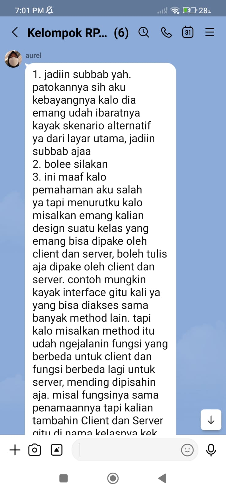

# Form Asistensi

## Tugas Besar IF2150 - Rekayasa Perangkat Lunak

| Informasi | Keterangan |
| --- | --- |
| **Hari** | Selasa |
| **Tanggal** | 26/10/2026 |
| **Kelas** | K-01 |
| **Nomor Kelompok** | G-08 |
| **Nama Kelompok** | firstTimeRPL |
| **Nama Perangkat Lunak** | SIGAP |
| **Dokumen** | - |

### Anggota Kelompok

| NIM | Nama |
| --- | --- |
| 13525022 | Muhammad Rafi Insyan Syiham Abrar |
| 13525037 | Muhammad Rafiif Ansyadya |
| 13525076 | Reinhard Mikhael Tandra |
| 13525094 | Arga Cyrano Simanjuntak |
| 13525136 | Jonathan Lewie |

### Catatan

| Catatan |
| --- |
| 1. Untuk antarmuka di bab 6 dijadikan subbab untuk state yang berbeda |
| 2. Didalam tabel spesifikasi objek, kolom keterangan boleh langsung merujuk pada ID algoritma bab 5 |
| 3. Tambahkan keterangan untuk kelas controller berada di bagian client atau server |
| 4. Menambahkan kelas baru juga perlu mengubah diagram sequence dan diagram kelas |
| 5. Boleh melampirkan figma |

**Notes for this section:**  
*Catatan dapat dituliskan dalam bentuk paragraf atau poin-poin, disesuaikan saja.* 

## Dokumentasi

<!--  -->

  

  <i>Gambar 1. Dokumentasi kegiatan asistensi.</i>

